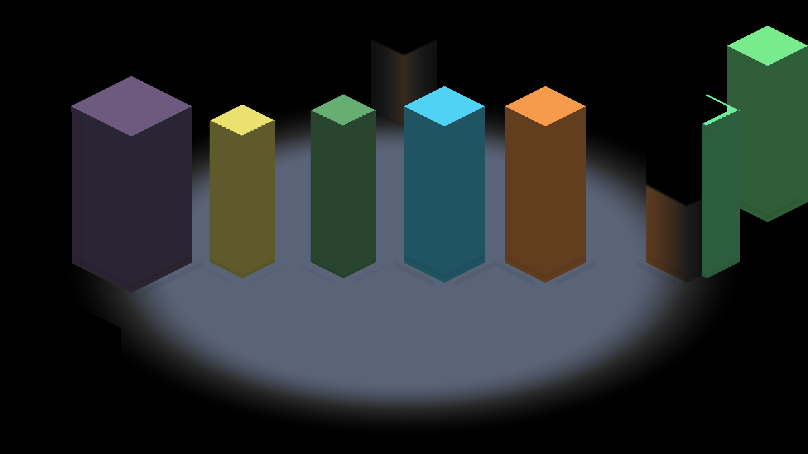
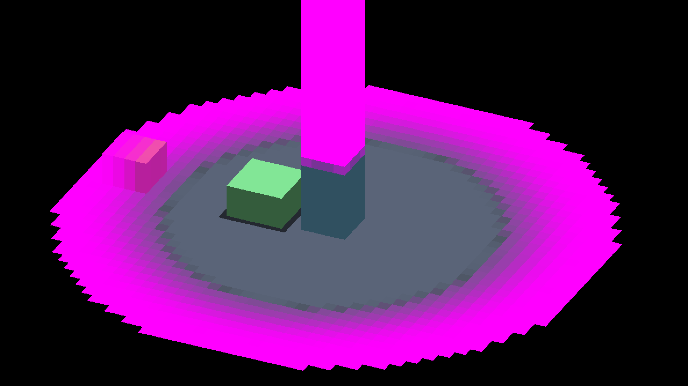
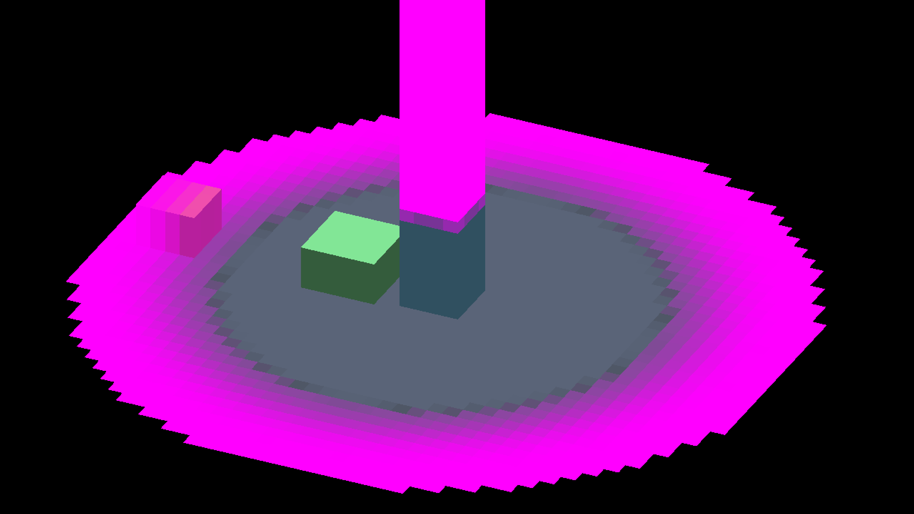
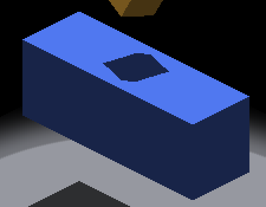
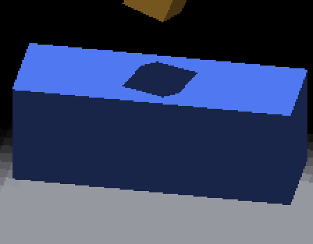
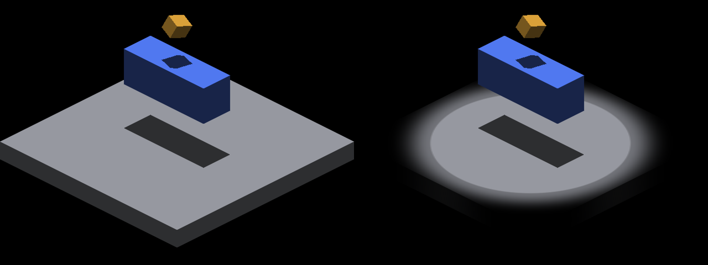

# Fog-compatible continuous receiving

On a pipeline that registers `FOG_TO_TRIXEL`, `IR_PERAXIS_SURFACE_LIGHTING=1`
now admits the cardinal and per-axis surface routes whenever the main canvas has
no line-of-sight gated source and no active glitch subject. The fog-composing lit
programs apply the shared fog colour transform once, after surface lighting.
Without the opt-in, fog pipelines keep the compute route, and every default
output is unchanged.

Every capture and profile below comes from one build of
`5e93271e77e9e5b2f627e0272397546abbb91628` on native Metal (Apple M4 Max). The
binary hashes are in [artifacts.txt](artifacts.txt). Windows/OpenGL execution
has not been verified here: this host cannot run the GL backend, and no GLSL
compiler was available to it.

## Route witnesses

`TRIXEL_TO_FRAMEBUFFER` logs `SURFACE-ROUTE cardinal=<0|1> perAxis=<0|1>
fog=<none|compose|fallback> fogComposed=<0|1>` whenever the route changes.
[fogdemo/summary.json](fogdemo/summary.json) holds every opt-in IRFogDemo run.
All 16 runs (8 cases, opt-in off and on) report `RESULT=CLEAN`.

| IRFogDemo case | Opt-in route | Off/on frame change |
|---|---|---|
| default (SDF shapes only) | cardinal compose | identical (no cardinal voxel surfaces) |
| `--entity-reveal-soft-edge` | cardinal compose | 10,256 px: 9,056 by 1–2 LSB, 1,096 at pillar contact edges |
| `--edge-zcost`, `--moving-observer` | cardinal compose | identical |
| `--ceiling-treatment --reveal-treatment` | cardinal, then per-axis compose | identical |
| `--peraxis-overflow` | cardinal, then per-axis compose | 4,992 px, the base band below |
| `--occlusion=high-ground --los-softness=1` | **fallback** (gated LOS source) | identical |
| `--explored-decay` | **fallback** (the demo keeps its canvas-readback probe on compute) | identical |

Two positive controls, run on the working tree before the final commit (the
branch they exercise is unchanged), show the composed samples take the new branch.
In each, the Metal composition was temporarily replaced with flat colours. Cardinal FIELD
floor voxels turned green and BODY pillars turned magenta. Per-axis FIELD cells
turned green and overflow entries turned yellow. SDF shapes stayed on compute.

The 1–2 LSB body differences are expected. Compute fog transforms rgba8-quantized
lit colour, while the composite transforms the unquantized fragment colour.
The larger differences are lighting-route differences, not fog:

| Body: off / on / changed pixels | Overflow: off / on / changed pixels |
|---|---|
|    |    |

The overflow fallback draws a one-voxel dark band around the pillar base that the
continuous route does not. This is the same sampled-route excess-shadow class the
polygon controls below measure, but it is not independently proven for this scene.

## Independent receiver-shadow geometry

The [independent polygon oracle](../../../../scripts/render_receiver_shadow_polygon.py)
from [receiver-shadow-polygon](../../codex/receiver-shadow-polygon/README.md) checks
the IRCanvasStress `shadowbox,floor` fixture. That checker has no fog knowledge, so
this PR adds `IRCanvasStress --fog-reveal <radius>`. The flag attaches fog to the
main canvas and draws one analytic disc about the origin. A radius of 16 fogs the
floor periphery and leaves the receiver revealed, which keeps the oracle's strict
palette valid. The driver is [capture.py.txt](polygon/capture.py.txt).
[results.json](polygon/results.json) records every command, route witness, frame
hash and oracle count. All 72 captures exit CLEAN.

| Placement | Yaws | Fog-composed (`--fog-reveal 16`, opt-in on) | Fog fallback (`--fog-reveal 16`, opt-in off) | Fog-free, opt-in on |
|---|---|---|---|---|
| origin | 0, π/2, π, 3π/2 | 0 / 0 / 0 at all four | 60/52 at 0 and π; 64/59 at π/2 and 3π/2 | 0 / 0 / 0 |
| origin | kπ/2 + 0.6 | 0 / 0 / 0 at all four | 18/638 or 32/650 | 0 / 0 / 0 |
| camera iso (-0.375, 0.625) | kπ/2 + 0.002 | 0 / 0 / 0 at all four | 18/644 or 22/660 | 0 / 0 / 0 |
| camera iso (-1.375, -0.625) | kπ/2 + 0.6 | 0 / 0 / 0 at all four | 18/638 or 32/650 | 0 / 0 / 0 |
| camera iso (0.1, -0.2), (-0.1, 0.2) | 0.6 | 0 / 0 / 0 at both | 18/638 | 0 / 0 / 0 |

Counts are missing / excess / unknown pixels outside the one-pixel boundary band.
Each case has at least 24,792 eligible samples.

On a fog pipeline the default is the compute fallback. At cardinal yaws it keeps
the 60/52 defect that the [receiver-shadow-polygon README](../../codex/receiver-shadow-polygon/README.md)
records for the historical sampled route. The fog-composed route removes it.
The fog-free sampled arms (opt-in off, no fog) match the existing baseline counts
exactly.

| yaw 0, fog fallback | yaw 0, fog composed | yaw 0.6, fog fallback | yaw 0.6, fog composed |
|---|---|---|---|
|  |  |  |  |

The fog is visible in these frames (yaw 0, fog off and on):

Ambient-strength and local-light variants of this matrix pass in
[receiver-shadow-ambient-local-light](../4757-receiver-shadow-ambient-local-light/README.md).

## Cost

The surface-lighting driver ([`scripts/perf/surface_lighting_controls.py`](../../../../scripts/perf/surface_lighting_controls.py))
gains `--fog-reveal` and `--no-stage-timing` arms. Each matrix ran under
`ir-acquire benchmark`. The setup is IRCanvasStress `shadowbox,floor` with 16
overlapping casters, zoom 4, a 360-frame capture-free profile, three
forward/reverse rounds, a Debug build and AC power. Every arm is an explicit
`IR_PERAXIS_SURFACE_LIGHTING` × `IR_PERAXIS_VISIBILITY_PREPASS` setting.

- [Fog, stage timing on](perf/fog-timed/summary.md) — quiet-host verdict
  `GUARDED`. The route checks require `fogToTrixel` samples in every arm, and a
  compute `trixelToFb` route on surface-off cardinal arms.
- [Fog, stage timing off](perf/fog-no-stage-timing/summary.md) — quiet-host
  verdict `GUARDED`. This is the instrumentation control: GPU stage timestamps are
  off and only wall-frame timing is recorded.

| Fog arm (surface/prepass) | Frame mean ms, timing on / off | Affected GPU stages, ms (timing on) |
|---|---|---|
| cardinal 0/0 (compute fallback) | 23.00 / 22.22 | lighting 0.024 + fog 0.024 + `trixelToFb` 0.069 |
| cardinal 1/0 (fog composed) | 22.98 / 22.46 | `cardinalSurfaceFb` 0.883 + lighting 0.019 + fog 0.020 + `trixelToFb` 0.064 |
| per-axis 0/0 (compute fallback) | 23.67 / 22.17 | `lightingPerAxis` 0.040 + `fogPerAxis` 0.039 + `fogOverflow` 0.003 + `perAxisScatter` 0.056 |
| per-axis 1/0 (fog composed) | 23.18 / 22.20 | `perAxisSurfaceFb` 0.457 (compute per-axis lighting and fog skipped) |
| per-axis 1/1 (fog composed, prepass) | 23.34 / 22.10 | `perAxisSurfaceFb` 0.572 |

The composed routes move about 0.4–0.8 ms of GPU work into the lit draw. In this
small fixture, under Debug and offscreen pacing, wall-frame means stay within
run-to-run noise. Every frame exceeds the 60 Hz budget, timed or not, which is a
property of this Debug fixture, not of the route. These numbers do not qualify a
default: the opt-in stays off.

[Fog-free control](perf/fog-free-timed/summary.md) — quiet-host verdict
`GUARDED`, same arms, no `--fog-reveal`. It isolates what fog composition adds
to the lit draws:

| Lit draw (surface 1, prepass 0) | Fog-free ms | Fog-composed ms | Added by fog composition |
|---|---|---|---|
| `cardinalSurfaceFb` | 0.563 | 0.883 | +0.32 ms |
| `perAxisSurfaceFb` | 0.428 | 0.457 | +0.03 ms |

On the cardinal route the composed draw evaluates the reveal per output pixel;
the compute fog it replaces cost 0.024 ms. The fog pass also changes the fixture
itself (retained voxels 422 with fog against 245 without), so these are
per-draw costs, not a scene-for-scene frame comparison. A default promotion
still needs representative scenes and Release builds (#4231).

## Default-path regression (render-verify, opt-in off)

| Target | Head `5e93271e7` | Master `469402034` control, same session |
|---|---|---|
| IRFogDemo | all 69 checks PASS | — |
| IRCanvasStress | 7 of 46 FAIL | the same 7 rows with identical metrics (`modeswitch_grid`/`_return` 99.9849 % Δ107, `detach_grid` 99.9891 % Δ110, `compare_yaw0`/`_q` 99.9992 % Δ240, `impulse_midspin` 99.9588 % Δ96, `impulse_settled` 99.9655 % Δ96). Tracked: #4763, #4806 |
| IRShapeDebug | 1 of 148 FAIL (10 skipped, references pending) | `text_size_sample` (99.9954 % Δ255). The head and master captures are pixel-identical. Tracked: #4809 |

## Tests

- `FogSurfaceComposition.*` (`test/render/fog_surface_composition_test.cpp`):
  - The observer snapshot, fog window and line-of-sight field are declared at
    exactly the bound slots in every fog-composing GLSL and MSL program, and no
    other block or sampler uses those slots.
  - The preserving fog kernel skips exactly the composite's samples, before its
    first colour write.
  - Each fragment body composes fog once.
- `SurfaceFogRoute.*` (`test/render/per_axis_surface_lighting_test.cpp`) covers
  the route decision:
  - fog-free and opted-out pipelines;
  - mixed canvases (fog only off the main canvas);
  - every gated source, and an active glitch;
  - a frame sequence of route changes and the main canvas losing its fog.
- `scripts/tests/test_render_fog_surface_composition.py` executes both dialects'
  `fogComposeSurface` against independent arithmetic over BODY/EXEMPT/FIELD,
  cut faces and two observers. It rejects these mutations: double fog,
  unfogged body, wrong-observer tone and anchor, lost alpha, lost material, and
  a reveal tapped for a body.
- The existing host-compiled routing harnesses
  (`test_render_cardinal_surface_lighting.py`,
  `test_render_per_axis_surface_lighting.py`) now cover the fog route on the
  production eligibility gate.
