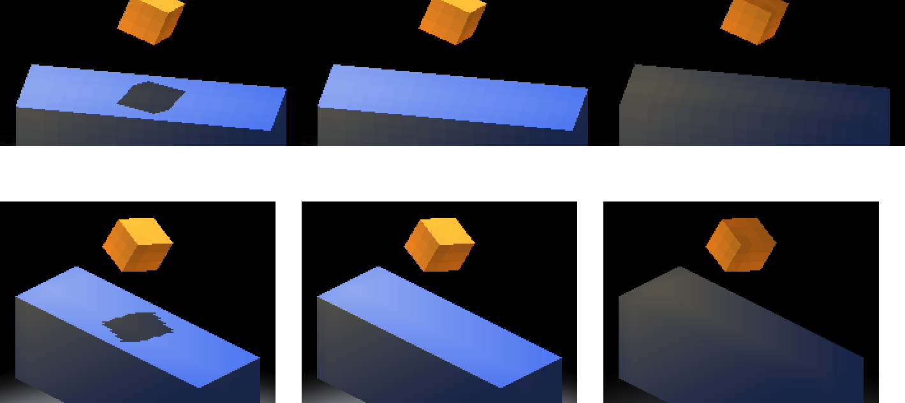
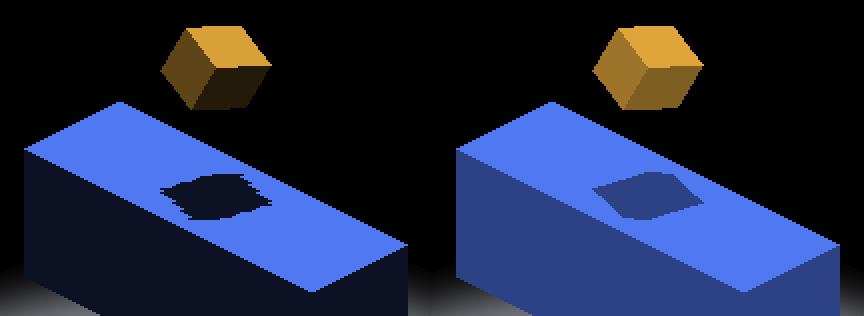

# Receiver-shadow geometry under ambient and local-light controls

The [independent polygon oracle](../../../../scripts/render_receiver_shadow_polygon.py)
already graded fog-composed continuous receiving at one sun/ambient configuration
([fog-surface-receiving](../4757-fog-surface-receiving/README.md)). This evidence repeats
that matrix with two other ambient strengths and with a local light. All 108 opt-in grades
are 0 missing / 0 excess / 0 unknown, with fog on and off, at every camera quadrant and
fractional placement. The opt-in-off controls reproduce the recorded sampled-route and
fog-fallback failures unchanged under every variant.

## New controls

IRCanvasStress:

- `--sun-ambient <a>` sets the sun's ambient floor. The default stays 0.30.
- `--probe-local-light <x> <y> <z>` adds an orange POINT light with radius 24.
  `--probe-local-light-intensity` scales it.
- `LIGHTING-PROBE` now logs the ambient. `LOCAL-LIGHT-PROBE` logs the light.

The oracle keeps its geometry. Only the palette that classifies a receiver pixel as lit or
shadowed changes:

- `--sun-ambient <a>`: analytic palette. The shadow is `albedo · a` and the lit colour is
  `albedo · (a + (1 − a) · lambert)`, at intensity 1 with no AO, LUT or HDR. An ambient that
  puts an RGB8 channel within 0.001 of a rounding tie is refused.
- `--lit-reference <png> --dark-reference <png>`: per-pixel palette, for light that no
  closed form describes. The lit reference is the same capture with `--no-shadows`. The
  dark reference uses a horizontal sun (`--sun-direction 1 0 0`), so the top face's Lambert
  term is zero. Its caster is moved back to the authored position with
  `--probe-overlapping-source-offset -12 0 -12`. Its colour is therefore
  `albedo · a + local`, which is exactly what a fully occluded pixel shows.
  Before grading, every eligible sample's `lit − dark` must be within one RGB8 count of the
  analytic direct term `albedo · (1 − a) · lambert` (each reference rounds independently).
  This rejects swapped, identical, self-shadowed, clipped or translucent references.
  The graded frame must still match one of the two reference colours exactly. `local_light`
  counts the samples whose dark reference differs from the analytic shadow colour, as a
  positive witness that the light reached the receiver.

## Matrix

Code `80b12b896`, macOS Metal, binary SHA-256 in [artifacts.txt](artifacts.txt). The drivers
are [cap.py.txt](cap.py.txt) (one capture), [matrix.py.txt](matrix.py.txt) (360 captures)
and [grade_all.py.txt](grade_all.py.txt). [results.json](results.json) records every
command, route witness, probe line, frame hash and count, including both references for
each local-light row. All 360 captures exit `RESULT=CLEAN`.

Placements are the 18 from the fog-surface-receiving matrix:

- the origin at the four cardinal yaws and the four kπ/2 + 0.6 yaws;
- camera iso (−0.375, 0.625) at kπ/2 + 0.002;
- camera iso (−1.375, −0.625) at kπ/2 + 0.6;
- camera iso (±0.1, ∓0.2) at yaw 0.6.

Each placement ran at fog 0 and `--fog-reveal 16`, and at `IR_PERAXIS_SURFACE_LIGHTING` 0
and 1. Counts are missing / excess / unknown. Every case has at least 24,792 eligible
samples.

| Variant | Opt-in on, fog-composed | Opt-in on, fog-free | Opt-in off, fog fallback | Opt-in off, fog-free (sampled) |
|---|---|---|---|---|
| ambient 0.15 (shadow 12,18,36) | 18/18 pass, 0/0/0 | 18/18 pass, 0/0/0 | 0/18: 60/52, 64/59 cardinal; 18/638 … 32/650 intermediate | 4/18: cardinal pass; 18/638 … 32/650 |
| ambient 0.55 (shadow 44,66,132) | 18/18 pass, 0/0/0 | 18/18 pass, 0/0/0 | same counts | same counts |
| local light at (8,0,−20), ambient 0.30 | 18/18 pass, 0/0/0 | 18/18 pass, 0/0/0 | same counts | same counts |

The local light reaches at least 24,462 of each case's eligible samples. Under it the
receiver shows dozens of distinct lit and shadowed colours, so the analytic palette
alone would grade every lit pixel unknown.

Route witnesses: every fog-16 opt-in capture logs
`SURFACE-ROUTE … fog=compose fogComposed=1`, and every fog-16 opt-out capture logs
`fog=fallback fogComposed=0`. Each reference capture logs the same route as its graded
capture.

The failing counts are identical to the default-palette matrix, which shows the variants
change only the palette. They do not change which pixels each route shadows.

| Local light, yaw 0.6, fog-composed: graded, lit reference, dark reference |
|---|
|  |

The top row passes. The bottom row is the yaw-0 fog fallback (opt-in off), which fails
60/52 against its own references.



Above: yaw 0, fog 16. On the left is ambient 0.15 on the fallback route (fails 60/52); on
the right is ambient 0.55, fog-composed (passes).

## Retained frames and replay

[retained/](retained/) keeps four full frames (and both references for each local-light
case): two passing and two failing. `test_retained_native_ambient_and_local_light_controls`
regrades them and pins their counts to results.json:

```sh
python3 scripts/render_receiver_shadow_polygon.py \
  docs/pr-screenshots/claude/4757-receiver-shadow-ambient-local-light/retained/local/origin-yaw0.6-fog16-surface1/main.png \
  --yaw 0.6 \
  --lit-reference docs/pr-screenshots/claude/4757-receiver-shadow-ambient-local-light/retained/local/origin-yaw0.6-fog16-surface1/lit.png \
  --dark-reference docs/pr-screenshots/claude/4757-receiver-shadow-ambient-local-light/retained/local/origin-yaw0.6-fog16-surface1/dark.png
python3 -m unittest discover -s scripts/tests -p test_render_receiver_shadow_polygon.py
```

CPU tests synthesize a striped local-light term with an independent Pillow rasterizer.
The palette must pass at three yaws and fail against the analytic palette. A shifted shadow
must fail as missing/excess. A foreign colour must count as unknown. Six malformed reference
pairs must be refused, and an ambient mismatch between the references and the grade must
be caught.

## Not covered

Windows/OpenGL execution of the fog-composing programs is not covered: the macOS host has
no GL backend. The host-pinned follow-up is linked from the PR.
