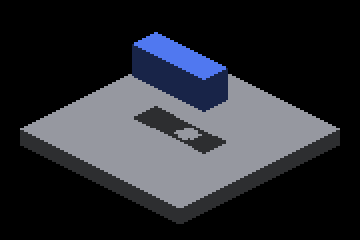
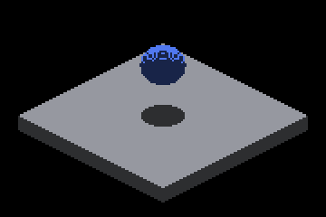

# Sun record-pool exhaustion: native Metal controls

A rigid source plate (`--probe-record-pool-filler`) forces the global
65,536-record sun face pool to overflow without crowding the receiver's tiles.
Creating it **before** the shadowbox casters makes their bake dispatches lose
every record; creating it **after** (`--probe-record-pool-filler-last`) loses
only filler records. Each case runs twice from one binary: `parent` stages
origin/master's four sun-index shaders, `head` uses this branch's.

| Parent: retained receiver records, pool exhausted elsewhere | Head |
|---|---|
|  |  |
|  |  |
|  |  |

Crops are rectangle `(1100,600)-(1460,840)` of native 2560×1440 frames; the
full frames and gzipped logs sit beside them for the key cases. Before this
change, any record exhaustion disabled the overflow hierarchy for the whole
frame, so 128 distant casters erased the lower shadow even though every
receiver record was stored.

## Results

All 82 captures exited CLEAN. "Outside band" counts changed pixels more than
2 px from an edge of the control crop; missing = brighter than control,
excess = darker. [captures.json](captures.json) retains commands, binary,
shader, frame and crop hashes, and the per-cascade tile counters of every
shot; `index.csv.gz` keeps the full tile dump for three head cases.

### Static casters

| Case | Records requested | Lost-record tiles near/far (head) | Parent missing / excess outside band | Head missing / excess outside band |
|---|---:|---:|---:|---:|
| far-128 (tile overflow, complete pool) | 5,164 | 0 / 0 | 0 / 0 | 0 / 0 |
| lower + filler last | 68,014 | 347 / 502 | 0 / 0 | 0 / 0 |
| lower + filler first | 68,014 | 261 / 373 | 0 / 0 | 0 / 0 |
| **far-128 + filler last** | 71,470 | 486 / 694 | **200** / 0 | **0** / 0 |
| far-128 h30 + filler last ¹ | 71,470 | 521 / 727 | 0 / 0 | 0 / 0 |
| **far-128 h90 + filler last** ¹ | 71,470 | 526 / 690 | **200** / 0 | **0** / 0 |
| far-128 + filler first 270 (under capacity) | 63,970 | 0 / 0 | 0 / 0 | 0 / 0 |
| far-128 + filler first 280 (straddles capacity) | 66,420 | 18 / 10 | 200 / 0 | 200 / 0 |
| far-128 + filler first | 71,470 | 312 / 463 | 200 / 0 | 200 / 0 |
| **oblique-aligned-128 + filler last** ² | 72,188 | 502 / 730 | **228** / 0 | **0** / 0 |
| oblique-aligned-128 + filler first ² | 72,188 | 215 / 382 | 228 / 0 | 228 / 0 |

¹ Graded against the same-height caster scene without a filler, whose nearby
h30 casters legitimately shadow the receiver. h30 differs from its control by
88 parent pixels, all inside the band. ² Graded against `oblique-lower`; the
oblique filler needs side 340 to exhaust the pool.

Lost-record tile counts vary between identical runs (a full rerun moved
`far-128 + filler last` from 515 / 692 to 486 / 694): failed reservations race
across parallel bake workgroups. Records requested, every crop grade and every
moving pose repeated exactly.

### Mixed finite, analytic and raster-only casters

The `analytic-*` cases replace the lower box with an analytic sphere at
subdivisions 2, where it indexes a typed sun-ray record (record type 1 in a
`--sun-face-geometry-probe` dump; at subdivisions 1 it writes none). The 128
casters stay finite and the GRID floor stays raster-only. Controls are the
sphere without the casters.

| Case | Records requested | Lost-record tiles near/far (head) | Parent missing / excess | Head missing / excess |
|---|---:|---:|---:|---:|
| analytic-far-128 (tile overflow, complete pool) | 5,057 | 0 / 0 | 0 / 0 | 0 / 0 |
| analytic-far-128 + filler last | 71,363 | 527 / 697 | 200 / 0 | 200 / 0 |
| analytic-far-128 + filler first | 71,363 | 255 / 395 | 200 / 0 | 200 / 0 |
| analytic-oblique-aligned-128 + filler last | 71,889 | 542 / 757 | 240 / 0 | 240 / 0 |

Creation order does not protect the sphere. Analytic shapes bake in
`SHAPES_TO_TRIXEL`, after every voxel canvas, so under exhaustion their
records are lost first: a geometry dump of both `filler last` and
`filler first` retains 65,536 records, all finite (type 0). Every incomplete
receiver tile then carries the lost-record bit, so this is the lost-own-record
limit below, with the loss decided by bake stage rather than creation order.

### Moving casters

Each track moves the 128-caster stack along +X at 120 units/s through the
engine's `VELOCITY_3D`: 2 units per fixed 60 Hz UPDATE tick, and auto-capture
runs one tick per frame. It runs 7 shots, 10 frames apart,
from x = -62 to +58 (cardinal) or -44 to +76 (oblique), crossing over the
receiver at shot 3. Each shot is graded against a static capture at the pose
the shot logged (`PROBE-DRIFT`). Without a filler, every shot of both tracks
is pixel-identical to its static pose control in both variants, so motion
leaves no stale-frame residue.

| Track (shots 0–6) | Records requested | Parent missing at shot 3 (others) | Head missing, all shots |
|---|---:|---:|---:|
| moving-128 | 5,164 | 0 (0) | 0 |
| **moving-128 + filler last** | 71,470 | **220** (0) | **0** |
| moving-128 + filler first | 71,470 | 220 (0) | 220 at shot 3, else 0 |
| oblique-moving-128 | 5,676 | 0 (0) | 0 |
| **oblique-moving-128 + filler last** | 72,188 | **228** (0) | **0** |

Excess shadow is 0 in every row.

### Reading the results

- **Repaired:** whenever the receiver's records were retained, head matches
  its sufficient-capacity control exactly, static or moving: 0 changed pixels
  in every `filler last` row with finite casters. Parent loses 200–228 shadow
  pixels in five of them.
- **Unchanged limit:** when the receiver's own records are lost (filler first,
  the 280 straddle, or an analytic sphere baked after every canvas), parent
  and head produce identical crops with the lower shadow's center missing.
  Those blockers exist only in the nearest-depth sampled layer, where the
  distant casters' depth hides them.
- `lower + filler first` differs from `lower` by 192 pixels, all inside the
  band: sampled fallback edges, not lost coverage.
- Capacity-boundary sweep: 270 → 280 → 300 moves the receiver from complete
  (0 lost tiles) to partially lost to fully lost; the hole appears exactly
  when the lower shadowbox's records are lost.

## Lost-record tiles and IRPerfGrid

A tile carrying the lost-record bit answers from the sampled layers and never
traverses the retained hierarchy. Letting it traverse for hits alone was
measured first: IRPerfGrid's 262,144-voxel grid exhausts the pool every frame
and nearly every tile loses records, so each receiver walked the retained
pool. [perf-grid/](perf-grid/) retains every report; `perf_grid.py` reruns
it. One 60-frame `--auto-profile` run per cell, all `CLEAN`, on a shared
host without the benchmark quiet guard, so read them as direction:

| Sun shaders | zoom 1 steady frame | zoom 1 `computeSunShadow` / `computeLightVolume` GPU | zoom 4 steady frame | zoom 4 `computeSunShadow` / `computeLightVolume` GPU |
|---|---:|---:|---:|---:|
| origin/master | 21.35 | 0.070 / 2.644 | 23.89 | 0.050 / 5.811 |
| lost tiles traverse for hits (`1fdb66458`) | 24.16 | 4.901 / 6.169 | 41.40 | 15.846 / 20.705 |
| **head: lost tiles answer from the sampled layers** | **21.21** | **0.074 / 2.602** | **23.44** | **0.051 / 6.103** |

All values are ms. The hierarchy build (`bakeSunShadowMap`) now runs on every
exhausted frame and costs 0.035–0.092 ms here against 0.006–0.021 ms on master.

## Timing (separate runs)

Steady-state profile, 360 frames, one run per row, parent/head/parent order.
[timing/](timing/) retains every summary and manifest. No capture or index
probe ran.

| Case | Parent-a frame ms | Head frame ms | Parent-b frame ms | entityCanvasToFb ms (a / head / b) | bakeSunShadowMap ms (a / head / b) |
|---|---:|---:|---:|---:|---:|
| far-128 | 72.99 | 73.41 | 73.38 | 6.567 / 6.763 / 6.718 | 0.020 / 0.020 / 0.020 |
| far-128 + filler last | 102.73 | 103.88 | 104.60 | 6.824 / 8.459 / 6.926 | 0.008 / 0.036 / 0.009 |
| far-128 + filler first | 104.74 | 104.62 | 107.53 | 6.985 / 7.076 / 7.083 | 0.007 / 0.039 / 0.010 |

Head's steady frame average is inside the parent spread for both exhausted
cases and 0.03 ms above it without exhaustion, where the shaders take the
same branches as the parent. When
the pool exhausts, the hierarchy build now runs (~0.03 ms). In the repaired
case, exact queries over the retained pool replace the parent's incorrect
sampled answer on the overflowed receiver tiles, costing about 1.6 ms of
composite GPU time. With the receiver's records lost (filler first), the
composite matches the parent.

The sun buffer layout and size are unchanged at 30,670,864 bytes, and
production frames gain no readback.

## Frame-latent capacity growth

The record pool now grows between frames to the demand the previous frame
measured (`docs/design/sun-face-index-capacity.md` § "Frame-latent capacity
growth"). The matrices below ran one binary built from this branch; the
baseline is the parent build frozen in its own tree, and the frozen variant
is the same branch binary with `--sun-record-ceiling 65536`, which pins the
pool at the parent's capacity. [`growth/`](growth/) retains every
`captures.json`, the receiver crops, the IRPerfGrid demand probes and the
timing reports.

### Static and moving cases

All 41 baseline captures, all 41 growth captures and all 41 frozen captures
exited CLEAN. The frozen variant is byte-identical to the baseline on every
frame of every case, so the layout change alone is output-neutral. With
growth, every case whose demand fits the ceiling matches its
sufficient-capacity control exactly; cases that never exhaust are
byte-identical to the baseline.

| Case | Records requested | Pool after growth | Baseline missing / excess outside band | Growth missing / excess |
|---|---:|---:|---:|---:|
| far-128 + filler first | 71,470 | 131,072 | 200 / 0 | **0 / 0** |
| far-128 + filler first 280 (straddles 65,536) | 66,420 | 131,072 | 200 / 0 | **0 / 0** |
| oblique-aligned-128 + filler first | 72,188 | 131,072 | 228 / 0 | **0 / 0** |
| analytic-far-128 + filler last | 71,363 | 131,072 | 200 / 0 | **0 / 0** |
| analytic-far-128 + filler first | 71,363 | 131,072 | 200 / 0 | **0 / 0** |
| analytic-oblique-aligned-128 + filler last | 71,889 | 131,072 | 240 / 0 | **0 / 0** |
| moving-128 + filler first, shot 3 (others) | 71,470 | 131,072 | 220 (0) | **0 (0)** |
| every filler-last and no-filler case, every other track | 1,601–72,188 | 65,536 or 131,072 | 0 / 0 | 0 / 0, frames byte-identical where the pool did not grow |

| Baseline `far-128-filler-first` | Growth | Control `far-128-filler-last` |
|---|---|---|
|  |  |  |

The analytic moving tracks (`analytic-moving-128`, `-filler-last`,
`-filler-first`: a sphere caster under a moving finite stack) grade 0 missing
and 0 excess on all seven shots each, against static captures of their logged
poses.

### Demand crossing capacity in one running scene

`--probe-record-pool-filler-frame N` spawns the filler at render frame N of a
scene that starts under capacity; shots run every frame from the sixth.
Shots before the spawn grade against the filler-free control, shots after it
against the sufficient-capacity control. Two spawn frames of opposite parity
put one shot on the exhausted frame.

| Case | Spawn frame | Demand sampled / pool applied (frame) | Shot on the exhausted frame | Later shots |
|---|---:|---:|---|---|
| far-128, filler at frame 9 | 9 | 10 / 11 | none landed | 0 missing, pool 131,072 |
| far-128, filler at frame 10 | 10 | 11 / 12 | shot 1: pool 65,536, 465 / 629 lost-record tiles, **0 missing** (the filler spawned last, so the box's records were retained) | 0 missing, pool 131,072 |
| analytic-far-128, filler at frame 9 | 9 | 10 / 11 | none landed | 0 missing, pool 131,072 |
| analytic-far-128, filler at frame 10 | 10 | 11 / 12 | shot 1: pool 65,536, 425 / 627 lost-record tiles, **200 missing** (the sphere's analytic record is lost first) | shot 2 onward 0 missing, pool 131,072 |

| Exhausted frame (analytic, shot 1) | Next frame (shot 2) |
|---|---|
|  |  |

So the loss is confined to the one frame whose demand first exceeds the pool;
the readback completes on the following frame and the grown pool serves the
frame after that. Delayed recovery is distinguishable from an exact current
frame by the `capacity_changes_before` and `face_record_capacity` fields the
driver records per shot.

### IRPerfGrid demand and the ceiling

`IRPerfGrid --sun-face-index-probe` dumps the probe on the final profile
frame. The 262,144-voxel grid requests **786,432** records at zoom 1 and at
zoom 4 (every voxel's three faces); the pool grows from 65,536 straight to
the 1,048,576-record ceiling (77,856,788 bytes) on frame 2, and at zoom 4 the
262,144-node spill pool also exhausts (273,294 requested).

Interleaved timing (`ab_timing.py`, five alternating baseline/candidate
pairs per cell, each run through `repeat_profile.py`'s quiet guard; a
contaminated run is retried):

| Cell | Variant | Steady frame mean ms (baseline → candidate) | Ratio | `computeSunShadow` ms | `computeLightVolume` ms |
|---|---|---:|---:|---:|---:|
| IRCanvasStress far-128 (no exhaustion) | growth | 72.47 → 72.50 | 1.000 | 0.049 → 0.048 | 0.045 → 0.046 |
| IRCanvasStress far-128 + filler first | growth to 131,072 | 100.52 → 104.81 | 1.043 | 0.037 → 0.091 | 0.050 → 0.050 |
| IRPerfGrid zoom 1 | growth to 1,048,576 | 21.32 → 34.56 | **1.621** | 0.069 → 12.248 | 2.600 → 13.098 |
| IRPerfGrid zoom 4 | growth to 1,048,576 | 24.47 → 69.10 | **2.823** | 0.053 → 39.456 | 6.055 → 44.566 |
| IRPerfGrid zoom 1 | ceiling 131,072 | 20.61 → 21.80 | 1.058 | 0.069 → 0.129 | 2.580 → 2.770 |
| IRPerfGrid zoom 4 | ceiling 131,072 | 24.56 → 24.28 | 0.989 | 0.052 → 0.151 | 5.965 → 5.942 |
| IRPerfGrid zoom 1 | ceiling 262,144 (3 pairs) | 20.65 → 22.11 | 1.071 (p99 **1.313**) | 0.069 → 2.265 | 2.547 → 3.835 |
| IRPerfGrid zoom 4 | ceiling 262,144 (3 pairs) | 24.13 → 32.62 | **1.352** | 0.053 → 7.642 | 6.030 → 12.701 |
| IRPerfGrid zoom 1 | frozen 65,536 (3 pairs) | 21.01 → 21.39 | 1.018 | 0.070 → 0.070 | 2.574 → 2.640 |
| IRPerfGrid zoom 4 | frozen 65,536 (3 pairs) | 24.15 → 24.27 | 1.005 | 0.051 → 0.051 | 5.951 → 5.903 |

The CanvasStress exhaustion cell pays for exact hierarchy queries on the
receiver tiles that were answered from the sampled layers before (the same
1.6 ms of composite GPU time the retained-record repair above cost), inside
the 1.10x budget. Letting IRPerfGrid reach its full demand is outside it:
every overflowed tile then traverses an unsorted 786,432-record hierarchy,
which is the traversal cost the hierarchy's spatial-ordering follow-up owns,
not a cost of growth. The shipped ceiling is therefore **131,072 records**
(`kSourceFaceCapacityCeiling`, 33,816,596 bytes), the largest pool whose
IRPerfGrid cost stayed inside the budget in the rows above: steady mean
1.058x and 0.989x, p99 1.049x and 1.056x, with the frozen pool at 1.018x and
1.005x showing the layout and readback themselves cost nothing measurable.
Demand past the ceiling is reported once per run and in the probe, and those
tiles keep the lost-tile policy.

Every retained report (`growth/ab-timing-*.md`) carries, per cell, the
measurements the cost criterion names:

| Measurement | Where |
|---|---|
| CPU frame mean / p99 (whole run and steady state) | `frame_*`, `steady_*` rows, graded against the 1.10x budget |
| Total GPU frame | `gpu_frame (envelope)` row with its baseline spread |
| Composite, `voxelSunFaces`, `computeSunShadow`, `computeLightVolume` | GPU stage rows (`entityCanvasToFb` / `cardinalSurfaceFb` / `trixelToFb` are the composite), each with its baseline spread |
| Hierarchy bake | `bakeSunShadowMap`: the hierarchy build is encoded in the bake system's `endTick`, inside its stage bracket |
| Shape casting | `shapeCast*` rows of the two analytic-sphere cells ([`ab-timing-analytic.md`](growth/ab-timing-analytic.md)); the finite cells cast no shapes |
| Completed sample counts | samples table: profiles, steady frames per profile, completed steady samples, retried profiles |
| Bytes allocated / cleared | record-pool table: final capacity and allocation parsed from each run log, checked against the layout; the clear writes 17,039,376 bytes per frame at every capacity (both sampled layers, the tile counts and spill heads, four tail words), since records and hierarchy nodes are written by their producers |
| Readback cost | the frozen-65,536 A/B pays the per-frame demand copy and completion-gated read with no growth: `bakeSunShadowMap`, whose bracket encodes the copy, moves +0.007 / +0.001 ms against baseline spreads of 0.008 / 0.001 ms, and the whole frame 1.005x / 1.004x (p99 0.992x / 1.013x) at zoom 1 / 4 |
| Resize cost | `resize_us` in the record-pool table: CPU time of `Buffer::resize` plus the capacity-word write, 27–55 µs over the five analytic growth runs (one resize each). The replacement storage adds no GPU work: its first clear writes the same bytes |

The analytic cells match the finite ones: no exhaustion 0.996x (steady
mean) and GPU frame 0.996x with every shape row inside its spread; under
exhaustion 0.990x mean / 1.012x p99, GPU frame 1.000x, with the exact
queries moving `entityCanvasToFb` by +1.48 ms and the shape-casting rows
unchanged. The 262,144 and frozen-ceiling explorations ran three pairs and
are not adoption evidence.

## Replay and limits

```bash
ir-acquire gpu -- python3 docs/pr-screenshots/claude/4759-sun-face-pool-exhaustion/capture.py --output /tmp/pool-exhaustion
python3 docs/pr-screenshots/claude/4759-sun-face-pool-exhaustion/timing.py --output /tmp/pool-exhaustion-timing
python3 docs/pr-screenshots/claude/4759-sun-face-pool-exhaustion/perf_grid.py --output /tmp/pool-exhaustion-grid --ref origin/master
# Growth matrices from one binary: --variants head skips the four-shader parent staging,
# which is invalid once the buffer layout differs from origin/master.
ir-acquire gpu -- python3 docs/pr-screenshots/claude/4759-sun-face-pool-exhaustion/capture.py --output /tmp/growth --variants head
ir-acquire gpu -- python3 docs/pr-screenshots/claude/4759-sun-face-pool-exhaustion/capture.py --output /tmp/frozen --variants head --extra=--sun-record-ceiling --extra=65536
python3 docs/pr-screenshots/claude/4759-sun-face-pool-exhaustion/ab_timing.py --output /tmp/ab --baseline-build <frozen parent build tree> --candidate-build build --pairs 5
python3 docs/pr-screenshots/claude/4759-sun-face-pool-exhaustion/slab_extrema_witness.py
```

All drivers stage GLSL instead of Metal off macOS, so the same commands
run on Windows/OpenGL. `ab_timing.py` needs two complete build trees because
a layout change cannot be staged as four shaders. Captured on Apple M4 Max, macOS, Metal Debug.
**Windows/OpenGL captures were not run on this host.** The CPU shader adapters
execute both backends' sources, not the OpenGL driver. Capture frames
synchronize the GPU and are not timing evidence.
