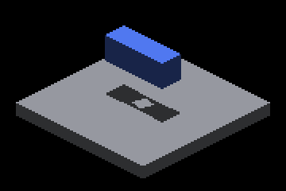
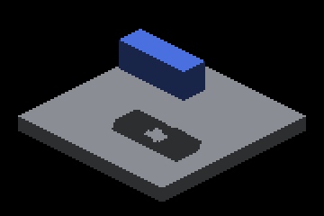
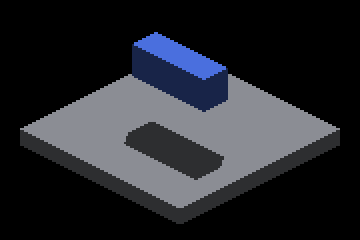

# Sun record-pool exhaustion: native Metal controls

A rigid source plate (`--probe-record-pool-filler`) forces the global
65,536-record sun face pool to overflow without crowding the receiver's tiles.
Creating it **before** the shadowbox casters makes their bake dispatches lose
every record; creating it **after** (`--probe-record-pool-filler-last`) loses
only filler records. Each case runs twice from one binary: `parent` stages
origin/master's four sun-index shaders, `head` uses this branch's.

| Parent: retained receiver records, pool exhausted elsewhere | Head |
|---|---|
|  |  |
|  |  |

Crops are rectangle `(1100,600)-(1460,840)` of native 2560×1440 frames; the
full frames sit beside them for the key cases. Before this change, any record
exhaustion disabled the overflow hierarchy for the whole frame, so 128 distant
casters erased the lower shadow even though every receiver record was stored.

## Results

All 32 captures exited CLEAN. "Outside band" counts changed pixels more than
2 px from an edge of the control crop; missing = brighter than control,
excess = darker. [captures.json](captures.json) retains commands, binary,
shader, frame and crop hashes, and the per-cascade tile counters.

| Case | Records requested | Lost-record tiles near/far (head) | Parent missing / excess outside band | Head missing / excess outside band |
|---|---:|---:|---:|---:|
| far-128 (tile overflow, complete pool) | 5,164 | 0 / 0 | 0 / 0 | 0 / 0 |
| lower + filler last | 68,014 | 347 / 494 | 0 / 0 | 0 / 0 |
| lower + filler first | 68,014 | 227 / 336 | 0 / 0 | 0 / 0 |
| **far-128 + filler last** | 71,470 | 509 / 692 | **200** / 0 | **0** / 0 |
| far-128 h30 + filler last ¹ | 71,470 | 502 / 685 | 0 / 0 | 0 / 0 |
| **far-128 h90 + filler last** ¹ | 71,470 | 469 / 656 | **200** / 0 | **0** / 0 |
| far-128 + filler first 270 (under capacity) | 63,970 | 0 / 0 | 0 / 0 | 0 / 0 |
| far-128 + filler first 280 (straddles capacity) | 66,420 | 18 / 10 | 200 / 0 | 200 / 0 |
| far-128 + filler first | 71,470 | 304 / 427 | 200 / 0 | 200 / 0 |
| **oblique-aligned-128 + filler last** ² | 72,188 | 567 / 791 | **228** / 0 | **0** / 0 |
| oblique-aligned-128 + filler first ² | 72,188 | 113 / 370 | 228 / 0 | 228 / 0 |

¹ Graded against the same-height caster scene without a filler, whose nearby
h30 casters legitimately shadow the receiver. h30 differs from its control by
88 parent pixels, all inside the band. ² Graded against `oblique-lower`; the
oblique filler needs side 340 to exhaust the pool.

- **Repaired:** whenever the receiver's records were retained, head matches
  its sufficient-capacity control exactly: 0 changed pixels in all four
  `filler last` cases. Parent loses 200–228 shadow pixels in three of them.
- **Unchanged limit:** when the receiver's own records are lost (filler first,
  or the 280 straddle where the shadowbox, created last, loses its records),
  parent and head produce identical crops with the lower shadow's center
  missing. Those blockers exist only in the nearest-depth sampled layer, where
  the distant casters' depth hides them. Hits from retained records are still
  queried, but no retained record blocks this receiver.
- `lower + filler first` differs from `lower` by 192 pixels, all inside the
  band: sampled fallback edges, not lost coverage.
- Capacity-boundary sweep: 270 → 280 → 300 moves the receiver from complete
  (0 lost tiles) to partially lost to fully lost; the hole appears exactly
  when the lower shadowbox's records are lost.

## Timing (separate runs)

Steady-state profile, 360 frames, one run per row, parent/head/parent order,
AC power, guarded quiet window. [timing/](timing/) retains every summary and
manifest. Provisional; no capture or index probe ran.

| Case | Parent-a frame ms | Head frame ms | Parent-b frame ms | entityCanvasToFb ms (a / head / b) | bakeSunShadowMap ms (a / head / b) |
|---|---:|---:|---:|---:|---:|
| far-128 | 73.18 | 73.05 | 73.12 | 6.869 / 6.859 / 6.870 | 0.020 / 0.020 / 0.020 |
| far-128 + filler last | 101.40 | 103.86 | 100.87 | 7.013 / 8.590 / 7.030 | 0.009 / 0.036 / 0.009 |
| far-128 + filler first | 104.00 | 103.07 | 102.47 | 7.052 / 7.016 / 7.034 | 0.007 / 0.038 / 0.007 |

Frames without exhaustion are unchanged. When the pool exhausts, the
hierarchy build now runs (~0.03 ms). In the repaired case, exact queries over
the retained pool replace the parent's incorrect sampled answer for the
overflowed receiver tiles, costing about 1.6 ms of composite GPU time.
Lost-record tiles also traverse the retained hierarchy for blocking hits; in
this fixture that stayed within the parent spread. The sun buffer layout and
size are unchanged at 30,670,864 bytes, and production frames gain no readback.

## Replay and limits

```bash
ir-acquire gpu -- python3 docs/pr-screenshots/claude/4759-sun-face-pool-exhaustion/capture.py --output /tmp/pool-exhaustion
python3 docs/pr-screenshots/claude/4759-sun-face-pool-exhaustion/timing.py --output /tmp/pool-exhaustion-timing
```

Both drivers stage GLSL instead of Metal off macOS, so the same commands run
on Windows/OpenGL. Captured on Apple M4 Max, macOS, Metal Debug. **Windows/
OpenGL captures were not run on this host.** The CPU shader adapters execute
both backends' sources, not the OpenGL driver. Capture frames synchronize
the GPU and are not timing evidence.
