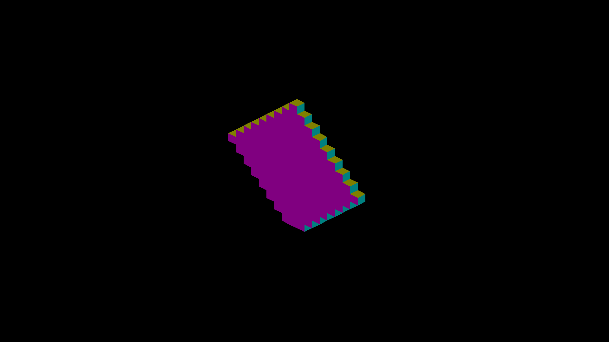
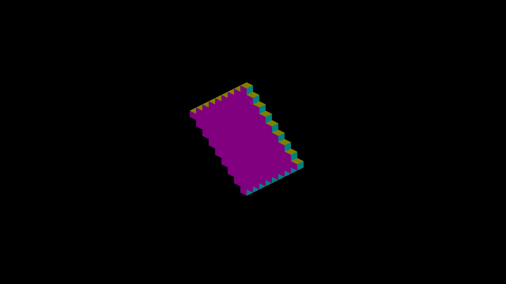

# GRID destination capacity: native evidence

Parent is `origin/master` `469402034` plus only the fixture flag
(`--focus-exact-fit-plate`); head is this branch. Both are macOS Release
builds on Metal (Apple silicon, AC power). Every capture command, the resolved
executable, and every image hash are in [captures.json](captures.json).

## Fixture

`IRCanvasStress --only orbit --focus-orbit 6` centers orbit 6, a GRID set posed
at +45° about +Y. `--focus-exact-fit-plate` allocates it as an exact-fit
12×1×12 plate (144 authored slots, 145 exposed destination cells) instead of a
12³ box (1728 slots, 610 exposed of 1740 covered). Shared arguments:

```text
fleet-run --build-dir <build> IRCanvasStress --auto-screenshot 30 --no-auto-rotate
  --no-spin --only orbit --focus-orbit 6 --pivot-origin --subdivisions 1 --zoom 8
  --sweep-yaw 0 4.7123889804 4 [--focus-exact-fit-plate]
```

Views: normals (`--no-ao --no-shadows --debug-overlay normals`), beauty (default
lighting), shadow (`--no-ao --debug-overlay shadow`). [capture.py](capture.py)
reproduces one view; [grade.py](grade.py) grades a directory.

## Displayed cells

`scripts/render-grid-cell-metric.py` derives the expected destination cells from
the authored box and an explicit double-precision rotation matrix, views them
under the camera yaw, and compares every pixel outside a one-pixel band.
[metrics-head.json](metrics-head.json) and [metrics-parent.json](metrics-parent.json)
hold every row and its command, 24 per side.

| Fixture, view | Yaw | Parent: missing exposed cells / missing px | Head: missing exposed cells / missing, extra, wrong-face px |
|---|---|---|---|
| plate, normals | 0 / 90 / 180 / 270 | 1 / 1,349 at each yaw | 0 / 0, 0, 0 at each yaw (145 of 145 visible) |
| plate, beauty | 0 / 90 / 180 / 270 | 1 / 1,349 at each yaw | 0 / 0, 0, n/a at each yaw |
| cube, normals | 0 / 90 / 180 / 270 | 0 / 0 (byte-identical to head) | 0 / 0, 0, 0 at each yaw (244 visible) |
| cube, beauty | 0 / 90 / 180 / 270 | 0 / 0 (byte-identical to head) | 0 / 0, 0, n/a at each yaw |

| Parent, plate normals 0° | Head, plate normals 0° |
|---|---|
|  |  |

`parent/` and `head/` each hold all 24 frames, and every `captures.json` record
names a file under its own side. All 12 cube captures and three of four plate
shadow captures are byte-identical between parent and head; the other nine
differ.

Metric controls ([metric-controls.json](metric-controls.json)): grading a head
capture at the wrong yaw (0° as 90°, 90° as 270°) or as the wrong fixture fails
with 32 to 139 missing exposed cells or 201,314 extra pixels; the parent beauty
frame fails with one missing cell.

## Direct-sun overlay

Any debug overlay keeps the compute sun route (`System<LIGHTING_TO_TRIXEL>`
enables the cardinal continuous receiver only with no overlay), so these frames
grade the route the overlay shows, not the one a player sees.

### Regression grade (criterion 3)

`python3 grade.py <repo> --shadow-regression .` reads every shadow frame's
hash from [captures.json](captures.json), re-hashes the stored file, and writes
[shadow-regression.json](shadow-regression.json); it exits 1 on any failed row,
and on any record whose stored file is outside its own side's directory.

| Fixture | Yaw | Grade | Result |
|---|---|---|---|
| cube | 0 / 90 / 180 / 270 | parent and head byte-identical | pass (4 of 4) |
| plate | 0 / 90 / 180 | parent and head byte-identical | pass (3 of 3) |
| plate | 270 | differing pixels inside the gained cell's footprint, dilated by 1 px | pass: 224 differing px, 0 outside; footprint 1,536 px (1,762 dilated) |

The gained cell is the one cell `missing_cells` names on
`parent/plate-normals-yaw270.png` (view cell `[0, 1, 8]`), painted by the
metric's painter at yaw 270° and zoom 8:

```text
python3 scripts/render-grid-cell-metric.py head/plate-shadow-yaw270.png --fixture plate
  --yaw 270 --zoom 8 --regression-parent parent/plate-shadow-yaw270.png
  --gained-from parent/plate-normals-yaw270.png
```

Controls, each `grade.py` exit 1:

- one head pixel changed at (10, 10), outside the footprint: `outside_footprint_pixels: 1`;
- one parent pixel changed in `parent/cube-shadow-yaw90.png`, hash updated to match: that row fails byte-identity;
- the parent cube 90° shadow record pointed at `head/cube-shadow-yaw90.png`: refused before grading.

### Terminator readings (information, outside #4760)

`--view shadow` against rays through the expected occupancy. Every reading is
the same at `--terminator-tolerance 0` and at the default 0.5, and identical on
parent and head except plate 270°:

| Fixture | Yaw | False / missed px, parent | False / missed px, head | Occlusion exercised |
|---|---|---|---|---|
| cube | 0 | 0 / 0 | 0 / 0 | no (all lit) |
| cube | 90 | 2,432 / 13,024 | 2,432 / 13,024 | yes |
| cube | 180 | 0 / 13,872 | 0 / 13,872 | yes |
| cube | 270 | 0 / 1,456 | 0 / 1,456 | yes |
| plate | 0 | 0 / 0 | 0 / 0 | no |
| plate | 90 | 2,432 / 0 | 2,432 / 0 | no |
| plate | 180 | 0 / 848 | 0 / 848 | yes |
| plate | 270 | 2,082 / 0 | 2,272 / 0 | no |

The disagreement sits on thin strips at the staircase's tread/riser junctions,
and the unchanged solid gives the same readings on parent and head, so it comes
from the compute sun route, not from capacity. At plate 270° the added cell
carries the same class of false shadow as its neighbours (+190 px). The
production-route shadow oracle is owned by #4763.

## Capacity readings

`--grid-capacity-probe <file>` appends one line whenever a reading changes.
Over a 2000-frame spinning run (about 1000 update ticks, more than one
revolution) each fixture wrote exactly one line, at update tick 1
([profile/probe.json](profile/probe.json)):

| Fixture | Authored | Capacity | Peak capacity | Growths | Failures | Pool resident / peak / live slots | Budget |
|---|---:|---:|---:|---:|---:|---|---:|
| plate | 144 | 216 | 216 | 1 | 0 | 216 / 360 / 360 | 262,144 |
| cube | 1728 | 1728 | 1728 | 0 | 0 | 1728 / 1728 / 1728 | 262,144 |

Peak capacity is the largest resident allocation the rebuild has visited, grown
or not, so the cube that never grows reads 1728. These are the untimed probe
runs that close the Release profile below, on the same head Release binary.

The plate's peak of 360 slots is the migration: the 144-slot span is freed only
after the 216-slot replacement is seeded. The freed 144 slots stay stranded
until an exact-size allocation reuses them (`pool_live` minus `pool_resident`).
The admission budget is the pool size, capped at 2,000,000 destination cells.

## Release profile

`scripts/perf/grid_capacity_controls.py` ran four capture-free rounds of
{parent, head} × {plate, cube}, forward and reverse, 2000 frames each with the
set spinning (750 steady update ticks per run, more than the 600-tick
revolution), under `ir-acquire benchmark`. The quiet window held for the whole
run (`IR_QUIET_REPORT_FILE` reads `GUARDED`). Head is the Release build of
`3decc0f55`, the commit that adds the per-tick peak-capacity update; parent is
`469402034` plus the fixture flag. Every run's manifest agrees on its side's
commit, binary and shader hashes, build type and power source
([profile/builds.json](profile/builds.json)). [profile/summary.md](profile/summary.md):

| Case | Frame mean ms | Steady mean / p95 / p99 ms | `RebuildGridVoxels` mean / min / max ms |
|---|---:|---:|---:|
| parent-plate | 8.355 | 8.332 / 8.866 / 9.340 | 0.0267 / 0.0050 / 0.7830 |
| head-plate | 8.365 | 8.332 / 9.101 / 9.373 | 0.0278 / 0.0050 / 0.1440 |
| parent-cube | 8.400 | 8.332 / 9.111 / 9.318 | 0.1247 / 0.0250 / 0.4300 |
| head-cube | 8.370 | 8.335 / 9.073 / 9.331 | 0.1247 / 0.0250 / 0.3540 |

Frames are paced at about 120 Hz offscreen, so frame time measures the pacing
wait, not the rebuild. Per-run `RebuildGridVoxels` means span 0.024–0.029 ms
(parent plate) and 0.027–0.029 ms (head plate), 0.117–0.138 ms (parent cube) and
0.112–0.137 ms (head cube): the parent/head difference is inside the run spread,
and there is no speedup claim. The parent-plate max of 0.783 ms is one run
(round 2); its other three runs peak at 0.059–0.063 ms. The profile report keeps
a per-frame series only for whole frames, so `RebuildGridVoxels` reports mean,
min and max; its max is the upper bound on its p99.

## Not covered

- OpenGL: no capture on this macOS host. The OpenGL parent/head frames and
  `grid-cell` readings are owned by #4808 (`render-verify --target IRCanvasStress`
  on `windows-debug` at the merge commit, parent control on its first parent).
- Interior occupancy, AO and light volume for solids that omit interior cells.
