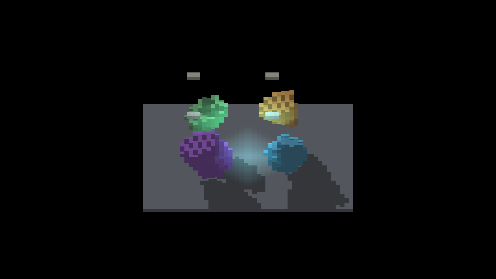
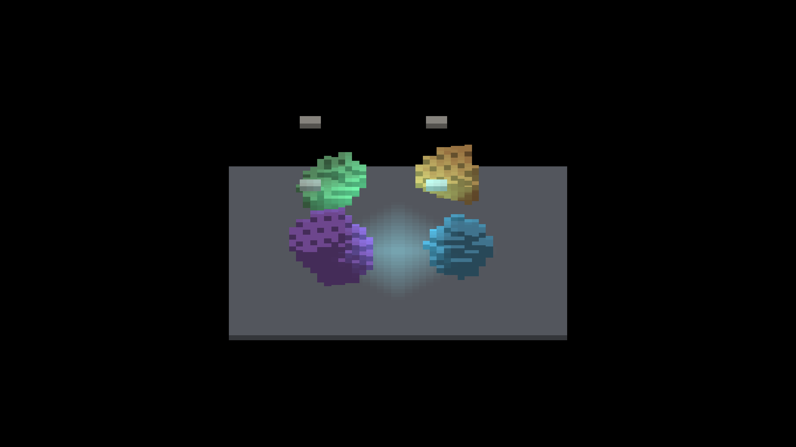
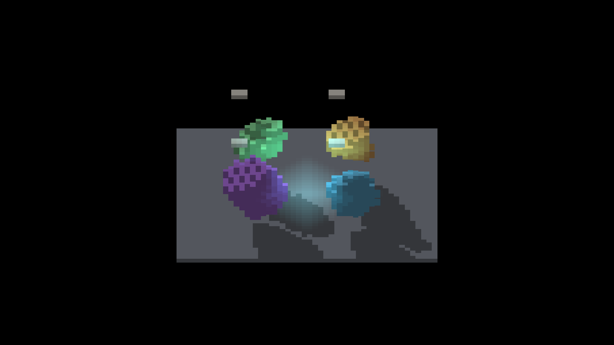
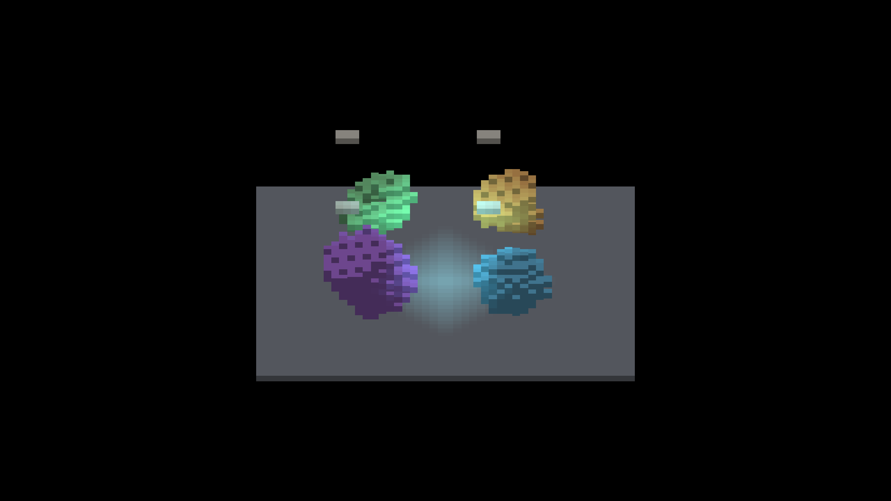
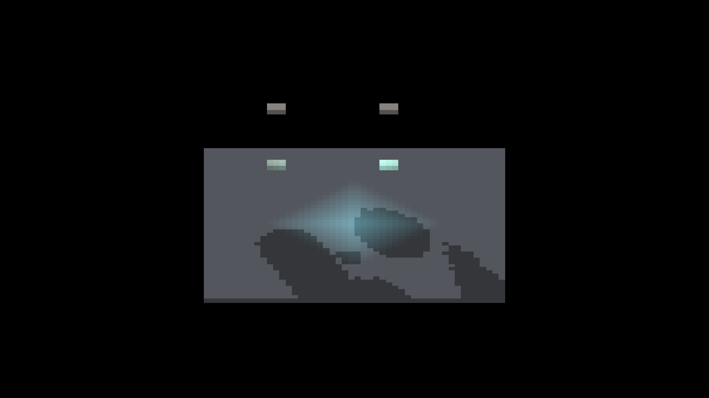
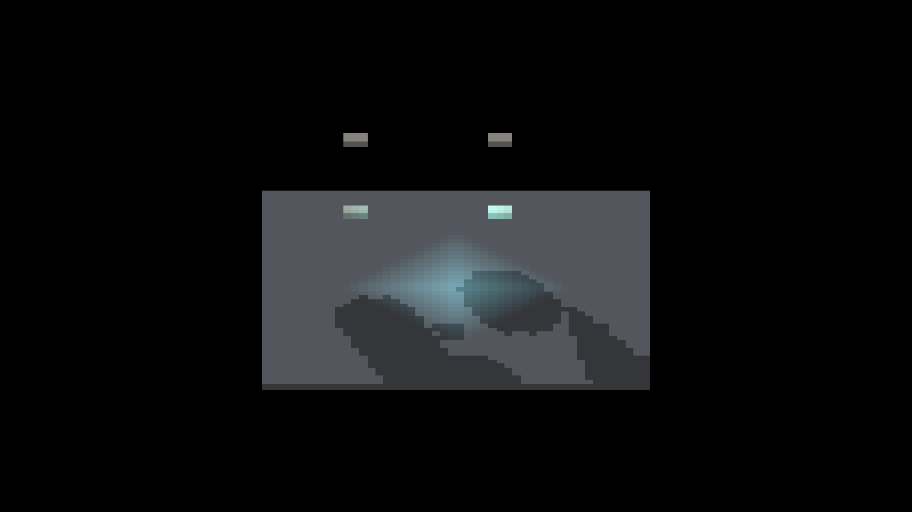
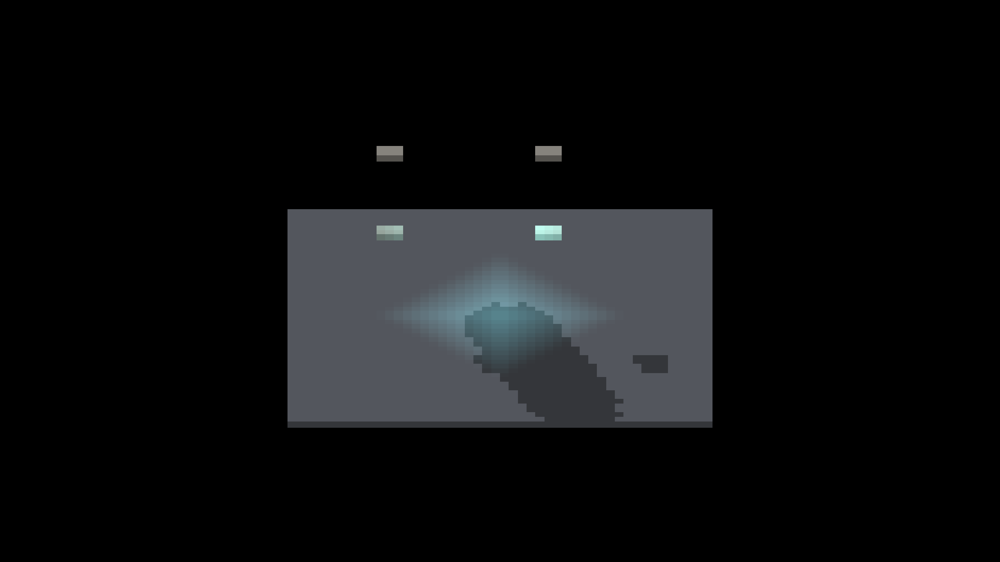
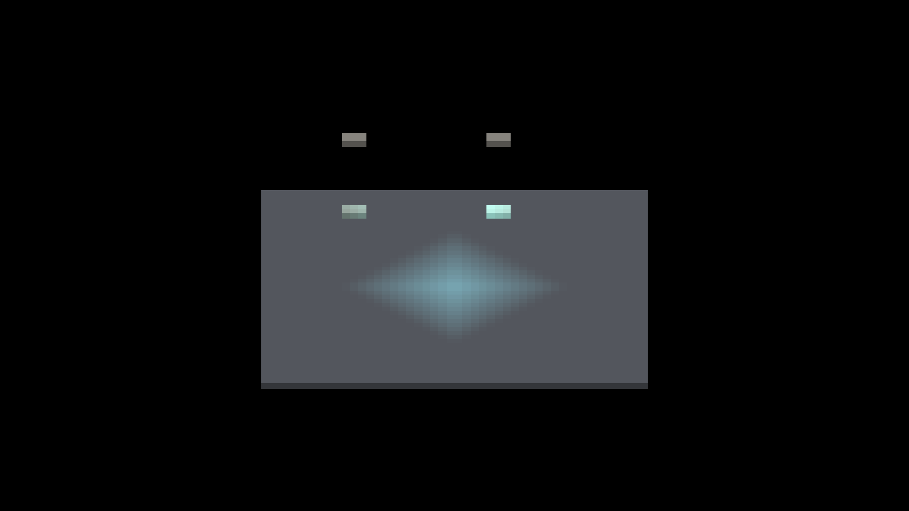

# Baked occupancy presentation qualification

This native macOS/Metal slice exercises moving baked occupancy as ordinary lit
voxel objects. It crosses shared GRID, rigid DETACHED source faces and
DETACHED_REVOXELIZE with independently rotating roots and a rotating shared
parent. Each cell retains the yaw-45, zoom-4 frame from a clean six-shot run.

## Controls

- Source: `e11078003ce25bed2ad1221fcb27cf004c973ec6` (tree-equivalent to
  `a6b9953c3eb8743a5c5b8c05889a3bdb9c7bb8ae` except for the empty task-claim
  commit).
- Binary SHA-256:
  `c9ee96cce6f941605c43b275a6af9a9054759e8bf4594dc1de57aa96abe3c4fc`.
- Host: macOS 26.5.2, Metal, 2560 x 1440 framebuffer, AC power reported by
  `pmset`.
- Every run used `--sdf-voxel-scene baked --sdf-voxel-motion
  --sdf-voxel-blockers --auto-screenshot 10`, emitted one `SDF-OCCUPANCY`
  witness, discovered one display and ended `RESULT=CLEAN`.
- Full-light arms leave AO, sun shadows and the fixture's local light enabled.
  Local-only arms add `--no-shadows --no-ao`, leaving the same local light and
  blocker geometry.

## Native frames

| Presentation / pose | Full lighting | Local light only |
|---|---|---|
| GRID / root |  |  |
| GRID / parented |  |  |
| Rigid DETACHED / root |  |  |
| Rigid DETACHED / parented |  |  |
| Revoxelized / root |  |  |
| Revoxelized / parented |  |  |

## Result

The moving GRID subjects retain their four authored colours, voxel silhouettes
and local-light response in both transform arrangements. Their full-light arms
also retain distinct projected shadows from the subjects and external casters.

Neither detached presentation qualifies yet. With sun shadows and AO disabled,
both rigid source-face and revoxelized subjects disappear while the receiver
floor and local-light volume remain visible. The static rigid-source control
reproduces the same absence, so continuous motion is not required. With full
lighting, detached arms retain projected shadow or dark-silhouette evidence but
not the four coloured, lit subjects seen on GRID. All four moving detached
local-only frames are byte-identical (SHA-256
`1b29f0fa8eb140b41e3b6041dc2d0de9bb8dc2ff7461d9f1a24407a0ec46897a`),
which confirms that neither presentation nor transform arrangement contributes
subject pixels in that control. This is a presentation-lighting failure, not an
intended resampling step, and these frames are diagnostic evidence rather than
approved visual baselines.

The commands follow this form, varying presentation, pose and the local-only
switches:

```bash
fleet-run IRShapeDebug --auto-screenshot 10 \
  --sdf-voxel-scene baked --sdf-voxel-presentation grid \
  --sdf-voxel-pose root --sdf-voxel-motion --sdf-voxel-blockers
```

This slice does not establish process RSS, temporary peak allocation, driver GPU
residency or Windows/OpenGL behavior. Those measurements remain open, as do the
detached lighting failures above.
