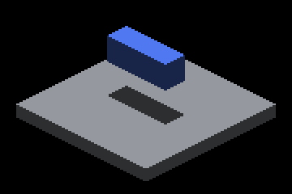
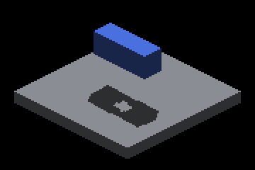
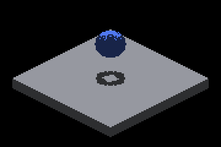
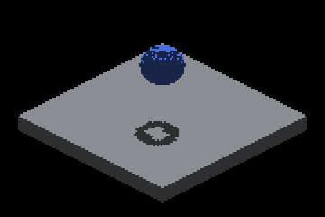
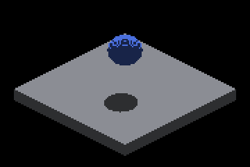
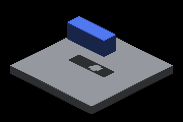

# Sun record-pool growth: before / after

The render change on this branch is visible only when the sun face record
pool exhausts. The native Metal captures, timing reports and probe dumps
live with the issue's evidence under
[`../4759-sun-face-pool-exhaustion/README.md`](../4759-sun-face-pool-exhaustion/README.md#frame-latent-capacity-growth)
(`growth/`). The pairs below are the same receiver crop from the parent
build and from this branch; the frozen-ceiling run of this branch is
byte-identical to the parent on all 41 matrix cases, and every case that
never exhausts is byte-identical between the two builds.

| Case | Parent (master) | This branch |
|---|---|---|
| far-128 + filler first |  |  |
| far-128 + filler first 280 |  |  |
| oblique-aligned-128 + filler first |  |  |
| analytic-far-128 + filler last |  |  |
| analytic-far-128 + filler first |  |  |
| analytic-oblique-aligned-128 + filler last |  |  |
| moving-128 + filler first, shot 3 |  |  |

Control for every row: `far-128-filler-last` /
`analytic-far-128-filler-last` captured on the parent build, the
sufficient-capacity case whose records were retained. Each "after" crop
grades 0 missing and 0 excess shadow pixels outside the 2 px band against
it; each "before" crop misses 200–240 pixels.
