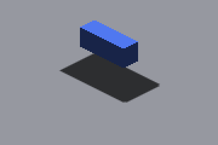
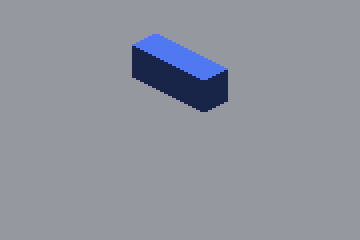

# Raster-only sun depth: native loss witness and candidate rejection

`IRCanvasStress --probe-particle-raster` registers the stateless particle
raster pass with one static emitter beside the floor, so
`BAKE_SUN_SHADOW_MAP` publishes no finite index and every visible canvas
pixel is a raster-only caster written by `c_bake_sun_shadow_map`'s atomic
minimum. `--probe-ray-casters <count> <distance> <step>` stacks GRID boxes on
the shadowbox sun ray; `--sun-primary-probe` reads the floor ray's primary and
fallback words per cascade on each capture frame and counts every fixture
caster's canvas pixels. Each case runs three times from one binary: `parent`
stages origin/master's bake and sampler shaders, `head` uses this branch's,
`second` adds `--sun-second-depth`, which selects the
`c_bake_sun_shadow_map_second_depth` program (the shared bake body compiled
with `IR_SUN_SECOND_DEPTH`) and sets the receiver's second-layer flag.

| Lower only (control) | Stacked: a caster 72 units up the ray | Stacked, second-depth diagnostic |
|---|---|---|
|  |  |  |

Crops are rectangle `(1100,600)-(1460,840)` of native 2560×1440 frames
(`far-*` cases `(1100,760)-(1460,1000)`); full frames are retained for every
case whose crop differs from its control. [captures.json](captures.json)
holds every command, the binary and shader hashes, frame and crop hashes,
each shot's probe lines, and the grades below. Each `run.log.gz` carries the
camera, lighting, subdivision and caster witnesses (`CaptureCamera`,
`LIGHTING-PROBE`, `Voxel render mode`, `PARTICLE-RASTER`, `RAY-CASTER`).

## Fixture

- Sun `(0,0,-1)` (cardinal) and `(0.3,0.4,-1)` (oblique); camera yaw 0, zoom 1,
  pivot at the origin, AO off, effective subdivision 1, 1280×720 game
  resolution at 2× output scale.
- GRID floor 120×120×4 at z = 4 (top at z = 2); lower GRID box 18×6×8 at
  z = −12; ray casters are the same box 72 (`stacked`), 72 and 72
  (`stacked-dup`) or 72 and 92 (`stacked-3`) units up the sun ray, created
  after the lower box or before it (`stacked-first`). `inside` places one
  caster 40 units up, inside the 64-unit throw. The `far-*` placement moves
  the fixture to `(-40,-40)`, iso depth −78 against the cascade split at −51.2,
  so the floor receiver reads cascade 0.
- Probe witness in every stacked case: `route=raster face_records=0`; both
  cascades' texels hold the distant top (depth −87, or −107 with two casters)
  where the lower-only control holds −15; the census counts 600 canvas pixels
  for the lower box and for every ray caster, and 31,320 occupied canvas
  pixels in all (30,720 lower-only).

## Results

"Missing / excess" count changed receiver pixels more than 2 px from an edge
of the control crop: missing = brighter than control, excess = darker. All
165 captures (43 cases × 3 variants, the two tracks carrying 7 shots each)
exited CLEAN. Every `head` frame is byte-identical to its `parent` frame,
and every `second` frame to its `head` frame.

| Case | Control | Cardinal missing / excess | Oblique missing / excess | Cascade 0 (`far-`) missing / excess |
|---|---|---:|---:|---:|
| unlit-stacked | unlit-lower | 0 / 0 | 0 / 0 | 0 / 0 |
| distant | lower | 8,405 / 0 | 8,874 / 0 | 7,774 / 0 |
| inside | lower | 0 / 1,066 ¹ | 0 / 1,090 ¹ | 0 / 1,066 ¹ |
| **stacked** | lower | **4,939** / 0 | **5,408** / 0 | **4,308** / 0 |
| stacked-first | lower | 4,939 / 0 | 5,408 / 0 | 4,308 / 0 |
| stacked-dup | lower | 4,939 / 0 | 5,408 / 0 | 4,308 / 0 |
| stacked-3 | lower | 4,939 / 0 | 5,408 / 0 | 4,308 / 0 |

Identical in all three variants. ¹ The in-throw caster legitimately shadows
the lower box's top; the floor footprint is unchanged (0 missing).

- **Loss reproduced** on the raster route: the whole floor shadow disappears
  behind a caster 72 units up the ray, in both sun directions and both
  cascades, independent of creation order, with both casters rasterized.
  `distant` differs from `lower` by the lower box's shadow and the hidden box
  itself (brighter pixels only), and the unlit pairs are identical, so the
  receiver's visibility is unchanged by the stack.
- **Moving caster.** The lead caster starts 10 units up the ray and climbs
  one unit per 60 Hz tick (one tick per captured frame), so the seven shots
  sit at 29, 39, 49, 59, 69, 79 and 89 units. Each shot equals its
  static-pose control in every variant (0 / 0 on all 14 shots), so no
  stale-frame shadow survives the per-frame clear. Against the lower-only
  control the pose controls read 0 missing at 29 and 39 units (nearest word
  −44 then −54, inside the throw) and the full loss from 49 units on
  (nearest −64 and beyond): the hole opens as the caster crosses the 64-unit
  throw, with the lower box top legitimately shadowed while the caster is
  within its own throw (excess 1,066 through 59 units).
- **Second retained depth recovers nothing.** Its fallback word is the
  distant caster's own neighbour (`second_depth=-86.667` under `nearest=-87`):
  a flat raster top spans three quantized sun depths per texel (−15, −14.667,
  −14.333 in the lower-only probe), so the second distinct depth never reaches
  the lower box. Every `second` crop equals its `head` crop.

## Finite-index routing census

`SUN-CASTER-CENSUS` counts occupied main-canvas pixels: 30,720 for the floor
and lower box alone, 31,320 with one ray caster (600 pixels each), 34,376 for
the demo's default scene. Each would be one record of the 65,536-record
finite pool, so the three-object fixture already fills 48 % of it and a
covered 642×722 canvas is 7.1 pools; a point or splat is also not an
authored face. Routing raster casters through the index moves the loss into
pool exhaustion rather than removing it.

## Timing

[timing/timing.md](timing/timing.md) pools five interleaved pairs per scene
(parent/head/second order alternating per pair, one `repeat_profile.py` run
each) under `ir-acquire benchmark`; `timing/<scene>/<variant>/pair-N/`
retains each summary and manifest. The production bake is a compile-time
wrapper over a shared body, so the default path carries no second-depth
instruction: an earlier measurement with a runtime switch inside the kernel
cost the raster scene's `bakeSunShadowMap` row +10 % (2.81 → 3.10 ms in all
five pairs), the predication tax the GPU stage timing cost model predicts.

## Replay

```bash
ir-acquire gpu -- python3 docs/pr-screenshots/claude/4799-raster-sun-depth-preservation/capture.py --output /tmp/raster-depth
ir-acquire benchmark -- python3 docs/pr-screenshots/claude/4799-raster-sun-depth-preservation/timing.py --output /tmp/raster-depth-timing
```

The drivers stage GLSL instead of Metal off macOS, so the same commands run
on Windows/OpenGL. Captured on Apple M4 Max, macOS, Metal Debug.
**Windows/OpenGL captures were not run on this host**; the CPU shader
adapters in `scripts/tests/` execute both dialects' sources, not the OpenGL
driver. Capture frames synchronize the GPU and are not timing evidence.
