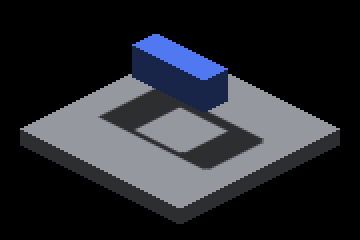
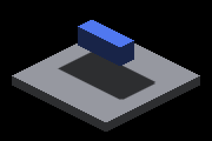
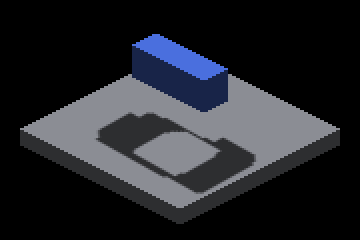
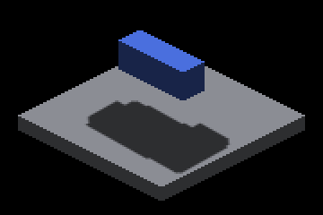
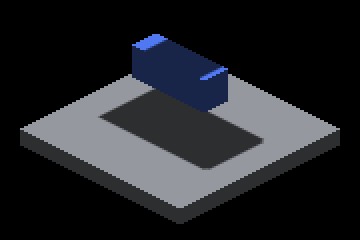
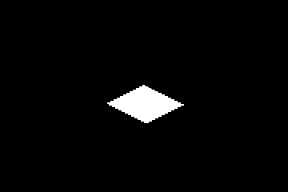

# Raster-only sun blockers behind a distant nearest depth: native Metal controls

The legacy canvas-depth sun bake keeps one nearest packed depth per texel. A
raster caster beyond the receiver's 64-unit throw replaces a lower raster
caster's depth at the same texel and the lower shadow disappears. These
captures reproduce that loss on the particle-registered legacy route
(`--probe-raster-sun-route`), witness both caster depths in the primary map
with `--sun-primary-probe`, and grade the depth-slab extrema repair against
the master build.

Every case: GRID floor receiver (span 40), lower GRID caster 18x6x8 at
z = -12 (10..18 units above the floor top), stack of 3x3x3 GRID casters on the
same sun ray, 2560x1440 native frames, zoom 1, `--no-ao`, subdivisions 1.
Crops are rectangle `(1100,600)-(1460,840)`; "missing" counts receiver pixels
brighter than the lower-only control outside a 2 px band around its edges,
"excess" counts darker ones. [capture.py](capture.py) is the replay driver;
[captures-baseline.json](captures-baseline.json),
[captures-head.json](captures-head.json) and the `captures-oblique-*.json`
twins retain every command, frame and receiver hash, the `SUN-ROUTE` witness
(`finite_coverage=0 particle_pass=1` on every lit head shot) and the probe
summaries.

The slab build is `kSunDepthSlabSlots = 3` in the three layout twins
(`sun_face_query_layout.hpp`, `ir_sun_face_query_layout.glsl`,
`ir_sun_face_query_layout.metal`); the shipped default is 0 (see Cost). Both
arms were built on master `a6b9953c3`, before the record-pool growth
(`d72f88820`) merged; that change touches the finite route only, and the
shipped default rebased onto it reproduces the baseline receiver hashes
exactly (`captures-default.json`: `lower`, `stacked-8-h60`, `oblique-lower`,
`oblique-stacked-8-h60`). The baseline binary is that master plus this
branch's CanvasStress fixture flags and a slab-free probe twin, built in a
separate worktree, so both arms take the same argv.

| Baseline: lower caster under eight casters at -84 | Slab build |
|---|---|
|  |  |
|  |  |
|  |  |

Lower-only control: ; the baseline's lost
pixels: .

## Phase 0: the collision is the primary map's

The probe under the receiver (world rectangle -12..12 x -6..6 at the floor
top, both cascades) reads the nearest word and the slab extrema per texel:

| Case | Nearest depths (cascade 0 texels) | Slabs per texel | Overflow |
|---|---|---|---|
| lower | -15 (1,175), -14 (50) | 2 on 1,225 | 0 |
| distant-8-h60 | -85 (398), -84 (39), 3 (788) | 1 on 788, 2 on 437 | 0 |
| stacked-8-h60 | -85 (398), -84 (39), -15 (738), -14 (50) | 2 on 788, 3 on 437 | 0 |
| layered-3-h60-step64 | -149 (398), -148 (39), -15 (738), -14 (50) | 2 on 788, 3 on 437 | 437 |

Under the stack the lower caster's depth (-15) survives only in slab 7 while
the nearest word is the distant caster's (-85); the baseline receiver rejects
that word as beyond the throw and lights the texel. Both depths reach the
bake before they collide: the lower-only and distant-only controls each show
their own depth at the same texels. Unlit pairs (`--no-shadows`) of the lower
and stacked scenes are byte-identical, so the visible difference is shadow.

## Results

| Case | Baseline missing / excess | Slab build missing / excess | Receiver identical |
|---|---:|---:|---|
| lower (control) | 0 / 0 | 0 / 0 | yes |
| floor, distant-8-h60 vs floor | 0 / 0 | 0 / 0 | yes |
| **stacked-8-h60** | **2,347** / 0 | **0** / 0 | no |
| stacked-8-h60-last (casters created after the box) | 2,347 / 0 | 0 / 0 | no |
| stacked-128-h60 (duplicates) | 2,347 / 0 | 0 / 0 | no |
| stacked-8-h90 | 2,347 / 0 | 0 / 0 | no |
| stacked-8-h30 (inside the throw) | 0 / 750 | 0 / 750 | yes |
| layered-2-h60-step40 (two bands, one slab) | 2,347 / 0 | 0 / 0 | no |
| layered-3-h60-step64 (four slabs on 437 texels) | 2,347 / 0 | 2,347 / 0 | yes |
| layered-4-h60-step64 | 2,347 / 0 | 2,347 / 0 | yes |
| stacked-8-h60-revoxelize (re-voxelized casters) | 2,773 / 0 | 0 / 0 | no |
| stacked-8-h60-revoxelized (re-voxelized floor receiver) | 2,262 / 0 | 0 / 0 | no |
| oblique-stacked-8-h60 | 2,428 / 0 | 0 / 0 | no |
| oblique-stacked-8-h60-last | 2,428 / 0 | 0 / 0 | no |
| oblique-stacked-128-h60 | 2,428 / 0 | 0 / 0 | no |
| oblique-stacked-8-h90 | 2,428 / 0 | 0 / 0 | no |
| oblique-stacked-8-h30 | 296 / 772 | 0 / 772 | no |
| oblique-layered-2-h60-step40 (two bands, two slabs) | 2,436 / 0 | 2,344 / 0 | no |
| oblique-layered-3-h60-step64, -4 | 2,428 / 0 | 0 / 0 | no |

The sign of the oblique stack offset was wrong in the first oblique pass
(casters off the receiver's sun ray); the oblique rows above are the
re-capture in `captures-oblique-*.json`.

Moving casters: the eight-caster stack starts 56 units above the floor and
rises at 20 units/s; seven shots eight frames apart cross the 64-unit throw
between shots 1 and 2. Each shot is graded against a static capture of the
pose it logged (`PROBE-DRIFT`). Baseline and slab build both match their
static poses exactly on every shot (0 / 0), so motion leaves no stale-frame
residue. Against the lower-only scene the baseline's static poses lose
2,347..2,608 pixels from pose 1 on; the slab build loses none, and both show
the stack's own legitimate shadow on the box top as excess.

Reading the table:

- Every beyond-throw stack on three or fewer slabs per texel is repaired to
  the lower-only control exactly, in both receiver modes, under both suns,
  for either creation order, with 128 duplicates, and through the track.
- Scenes with no hidden blocker are byte-identical to the baseline: the
  controls, the distant-only and in-window scenes, and the overflowed layered
  scenes, where a fourth distinct slab on a texel sets the overflow bit and
  the receiver keeps the nearest-only answer.
- `oblique-stacked-8-h30` is a baseline loss the issue did not predict: an
  in-window stack's splat words also hid 296 lower-blocker pixels; the slab
  build recovers them because the slab lookup fires on any nearest word
  beyond the throw, whichever caster wrote it.
- Two distant bands in different slabs plus the lower caster and the floor
  need four slots; `kSunDepthSlabSlots = 4` would cost a fourth plane pair.

## Harness

`python3 scripts/tests/test_render_sun_depth_slab.py` executes the writer,
clear and receiver in both dialects against an independent per-write oracle:
61,750 write sets per dialect through every permutation up to 24, 18,440
recoveries behind a nearest word beyond the throw, 200 overflow cases that
keep the nearest-only answer, 48 splat-extrema residuals (an interior write
hidden because both extrema of its slab are splats the receiver plane
rejects; none with direct or surface words), poisoned storage cleared, mixed
primary / indexed layers counted once, and ten mutation controls per dialect.

## Cost

Five interleaved pairs per cell through [ab_timing.py](ab_timing.py)
(`repeat_profile.py`, 360 profiled frames for IRCanvasStress and 60 for
IRPerfGrid, both complete build trees, Apple M4 Max, macOS Metal debug);
[ab-timing.md](ab-timing.md) has every GPU stage and sun-system CPU row with
its per-arm spread, [ab-timing.json](ab-timing.json) the samples.

| Cell | Metric | Baseline mean (min..max) | Three slots mean (min..max) | Ratio |
|---|---|---|---|---|
| IRCanvasStress raster route, lower caster | steady frame mean ms | 8.48 (8.33..8.73) | 10.90 (8.82..12.52) | 1.285x |
| IRCanvasStress raster route, lower caster | steady frame p99 ms | 14.05 (8.86..17.85) | 19.91 (18.40..20.94) | 1.416x |
| IRCanvasStress raster route, lower caster | GPU frame envelope ms | 2.10 (2.03..2.16) | 3.36 (3.13..3.78) | 1.601x |
| IRCanvasStress raster route, lower caster | GPU bakeSunShadowMap ms | 1.10 (0.98..1.17) | 2.43 (2.13..2.76) | 2.212x |
| IRCanvasStress raster route, 128 distant casters | steady frame mean ms | 8.33 (8.33..8.33) | 11.16 (9.54..12.35) | 1.340x |
| IRCanvasStress raster route, 128 distant casters | steady frame p99 ms | 8.85 (8.81..8.87) | 19.64 (18.98..20.22) | 2.220x |
| IRCanvasStress raster route, 128 distant casters | GPU frame envelope ms | 2.26 (2.14..2.30) | 4.17 (4.07..4.22) | 1.846x |
| IRCanvasStress raster route, 128 distant casters | GPU bakeSunShadowMap ms | 1.22 (1.15..1.24) | 3.08 (3.02..3.11) | 2.528x |
| IRCanvasStress default scene, raster route | steady frame mean ms | 22.44 (22.16..22.65) | 22.53 (22.46..22.59) | 1.004x |
| IRCanvasStress default scene, raster route | steady frame p99 ms | 27.06 (26.33..27.88) | 25.82 (24.69..26.79) | 0.954x |
| IRCanvasStress default scene, raster route | GPU frame envelope ms | 7.41 (7.19..7.54) | 7.46 (7.35..7.54) | 1.006x |
| IRCanvasStress default scene, raster route | GPU bakeSunShadowMap ms | 2.13 (2.04..2.20) | 2.92 (2.85..2.99) | 1.373x |
| IRPerfGrid zoom 1 | steady frame mean ms | 21.02 (20.27..21.62) | 21.76 (21.57..21.97) | 1.035x |
| IRPerfGrid zoom 1 | steady frame p99 ms | 23.20 (22.39..23.84) | 24.03 (23.78..24.31) | 1.036x |
| IRPerfGrid zoom 1 | GPU frame envelope ms | 4.87 (4.82..4.93) | 5.31 (5.24..5.38) | 1.091x |
| IRPerfGrid zoom 1 | GPU bakeSunShadowMap ms | 0.09 (0.09..0.09) | 0.09 (0.09..0.09) | 0.989x |
| IRPerfGrid zoom 4 | steady frame mean ms | 24.13 (23.32..24.88) | 23.98 (23.21..24.50) | 0.994x |
| IRPerfGrid zoom 4 | steady frame p99 ms | 28.27 (25.86..30.14) | 27.96 (26.04..29.81) | 0.989x |
| IRPerfGrid zoom 4 | GPU frame envelope ms | 7.34 (7.16..7.61) | 7.34 (7.10..7.41) | 0.999x |
| IRPerfGrid zoom 4 | GPU bakeSunShadowMap ms | 0.04 (0.03..0.04) | 0.03 (0.03..0.04) | 0.922x |

Three slots grow the sun buffer from 30,670,864 to 81,002,512 bytes, 48 MiB
of slab words cleared every frame. The two small raster-route cells exceed
the plan's 1.10x budget on frame mean and p99 and the `bakeSunShadowMap` row
beyond its baseline spread; the default raster scene and both IRPerfGrid
cells stay inside it (the perf-grid cells pay only the clear, since their
finite route bakes no canvas depth). The staged ablation
([stage_ablation.py](stage_ablation.py); [stage-ablation-planar.json](stage-ablation-planar.json)
for the planar layout, [stage-ablation-interleaved.json](stage-ablation-interleaved.json)
for the earlier per-texel pairs, both taken while `origin/master` still held
the pre-growth shaders the script stages) on the slab binary attributes the
raster-route envelope delta to the layout (buffer and clear: 2.2 → 2.7 ms on
the lower-caster cell) and to the writer (2.7 → 4.0 ms); master's receiver
shaders over the slab layout and the slab receiver over master's bake measure
the same, so the receiver's slab lookup is free. Within the writer, atomic contention is not
the cost: issuing the extrema atomics only when a plain load shows the write
moves an extremum did not move the bake, planar slab planes beat per-texel
pairs, and prefetching a splat row's words before deciding spilled registers
and measured slower. The remaining cost is the two covering loads every one
of the 225 splat writes per caster pixel makes against master's single
atomic. The shipped default therefore compiles the layer out
(`kSunDepthSlabSlots = 0`); the design note records the two paths that could
bring it inside the budget.


## Deterministic replay

```
ir-acquire gpu -- python3 docs/pr-screenshots/claude/4799-sun-raster-depth-slabs/capture.py --output <dir> --label head
ir-acquire gpu -- python3 docs/pr-screenshots/claude/4799-sun-raster-depth-slabs/capture.py --output <dir> --build-dir <baseline-build> --label baseline
python3 docs/pr-screenshots/claude/4799-sun-raster-depth-slabs/ab_timing.py --output <dir> --baseline <baseline-build> --head build --pairs 5
python3 docs/pr-screenshots/claude/4799-sun-raster-depth-slabs/stage_ablation.py --output <dir>
```
