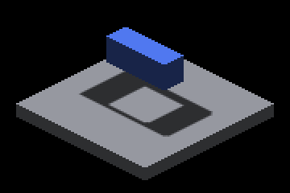
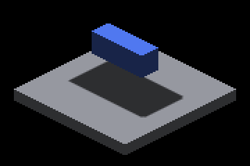
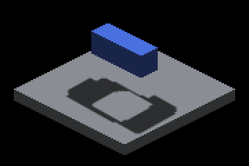
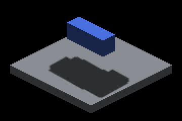
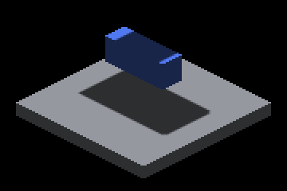
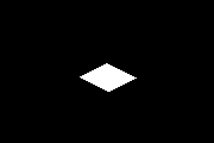

# Raster-only sun blockers behind a distant nearest depth: native Metal controls

The legacy canvas-depth sun bake keeps one nearest packed depth per texel. A
raster caster beyond the receiver's 64-unit throw replaces a lower raster
caster's depth at the same texel and the lower shadow disappears. These
captures reproduce that loss on the particle-registered legacy route
(`--probe-particle-raster`), witness both caster depths in the primary map
with `--sun-primary-rect-probe`, and grade the depth-slab extrema repair against
the master build.

Every case: GRID floor receiver (span 40), lower GRID caster 18x6x8 at
z = -12 (10..18 units above the floor top), stack of 3x3x3 GRID casters on the
same sun ray, 2560x1440 native frames, zoom 1, `--no-ao`, subdivisions 1.
Crops are rectangle `(1100,600)-(1460,840)`; "missing" counts receiver pixels
brighter than the lower-only control outside a 2 px band around its edges,
"excess" counts darker ones. [capture.py](capture.py) is the replay driver;
[captures-baseline.json](captures-baseline.json),
[captures-per-pixel.json](captures-per-pixel.json) and
[captures-head.json](captures-head.json) retain every command, frame and
receiver hash, the `SUN-ROUTE` witness (`finite_coverage=0 particle_pass=1` on
every lit three-slot shot) and the probe summaries.

The slab build is `kSunDepthSlabSlots = 3` in the three layout twins
(`sun_face_query_layout.hpp`, `ir_sun_face_query_layout.glsl`,
`ir_sun_face_query_layout.metal`); the shipped default is 0 (see Cost and
Budget). Every arm is a frozen build tree of this branch on master
`8a3840064`, identified by binary and shader hashes in the capture JSONs and
`budget/*/manifests.json`: **base** = zero slots (master's layout, writer and
clear plus the fixture flags the stacked scenes need; master's own binary
rejects `--probe-overlapping-source-mode`), **per-pixel** = three slots with the
prototype's per-pixel writer and per-texel clear, **fills** = three slots with
the two device fills, **head** = three slots with the fills and the
workgroup-cooperative splat kernel. `captures-baseline.json` is the base arm,
`captures-per-pixel.json` and `captures-head.json` the three-slot arms; all
three take the same argv. The shipped default reproduces the base arm's
receiver hashes exactly (`captures-default.json`: `lower`, `stacked-8-h60`,
`oblique-lower`, `oblique-stacked-8-h60`).

| Baseline: lower caster under eight casters at -84 | Slab build |
|---|---|
|  |  |
|  |  |
|  |  |

Lower-only control: ; the baseline's lost
pixels: .

## Phase 0: the collision is the primary map's

The probe under the receiver (world rectangle -12..12 x -6..6 at the floor
top, both cascades) reads the nearest word and the slab extrema per texel:

| Case | Nearest depths (cascade 0 texels) | Slabs per texel | Overflow |
|---|---|---|---|
| lower | -15 (1,175), -14 (50) | 2 on 1,225 | 0 |
| distant-8-h60 | -85 (398), -84 (39), 3 (788) | 1 on 788, 2 on 437 | 0 |
| stacked-8-h60 | -85 (398), -84 (39), -15 (738), -14 (50) | 2 on 788, 3 on 437 | 0 |
| layered-3-h60-step64 | -149 (398), -148 (39), -15 (738), -14 (50) | 2 on 788, 3 on 437 | 437 |

Under the stack the lower caster's depth (-15) survives only in slab 7 while
the nearest word is the distant caster's (-85); the baseline receiver rejects
that word as beyond the throw and lights the texel. Both depths reach the
bake before they collide: the lower-only and distant-only controls each show
their own depth at the same texels. Unlit pairs (`--no-shadows`) of the lower
and stacked scenes are byte-identical, so the visible difference is shadow.

## Results

| Case | Baseline missing / excess | Slab build missing / excess | Receiver identical |
|---|---:|---:|---|
| lower (control) | 0 / 0 | 0 / 0 | yes |
| floor, distant-8-h60 vs floor | 0 / 0 | 0 / 0 | yes |
| **stacked-8-h60** | **2,347** / 0 | **0** / 0 | no |
| stacked-8-h60-last (casters created after the box) | 2,347 / 0 | 0 / 0 | no |
| stacked-128-h60 (duplicates) | 2,347 / 0 | 0 / 0 | no |
| stacked-8-h90 | 2,347 / 0 | 0 / 0 | no |
| stacked-8-h30 (inside the throw) | 0 / 750 | 0 / 750 | yes |
| layered-2-h60-step40 (two bands, one slab) | 2,347 / 0 | 0 / 0 | no |
| layered-3-h60-step64 (four slabs on 437 texels) | 2,347 / 0 | 2,347 / 0 | yes |
| layered-4-h60-step64 | 2,347 / 0 | 2,347 / 0 | yes |
| stacked-8-h60-revoxelize (re-voxelized casters) | 2,773 / 0 | 0 / 0 | no |
| stacked-8-h60-revoxelized (re-voxelized floor receiver) | 2,262 / 0 | 0 / 0 | no |
| oblique-stacked-8-h60 | 2,428 / 0 | 0 / 0 | no |
| oblique-stacked-8-h60-last | 2,428 / 0 | 0 / 0 | no |
| oblique-stacked-128-h60 | 2,428 / 0 | 0 / 0 | no |
| oblique-stacked-8-h90 | 2,428 / 0 | 0 / 0 | no |
| oblique-stacked-8-h30 | 296 / 772 | 0 / 772 | no |
| oblique-layered-2-h60-step40 (two bands, two slabs) | 2,436 / 0 | 2,344 / 0 | no |
| oblique-layered-3-h60-step64, -4 | 2,428 / 0 | 0 / 0 | no |

Moving casters: the eight-caster stack starts 56 units above the floor and
rises at 20 units/s; seven shots eight frames apart cross the 64-unit throw
between shots 1 and 2. Each shot is graded against a static capture of the
pose it logged (`PROBE-DRIFT`). Baseline and slab build both match their
static poses exactly on every shot (0 / 0), so motion leaves no stale-frame
residue. Against the lower-only scene the baseline's static poses lose
2,347..2,608 pixels from pose 1 on; the slab build loses none, and both show
the stack's own legitimate shadow on the box top as excess.

Re-captured on the current tree with the three frozen arms: every row above
reads the same (base arm versus lower-only control; three-slot arms versus
theirs), the 17 controls keep receiver hashes identical to the base arm's, and
the cooperative kernel's receivers are hash-identical to the per-pixel writer's
on all 58 captures (the 29 static cases, two seven-shot tracks and their
static poses), so the cooperative path is exact natively as well as in the
harness. The head arm's probe summaries were re-captured with the probe
reading the overflow flag from max plane 0 (planar storage puts it right after
the last min plane): every receiver hash is unchanged and the overflow column
now agrees with the per-pixel arm's on all 80 cascade rows (437 / 379 texels
on `layered-3` and `-4`, 277 / 249 on `oblique-layered-2-h60-step40`, zero
elsewhere), so the cooperative flush propagates the sticky bit natively too.

Reading the table:

- Every beyond-throw stack on three or fewer slabs per texel is repaired to
  the lower-only control exactly, in both receiver modes, under both suns,
  for either creation order, with 128 duplicates, and through the track.
- Scenes with no hidden blocker are byte-identical to the baseline: the
  controls, the distant-only and in-window scenes, and the overflowed layered
  scenes, where a fourth distinct slab on a texel sets the overflow bit and
  the receiver keeps the nearest-only answer.
- `oblique-stacked-8-h30` is a baseline loss the issue did not predict: an
  in-window stack's splat words also hid 296 lower-blocker pixels; the slab
  build recovers them because the slab lookup fires on any nearest word
  beyond the throw, whichever caster wrote it.
- Two distant bands in different slabs plus the lower caster and the floor
  need four slots; `kSunDepthSlabSlots = 4` would cost a fourth plane pair.

## Harness

`python3 scripts/tests/test_render_sun_depth_slab.py` executes the writer,
clear and receiver in both dialects against an independent per-write oracle:
61,750 write sets per dialect through every permutation up to 24, 18,440
recoveries behind a nearest word beyond the throw, 200 overflow cases that
keep the nearest-only answer, 48 splat-extrema residuals (an interior write
hidden because both extrema of its slab are splats the receiver plane
rejects; none with direct or surface words), poisoned storage cleared, mixed
primary / indexed layers counted once, and ten mutation controls per dialect.
The same harness emulates the cooperative kernel's window lane by lane with the
barriers as phase boundaries (reset, footprint reduction, init, routed splat,
flush) and compares the planes it leaves with the per-pixel writer's on 107
write sets in both dialects (153,953 writes spilled past the window, 411
dropped at the cascade edge, 39,060 overflowed texels, both lane orders, tiles
merging into planes another tile already claimed); a dropped flush, a spill
routed nowhere, a shifted flush origin and an inclusive window bound each fail
by name.

## Cost of the prototype

The prototype's measurement on master `a6b9953c3`, kept as the record the
budget work started from; the current-tree readings are in the Budget sections
below. Five interleaved pairs per cell through [ab_timing.py](ab_timing.py)
(`repeat_profile.py`, 360 profiled frames for IRCanvasStress and 60 for
IRPerfGrid, both complete build trees, Apple M4 Max, macOS Metal debug);
[ab-timing.md](ab-timing.md) has every GPU stage and sun-system CPU row with
its per-arm spread, [ab-timing.json](ab-timing.json) the samples.

| Cell | Metric | Baseline mean (min..max) | Three slots mean (min..max) | Ratio |
|---|---|---|---|---|
| IRCanvasStress raster route, lower caster | steady frame mean ms | 8.48 (8.33..8.73) | 10.90 (8.82..12.52) | 1.285x |
| IRCanvasStress raster route, lower caster | steady frame p99 ms | 14.05 (8.86..17.85) | 19.91 (18.40..20.94) | 1.416x |
| IRCanvasStress raster route, lower caster | GPU frame envelope ms | 2.10 (2.03..2.16) | 3.36 (3.13..3.78) | 1.601x |
| IRCanvasStress raster route, lower caster | GPU bakeSunShadowMap ms | 1.10 (0.98..1.17) | 2.43 (2.13..2.76) | 2.212x |
| IRCanvasStress raster route, 128 distant casters | steady frame mean ms | 8.33 (8.33..8.33) | 11.16 (9.54..12.35) | 1.340x |
| IRCanvasStress raster route, 128 distant casters | steady frame p99 ms | 8.85 (8.81..8.87) | 19.64 (18.98..20.22) | 2.220x |
| IRCanvasStress raster route, 128 distant casters | GPU frame envelope ms | 2.26 (2.14..2.30) | 4.17 (4.07..4.22) | 1.846x |
| IRCanvasStress raster route, 128 distant casters | GPU bakeSunShadowMap ms | 1.22 (1.15..1.24) | 3.08 (3.02..3.11) | 2.528x |
| IRCanvasStress default scene, raster route | steady frame mean ms | 22.44 (22.16..22.65) | 22.53 (22.46..22.59) | 1.004x |
| IRCanvasStress default scene, raster route | steady frame p99 ms | 27.06 (26.33..27.88) | 25.82 (24.69..26.79) | 0.954x |
| IRCanvasStress default scene, raster route | GPU frame envelope ms | 7.41 (7.19..7.54) | 7.46 (7.35..7.54) | 1.006x |
| IRCanvasStress default scene, raster route | GPU bakeSunShadowMap ms | 2.13 (2.04..2.20) | 2.92 (2.85..2.99) | 1.373x |
| IRPerfGrid zoom 1 | steady frame mean ms | 21.02 (20.27..21.62) | 21.76 (21.57..21.97) | 1.035x |
| IRPerfGrid zoom 1 | steady frame p99 ms | 23.20 (22.39..23.84) | 24.03 (23.78..24.31) | 1.036x |
| IRPerfGrid zoom 1 | GPU frame envelope ms | 4.87 (4.82..4.93) | 5.31 (5.24..5.38) | 1.091x |
| IRPerfGrid zoom 1 | GPU bakeSunShadowMap ms | 0.09 (0.09..0.09) | 0.09 (0.09..0.09) | 0.989x |
| IRPerfGrid zoom 4 | steady frame mean ms | 24.13 (23.32..24.88) | 23.98 (23.21..24.50) | 0.994x |
| IRPerfGrid zoom 4 | steady frame p99 ms | 28.27 (25.86..30.14) | 27.96 (26.04..29.81) | 0.989x |
| IRPerfGrid zoom 4 | GPU frame envelope ms | 7.34 (7.16..7.61) | 7.34 (7.10..7.41) | 0.999x |
| IRPerfGrid zoom 4 | GPU bakeSunShadowMap ms | 0.04 (0.03..0.04) | 0.03 (0.03..0.04) | 0.922x |

Three slots grow the sun buffer from 30,670,864 to 81,002,512 bytes, 48 MiB
of slab words cleared every frame. The two small raster-route cells exceed
the plan's 1.10x budget on frame mean and p99 and the `bakeSunShadowMap` row
beyond its baseline spread; the default raster scene and both IRPerfGrid
cells stay inside it (the perf-grid cells pay only the clear, since their
finite route bakes no canvas depth). The staged ablation
([stage_ablation.py](stage_ablation.py); [stage-ablation-planar.json](stage-ablation-planar.json)
for the planar layout, [stage-ablation-interleaved.json](stage-ablation-interleaved.json)
for the earlier per-texel pairs, both taken while `origin/master` still held
the pre-growth shaders the script stages) on the slab binary attributes the
raster-route envelope delta to the layout (buffer and clear: 2.2 → 2.7 ms on
the lower-caster cell) and to the writer (2.7 → 4.0 ms); master's receiver
shaders over the slab layout and the slab receiver over master's bake measure
the same, so the receiver's slab lookup is free. Within the writer, atomic contention is not
the cost: issuing the extrema atomics only when a plain load shows the write
moves an extremum did not move the bake, planar slab planes beat per-texel
pairs, and prefetching a splat row's words before deciding spilled registers
and measured slower. The remaining cost is the two covering loads every one
of the 225 splat writes per caster pixel makes against master's single
atomic. The shipped default therefore compiles the layer out
(`kSunDepthSlabSlots = 0`); the design note records the two paths that could
bring it inside the budget.


## Budget, phase 0: the splat footprint per bake workgroup

The cooperative-splat premise is that a 16x16 bake workgroup's splat boxes
fit a fixed window of sun texels in threadgroup memory, so each texel's
extrema can be reduced once per tile instead of once per caster pixel. The
footprint probe (`IRCanvasStress --sun-bake-footprint-probe`, `IRPerfGrid`
likewise; `footprint/*.csv`) reads the main canvas depth after the bake,
recovers every caster pixel through the bake's own resident frame data,
projects it to its splat box's base texel per cascade, and reports per
workgroup the base-texel bounding box and how many of its pixels' boxes
(radius 7, so 15 texels wide) fit a window of 32, 40, 48 or 64 texels anchored
at that bounding box's minimum. The census agrees with the bake: the union of
the per-tile boxes with their halo covers 22,518 / 13,426 texels on the
lower-caster cell against 21,966 / 13,218 primary texels the bake wrote
(`footprint/canvas-lower-primary-census.csv`, both cascades). Fog culling is
not modelled, so the counts are an upper bound on bake writes.

| Cell | Caster pixels | Group | Cascade | Workgroups | Fit 32 | Fit 40 | Fit 48 | Fit 64 |
|---|---:|---|---|---:|---:|---:|---:|---:|
| canvas-lower | 16008 | 16x16 | 0 | 84 | 54.1% | 85.3% | 89.0% | 97.0% |
| canvas-lower | 16008 | 16x16 | 1 | 84 | 81.2% | 89.6% | 96.1% | 99.2% |
| canvas-lower | 16008 | 8x8 | 0 | 290 | 93.8% | 93.8% | 94.3% | 99.6% |
| canvas-lower | 16008 | 8x8 | 1 | 290 | 93.8% | 94.7% | 99.2% | 100.0% |
| canvas-stacked-128 | 16224 | 16x16 | 0 | 90 | 54.7% | 85.5% | 89.1% | 97.1% |
| canvas-stacked-128 | 16224 | 16x16 | 1 | 90 | 81.5% | 89.7% | 96.1% | 99.2% |
| canvas-stacked-128 | 16224 | 8x8 | 0 | 298 | 93.9% | 93.9% | 94.4% | 99.6% |
| canvas-stacked-128 | 16224 | 8x8 | 1 | 298 | 93.9% | 94.7% | 99.2% | 100.0% |
| canvas-default-raster | 121920 | 16x16 | 0 | 526 | 77.7% | 99.5% | 100.0% | 100.0% |
| canvas-default-raster | 121920 | 16x16 | 1 | 526 | 84.9% | 99.7% | 100.0% | 100.0% |
| canvas-default-raster | 121920 | 8x8 | 0 | 2012 | 99.8% | 100.0% | 100.0% | 100.0% |
| canvas-default-raster | 121920 | 8x8 | 1 | 2012 | 99.9% | 100.0% | 100.0% | 100.0% |
| perf-grid-zoom1 | 0 (finite route, `finite_coverage=1`) | - | - | 0 | - | - | - | - |
| perf-grid-zoom4 | 0 (finite route, `finite_coverage=1`) | - | - | 0 | - | - | - | - |

Three slots of (min, max) plus the nearest word are 28 bytes per window texel,
so 32 KiB of threadgroup memory holds a 32-texel window at 16x16 (28,672
bytes). At that window the two small raster cells fit 54% (cascade 0) and 81%
(cascade 1) of their caster pixels and the default raster scene 78%: the median
16x16 tile spans 27 (cascade 0) and 20 (cascade 1) base texels on the small
cells and 23 / 22 on the default scene, plus the 14-texel splat halo. The
redundancy the reduction removes is real: each tile's pixels issue 225 box
writes each against a bounding box of about 1,500 texels, a lower bound of 29x
(cascade 0) to 43x writes per texel within one tile, and the whole-map census
shows 164 writes per written texel across tiles on the lower cell. The design
answer took the 8x8 group at the 32 window with the full 28-byte texel (94% of
the small cells' pixels, 99.8% of the default scene's), with the spill decided
per write rather than per pixel, and retired the pixel-level premise bar: a
pixel whose box leaves the window still writes most of its box through the
window and only the texels outside it through the per-pixel path, so the
slow-path residual is the share of box writes outside the window, which the
probe now reports beside the fit (`spill_writes_<window>` header lines).

The census shot above is the zoom-2 capture frame (`smallzoom_high`, 16,008
caster pixels on the lower cell); the timing cells profile at zoom 1, whose
frame (`so3_smooth_sweep`, 4,002 caster pixels) is in `footprint/<cell>-zoom1.csv`.
Per-write spill at the 8x8 group and 32 window:

| Cell | Frame | Caster pixels | Cascade 0 pixels fit | Cascade 0 writes spilled | Cascade 1 pixels fit | Cascade 1 writes spilled |
|---|---|---:|---:|---:|---:|---:|
| canvas-lower | zoom 2 census | 16,008 | 93.8% | 6.14% (221,175 / 3,601,800) | 93.8% | 4.50% (162,165 / 3,601,800) |
| canvas-lower | zoom 1 profiled | 4,002 | 88.8% | 5.17% (46,515 / 900,450) | 94.5% | 2.82% (25,395 / 900,450) |
| canvas-stacked-128 | zoom 2 census | 16,224 | 93.9% | 6.06% (221,175 / 3,650,400) | 93.9% | 4.44% (162,165 / 3,650,400) |
| canvas-stacked-128 | zoom 1 profiled | 4,056 | 89.0% | 5.10% (46,515 / 912,600) | 94.6% | 2.78% (25,395 / 912,600) |
| canvas-default-raster | zoom 2 census | 121,920 | 99.8% | 0.04% (10,815 / 27,432,000) | 99.9% | 0.02% (4,815 / 27,432,000) |
| canvas-default-raster | zoom 1 profiled | 34,376 | 100% | 0% | 100% | 0% |

## Budget: the four arms on the five cells

The slab planes are laid out as every slot's min plane then every slot's max
plane, and the bake system clears them with two device fills (`0xFF` over the
min planes, `0x00` over the max planes) through `RenderDevice::fillBuffer`
with a byte offset, instead of the per-texel clear kernel's slot loop. The
cooperative splat (design answer: 8x8 pixel tile, 32-texel window, nearest
word plus three (min, max) pairs per window texel, per-write spill) is the
third wrapper `c_bake_sun_shadow_map_cooperative`, dispatched where the
coverage splat is engaged; the production, second-depth and clear kernels stay
at 16x16. The four frozen trees were profiled through [ab_timing.py](ab_timing.py)
in one guarded `ir-acquire benchmark` window per cell, five interleaved rounds,
order reversed on alternate rounds (Apple M4 Max, Metal, display held awake).
`budget/<cell>/ab-timing.md` has every row with the base spread, the paired
delta, its one-sided 95% lower bound and the verdict against the plan's gate;
`ab-timing.json` the samples and the steady frame-time bins; `manifests.json`
the twenty run manifests.

| Cell | Row | Base mean (min..max) | Per-pixel | Fills | Head (cooperative) | Gate | Head verdict |
|---|---|---|---|---|---|---|---|
| canvas-lower | GPU bakeSunShadowMap ms | 1.451 (1.434..1.465) | 2.714, 1.871x | 2.942, 2.028x | 4.762, 3.282x (delta +3.311, lower bound +3.191) | delta <= 0.064 ms | FAIL |
| canvas-lower | steady frame mean ms | 8.850 (8.330..9.490) | 13.390, 1.513x | 13.296, 1.502x | 16.754, 1.893x | <= 1.10x | FAIL |
| canvas-lower | steady frame p99 ms | 14.140 (8.800..18.020) | 20.306, 1.436x | 20.760, 1.468x | 23.250, 1.644x | <= 1.10x | FAIL |
| canvas-lower | GPU envelope ms | 2.374 (2.265..2.453) | 3.635, 1.531x | 3.838, 1.617x | 5.677, 2.391x | reported | - |
| canvas-stacked-128 | GPU bakeSunShadowMap ms | 1.458 (1.439..1.476) | 3.026, 2.076x | 3.327, 2.283x | 4.080, 2.799x (delta +2.622, lower bound +2.539) | delta <= 0.029 ms | FAIL |
| canvas-stacked-128 | steady frame mean ms | 11.992 (9.970..13.800) | 14.868, 1.240x | 18.708, 1.560x | 17.510, 1.460x | <= 1.10x | FAIL |
| canvas-stacked-128 | steady frame p99 ms | 20.550 (17.930..22.480) | 23.776, 1.157x | 24.928, 1.213x | 25.852, 1.258x | <= 1.10x | FAIL |
| canvas-stacked-128 | GPU envelope ms | 2.444 (2.300..2.519) | 4.029, 1.648x | 4.360, 1.784x | 5.090, 2.083x | reported | - |
| canvas-default-raster | GPU bakeSunShadowMap ms | 2.401 (2.308..2.459) | 3.160, 1.316x | 3.042, 1.267x | 3.570, 1.487x | reported (base range 0.151) | - |
| canvas-default-raster | steady frame mean ms | 22.640 (22.360..22.930) | 22.358, 0.988x | 22.198, 0.980x | 22.474, 0.993x | <= 1.10x | pass |
| canvas-default-raster | steady frame p99 ms | 28.784 (27.400..32.620) | 25.990, 0.903x | 26.040, 0.905x | 26.034, 0.904x | <= 1.10x | pass |
| canvas-default-raster | GPU envelope ms | 7.447 (7.301..7.551) | 7.544, 1.013x | 7.393, 0.993x | 7.613, 1.022x | reported | - |
| perf-grid-zoom1 | GPU bakeSunShadowMap ms | 0.374 (0.334..0.404) | 0.387, 1.035x | 0.391, 1.045x | 0.379, 1.013x | reported | - |
| perf-grid-zoom1 | steady frame mean / p99 | 23.462 / 31.180 | 1.040x / 1.053x | 1.044x / 1.080x | 1.044x / 1.043x | <= 1.10x | pass |
| perf-grid-zoom4 | GPU bakeSunShadowMap ms | 0.131 (0.123..0.144) | 0.122, 0.930x | 0.122, 0.930x | 0.125, 0.957x | reported | - |
| perf-grid-zoom4 | steady frame mean / p99 | 26.526 / 34.930 | 0.973x / 0.984x | 0.970x / 0.994x | 0.921x / 0.935x | <= 1.10x | pass |

Reading the table:

- The fills are cost-neutral against the per-texel clear loop, as before: the
  per-pixel and fills arms sit within 0.31 ms of each other on every bake row
  and within their spreads on the envelope. The writer carries the three-slot
  cost.
- The cooperative kernel is slower than the per-pixel writer it replaces, by
  +2.0 ms on the lower cell's bake row and +1.1 ms on the stacked cell's; it
  fails decision 7 on both small cells by more than forty floors, and the
  frame rows with it. The default raster scene passes the frame gate with
  every arm (the bake row is 1.49x there, hidden behind a 22 ms frame), and
  the IRPerfGrid cells pay nothing (finite route, no caster pixels).
- The base arm's bake row sits at 1.451 / 1.458 ms with between-run ranges of
  0.031 / 0.037 ms, inside the locked floors' derivation; the frame rows at
  the 120 Hz vsync lock split between the 8..9 ms and 17..19 ms bins as the
  plan predicted.

### Attribution: the window skeleton alone is over budget

`budget/attribution/<cell>/` times the two small cells with a third arm
staged by [stage_window_nearest_only.py](stage_window_nearest_only.py) from
the head tree: the cooperative kernel with its slab words compiled out, so the
window carries the nearest word alone and the flush writes only it (the planes
are not exact there; the arm is timed, never captured).

| Cell | Row | Base | Cooperative (head) | Nearest-only window |
|---|---|---|---|---|
| canvas-lower | GPU bakeSunShadowMap ms | 1.441 (1.435..1.454) | 4.678, 3.246x | 2.098, 1.456x (delta +0.657, lower bound +0.642) |
| canvas-lower | GPU envelope ms | 2.275 | 5.485, 2.411x | 2.940, 1.293x |
| canvas-lower | steady frame mean / p99 ms | 8.330 / 8.812 | 17.072 / 22.756 | 8.704 / 17.306 |
| canvas-stacked-128 | GPU bakeSunShadowMap ms | 1.449 (1.437..1.460) | 4.080, 2.815x | 2.106, 1.453x (delta +0.656, lower bound +0.645) |
| canvas-stacked-128 | GPU envelope ms | 2.289 | 4.931, 2.154x | 2.961, 1.293x |
| canvas-stacked-128 | steady frame mean / p99 ms | 12.924 / 19.566 | 17.330 / 24.028 | 14.342 / 22.104 |

The window machinery alone (reset, footprint reduction, init, the shared
nearest-word atomics, the flush and five barriers per cascade, under a 28 KiB
threadgroup allocation) costs +0.66 ms on the bake row on both cells, ten and
twenty-two floors wide, before any slab word is touched; the shared-memory slab
claim adds a further +2.6 ms / +2.0 ms. Master's nearest-only bake does the
same writes as that skeleton with one fire-and-forget global `atomicMin` each
and no barrier, 0.66 ms cheaper; on this GPU a threadgroup reduction of the
coverage splat does not pay for itself even with nothing to reduce into.

`budget/cooperative-full-window/<cell>/` keeps the first form of the kernel,
measured in the same protocol before the restructure: it cleared and flushed
the whole 1,024-texel window on every tile, caster or not, with four barriers
per cascade. Lower cell bake 3.777 ms (2.607x), stacked 4.497 ms (3.066x),
default raster 3.837 ms (1.725x); the restructure (footprint-rectangle init
and flush, empty tiles skipping both) moved the stacked and default cells by
-0.4 and -0.3 ms and the lower cell by +1.0 ms, inside the spread of a kernel
that is slow for a reason the window shape does not reach.

### The opt-out is master's cost

`budget/master-vs-base/`: origin/master's own frozen binary (`8a3840064`)
against the zero-slot base arm on `canvas-lower`, five interleaved pairs:
`bakeSunShadowMap` 1.465 vs 1.458 ms (+0.006 ms, 1.004x, inside F by rule
(i)), envelope 1.004x, steady frame mean 1.022x, steady p99 17.614 vs
15.874 ms (1.110x) with both arms 90% / 93% in the 7..9 ms bins, the p99
difference being the bimodal vsync p99 of two of the base runs (8.8 ms) rather
than a shift. The zero-slot layout, writer and dispatches are master's.

### Decision

Decision 7 fails on both small raster cells, so the shipped layout stays at
zero slots and the layer compiled out; `kSunDepthSlabSlots = 0u` in the three
twins, the cooperative program is not constructed and the dispatches are
master's. Recorded in the design note, not built: a load-free direct-mapped
slab table (slot = slab mod slots, fire-and-forget extrema, the receiver
trusting a slot only when its slab matches), premised on a collision census
computed from the per-pixel arm's probe CSVs over this matrix: of 95,158
probed texels, 79,738 hold two or more distinct slabs and 4 of those (all in
`oblique-layered-2-h60-step40`, an overflowing scene) hold two slabs congruent
mod 3; and 256 threads over the 8x8 tile, which the attribution arm suggests
would not recover the window skeleton's own cost.

## Deterministic replay

```
ir-acquire gpu -- python3 docs/pr-screenshots/claude/4799-sun-raster-depth-slabs/capture.py --output <dir> --label head
ir-acquire gpu -- python3 docs/pr-screenshots/claude/4799-sun-raster-depth-slabs/capture.py --output <dir> --build-dir <zero-slot-build> --label baseline
ir-acquire --timeout 3600 benchmark -- python3 docs/pr-screenshots/claude/4799-sun-raster-depth-slabs/ab_timing.py --output <dir>/<cell> --baseline <zero-slot-build> --arm per-pixel=<per-pixel-build> --arm fills=<fills-build> --head build --pairs 5 --cells <cell>
cp -Rc build <dir>/coop-nearest && python3 docs/pr-screenshots/claude/4799-sun-raster-depth-slabs/stage_window_nearest_only.py <dir>/coop-nearest   # the attribution arm, then --arm cooperative=build --head <dir>/coop-nearest
python3 docs/pr-screenshots/claude/4799-sun-raster-depth-slabs/stage_ablation.py --output <dir>
IRREDEN_BUILD_DIR=build ir-acquire gpu -- fleet-run IRCanvasStress <cell argv with --auto-screenshot 10> --sun-bake-footprint-probe   # writes sun-footprint-<shot>.csv beside the exe
```

A run that discovers zero display monitors (the host display asleep) stalls
the offscreen frame loop and ir-run reports `NO-DISPLAY`; hold the display
awake (`caffeinate -d -i -u`) around the timing windows.
