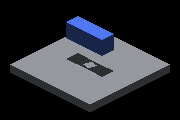
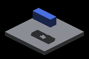
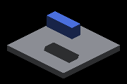
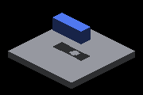
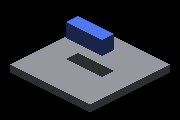

# Sun record-pool exhaustion: Windows/OpenGL replay

This is a replay of the [Metal matrix](../4759-sun-face-pool-exhaustion/README.md)
on native Windows with the same two drivers, `capture.py` and `timing.py`.
The host is an NVIDIA GeForce RTX 3060 Ti (driver 32.0.15.8180) on Windows 10
19045, built Debug with MSYS2 mingw64 and OpenGL. The drivers stage GLSL here.

- **head** is `a6b9953c3`, with the sun-index shaders as merged.
- **parent** is `ecb5405ba`, the commit before the change merged. The four
  policy shaders are unchanged between the merge and head. Because
  `origin/master` now *is* the change, the drivers take `--parent-ref`.

Both variants share one binary, as on Metal: `captures.json` records the
binary hash and each variant's four shader hashes.

This host renders a 1× framebuffer (1280×720) where macOS renders 2×
(2560×1440). The receiver crop is therefore `(550,300)-(730,420)`, the same
scene rectangle as Metal's `(1100,600)-(1460,840)`. `capture.py` scales it
from the frame width and records it per shot.

| Parent: retained receiver records, pool exhausted elsewhere | Head |
|---|---|
|  |  |
|  |  |
|  |  |

## Results

**All 82 captures exited CLEAN.** Every case requested exactly the same
number of face records as on Metal, and every track logged the same seven
poses.

**Every receiver crop is pixel-identical to Metal's.** That covers all 142
crops (71 per variant): every static case, every track shot and every pose
control. Each Windows crop equals the Metal crop downsampled 2× by nearest
neighbour, comparing RGB with zero differing pixels. Every outcome in the
Metal table therefore holds on OpenGL:

- the repaired `filler-last` cases with finite casters are at 0 changed
  pixels against their controls, static and moving;
- the `filler-first`, 280-straddle and analytic-sphere limits are unchanged
  from parent to head.

### Static casters

"Outside band" counts changed pixels more than 2 frame pixels from an edge
of the control crop. Missing means brighter than the control; excess means
darker. Metal's counts are in parentheses.

| Case | Records requested | Lost-record tiles near/far (head) | Parent missing / excess outside band | Head missing / excess outside band |
|---|---:|---:|---:|---:|
| far-128 (tile overflow, complete pool) | 5,164 | 0 / 0 | 0 / 0 | 0 / 0 |
| lower + filler last | 68,014 | 138 / 262 (347 / 502) | 0 / 0 | 0 / 0 |
| lower + filler first | 68,014 | 144 / 247 (261 / 373) | 0 / 0 | 0 / 0 |
| **far-128 + filler last** | 71,470 | 289 / 388 (486 / 694) | **44** / 0 (200 / 0) | **0** / 0 |
| far-128 h30 + filler last | 71,470 | 294 / 397 (521 / 727) | 0 / 0 | 0 / 0 |
| **far-128 h90 + filler last** | 71,470 | 274 / 425 (526 / 690) | **44** / 0 (200 / 0) | **0** / 0 |
| far-128 + filler first 270 (under capacity) | 63,970 | 0 / 0 | 0 / 0 | 0 / 0 |
| far-128 + filler first 280 (straddles capacity) | 66,420 | 18 / 10 (18 / 10) | 44 / 0 (200 / 0) | 44 / 0 (200 / 0) |
| far-128 + filler first | 71,470 | 139 / 260 (312 / 463) | 44 / 0 (200 / 0) | 44 / 0 (200 / 0) |
| **oblique-aligned-128 + filler last** | 72,188 | 362 / 480 (502 / 730) | **57** / 0 (228 / 0) | **0** / 0 |
| oblique-aligned-128 + filler first | 72,188 | 207 / 286 (215 / 382) | 57 / 0 (228 / 0) | 57 / 0 (228 / 0) |
| analytic-far-128 (tile overflow, complete pool) | 5,057 | 0 / 0 | 0 / 0 | 0 / 0 |
| analytic-far-128 + filler last | 71,363 | 250 / 390 (527 / 697) | 50 / 0 (200 / 0) | 50 / 0 (200 / 0) |
| analytic-far-128 + filler first | 71,363 | 122 / 240 (255 / 395) | 50 / 0 (200 / 0) | 50 / 0 (200 / 0) |
| analytic-oblique-aligned-128 + filler last | 71,889 | 332 / 460 (542 / 757) | 60 / 0 (240 / 0) | 60 / 0 (240 / 0) |

The controls and footnotes are Metal's. As there, `h30` differs from its
control only inside the band (22 parent pixels; Metal 88).
`lower + filler first` differs from `lower` by 48 pixels, also all inside
the band (Metal 192).

### Moving casters

| Track (shots 0–6) | Records requested | Parent missing at shot 3 (others) | Head missing, all shots |
|---|---:|---:|---:|
| moving-128 | 5,164 | 0 (0) | 0 |
| **moving-128 + filler last** | 71,470 | **47** (0), Metal 220 | **0** |
| moving-128 + filler first | 71,470 | 47 (0), Metal 220 | 47 at shot 3, else 0 |
| oblique-moving-128 | 5,676 | 0 (0) | 0 |
| **oblique-moving-128 + filler last** | 72,188 | **57** (0), Metal 228 | **0** |

Excess shadow is 0 in every row.

### Attributed divergences

- **Outside-band pixel counts.** The crops are identical, so the counts
  differ only because of the grading scale. A 1× crop has a quarter of the
  pixels, and the 2-pixel band covers 4 Metal pixels here. Every
  all-changed-pixel count is exactly Metal's divided by four (280 → 70,
  392 → 98, 476 → 119). Regrading the Windows crops with a 1-pixel band
  (the 1× equivalent of Metal's 2) gives Metal's outside-band count divided
  by four in every nonzero row except the `far-128-h30` control, where it
  gives 46 excess against 50.
- **Lost-record tile counts.** These are lower than Metal's in every exhausted
  case except the 280 straddle, which matches exactly. The Metal README
  records that these counts vary between identical runs because failed
  reservations race across parallel bake workgroups. NVIDIA schedules those
  workgroups differently from the M4. The crops do not depend on the count:
  they match Metal pixel for pixel.

## Timing (separate runs)

Steady-state profile: 360 frames, one run per row, parent/head/parent order.
No capture or index probe ran. [timing/](timing/) keeps every summary and
manifest, and `matrix.json` records each pass's shader hashes.

Every retained run is quiet-window `guarded`. Three attempts breached the
window on the live fleet host and were discarded and rerun
(`quiet_breaches_discarded` in `matrix.json`). OpenGL reports no
whole-frame GPU timing, so only the per-stage rows are GPU numbers.

| Case | Parent-a frame ms | Head frame ms | Parent-b frame ms | entityCanvasToFb ms (a / head / b) | bakeSunShadowMap ms (a / head / b) |
|---|---:|---:|---:|---:|---:|
| far-128 | 67.66 | 67.56 | 67.57 | 37.975 / 37.843 / 37.771 | 0.028 / 0.028 / 0.028 |
| far-128 + filler last | 80.96 | 81.29 | 83.60 | 0.973 / 38.906 / 0.946 | 0.007 / 0.034 / 0.007 |
| far-128 + filler first | 83.91 | 85.72 | 89.04 | 1.044 / 1.012 / 1.088 | 0.007 / 0.036 / 0.007 |

- **Frame time.** Head's steady frame average is inside the parent spread in
  both exhausted cases. Without exhaustion it is 0.1 ms under both parent
  runs. The Debug frame is CPU-bound here, so GPU stage time does not reach
  the frame average.
- **Hierarchy build.** As on Metal, `bakeSunShadowMap` now runs when the pool
  exhausts: about 0.03 ms against 0.007 ms.
- **Composite cost (diverges from Metal).** In the repaired case, head pays
  exactly the composite cost of the complete-pool `far-128` scene:
  `entityCanvasToFb` 38.9 ms against 37.8–38.0 ms. That cost is the exact
  query over overflowed receiver tiles, and parent avoided it only by
  answering from the sampled layers. On Metal the same repair cost about
  1.6 ms, on a 6.6 ms complete-pool composite. On this GPU, under OpenGL,
  the exact overflowed-tile query costs about 38 ms of composite time
  whether or not the pool exhausted.
- **Filler first.** With the receiver's records lost, head's composite
  matches parent's.

## Replay

Frame-latent growth (`d72f88820`) later changed the sun buffer layout, so
`ecb5405ba`'s shaders cannot be staged into a current build. Replay from a
checkout of head `a6b9953c3` with the current drivers laid over it, and
build `IRCanvasStress` there. That binary has no
`--probe-record-pool-filler-frame`, so skip the transitions; the five tracks
named are the ones retained here (the analytic tracks came with growth).

```bash
git worktree add --detach <tree> a6b9953c3
git -C <tree> checkout origin/master -- docs/pr-screenshots/claude/4759-sun-face-pool-exhaustion
# configure and build IRCanvasStress in <tree>/build, then from <tree>:
ir-acquire gpu -- python3 docs/pr-screenshots/claude/4759-sun-face-pool-exhaustion/capture.py --output <dir> --parent-ref ecb5405ba --transitions none --tracks moving-128,moving-128-filler-last,moving-128-filler-first,oblique-moving-128,oblique-moving-128-filler-last
python3 docs/pr-screenshots/claude/4759-sun-face-pool-exhaustion/timing.py --output <dir>/timing --parent-ref ecb5405ba
```

The overlaid drivers issue the same `IRCanvasStress` command per case as the
ones this evidence was captured with.

On the MSYS2 host, both drivers need a Python with Pillow. Run them with a
CPython 3.11 venv: mingw64's Python has neither Pillow nor pip. `timing.py`
still launches `python3` (mingw64) for `repeat_profile.py`, which is
stdlib-only.
