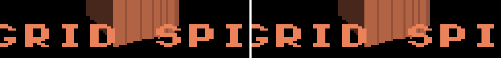
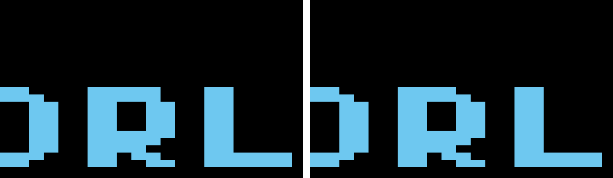
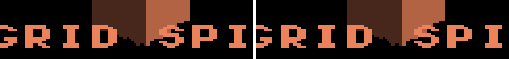
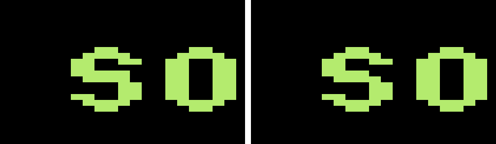

# IRCanvasStress `compare_yaw0` / `compare_yaw_q`: attributed to the #4730 font edit

Base `a6b9953c3` (origin/master at capture time), macOS Metal, `macos-debug`
(Debug). All captures used the manifest's compare argv,
`fleet-run --timeout 120 IRCanvasStress --auto-screenshot 120 --only compare`.
The gated rows are full frames 13 and 14 of 15 (`capture_offset -3`). Every
run exited `RESULT=CLEAN`.

## Mover and mechanism

**`e8a36d033` (#4730), "refine trixel font glyphs B, P, R, S, 0, 4, 5, 6, 9".**
The commit edits glyph bitmap data in
`engine/render/include/irreden/render/trixel_font.hpp` and nothing else. The
compare scene draws three labels with that font, in `kCompareColors`:
"GRID spin" (orange), "world Z-yaw" (blue) and "detached SO(3)" (green).
#4730 removes one trixel from three glyphs these labels use:

- **R** and **P**: the top row, `XXXXX.` → `XXXX..`.
- **S**: the fifth row (the middle stroke), `XXXXX.` → `XXXX..`.

The labels contain five such glyphs: "GRID SPIN" has R, S and P, "WORLD Z-YAW"
has R, and "DETACHED SO(3)" has S. One trixel at this zoom is a 4×2-px cell, so
the master frame loses five 4×2 cells of label colour per row. Each cell turns
background black, or shows the cube face behind the label. The old-to-black
step is the max Δ 240 that fails `max_delta 64`.

This is authored font data, drawn faithfully, so it is drift and not a
defect. The two `macos-debug` references are refreshed and the thresholds stay
unchanged.

The issue's bisect window could not find the mover. The #4721 broad run that
passed `compare` ran on head `fc533c25a`, and
`git merge-base --is-ancestor e8a36d033 fc533c25a` is false: that head forked
before #4730 landed. Both endpoints of the window (`b3fe5d2dd..469402034`)
already contain the mover.

## Causal control (revert arm), at base `a6b9953c3`

| Arm | Tree | `compare_yaw0` | `compare_yaw_q` | exe SHA-256 |
|---|---|---|---|---|
| A | base + #4730's glyph rows restored ([patch](patches/armA-restore-4730-glyph-rows.diff)) | `160ac611…` = pre-refresh reference | `ea2069eb…` = pre-refresh reference | `343c527b…` |
| B | base, unmodified | `a0030b98…` = refreshed reference | `a8fedc3f…` = refreshed reference | `0cba6ae5…` |

The arm A patch is
`git show e8a36d033 -- engine/render/include/irreden/render/trixel_font.hpp | git apply -R --reject`
on the base. The two digit-0 hunks reject because a later commit re-edited
that glyph, and no label contains a 0. With only the glyph rows changed, arm A
reproduces the committed references byte for byte. So #4730's rows are the
whole delta, and nothing else has moved these rows since the #4399 bless.

Arm B was captured after restoring `trixel_font.hpp` and rebuilding (4 objects
recompiled, exe hash changed from arm A's). A first base capture taken before
arm A, with exe `0eb66ecc…`, gave the same arm B frames. Full hashes are in
[`results.json`](results.json). Full frames: [`armA/`](armA/), [`armB/`](armB/).

Crops, upscaled 6×, with arm A (old glyphs) on the left and arm B (master) on
the right:

| Row | Crop |
|---|---|
| `compare_yaw0` "GRID SPIN" |  |
| `compare_yaw0` "WORLD Z-YAW" |  |
| `compare_yaw0` "DETACHED SO(3)" |  |
| `compare_yaw_q` "GRID SPIN" |  |
| `compare_yaw_q` "WORLD Z-YAW" |  |
| `compare_yaw_q` "DETACHED SO(3)" |  |

## Locality census (old reference vs refreshed reference)

`python3 docs/pr-screenshots/claude/4806-canvas-stress-compare-font-drift/tools/census.py <old> <new> …`
(stdlib only; it decodes the PNGs with `scripts/render-compare.py`):

```
compare_yaw0.png -> compare_yaw0.png  (2560x1440)
  changed px: 40
  old colour: {'blue': 8, 'green': 8, 'orange': 24}
  new colour: {'black': 36, 'other': 4}
  cells: 5  by old colour: {'blue': 1, 'green': 1, 'orange': 3}
    origin (1476,614) 4x2 px=8 old={'green': 8}
    origin (1092,666) 4x2 px=8 old={'blue': 8}
    origin (884,726) 4x2 px=8 old={'orange': 8}
    origin (1044,726) 4x2 px=8 old={'orange': 8}
    origin (1012,734) 4x2 px=8 old={'orange': 8}
compare_yaw_q.png -> compare_yaw_q.png  (2560x1440)
  changed px: 40
  old colour: {'blue': 8, 'green': 8, 'orange': 24}
  new colour: {'black': 40}
  cells: 5  by old colour: {'blue': 1, 'green': 1, 'orange': 3}
    origin (1236,618) 4x2 px=8 old={'green': 8}
    origin (1004,726) 4x2 px=8 old={'blue': 8}
    origin (940,842) 4x2 px=8 old={'orange': 8}
    origin (1100,842) 4x2 px=8 old={'orange': 8}
    origin (1068,850) 4x2 px=8 old={'orange': 8}
```

The 4 `other` px in `compare_yaw0` are the "GRID SPIN" S cell, where the cube
face behind the label shows through.

## Positive fire (the gate still separates the two glyph sets)

`python3 scripts/render-compare.py armA/<row>.png <refreshed reference> --per-pixel-tol 8`:

```
compare_yaw0   FAIL  match=99.9992%  max_delta=240  psnr=54.63dB   reason: max_delta 240 > 64
compare_yaw_q  FAIL  match=99.9992%  max_delta=240  psnr=54.25dB   reason: max_delta 240 > 64
```

## Other backends

The `windows-debug` compare references were blessed on 2026-10-17 (#4515),
before #4730 landed. They are half resolution (1280×720). All 10 Windows pixels
that map onto the 40 changed cells are still label-coloured, so the Windows
references carry the old glyphs and need a Windows-host refresh. That is filed
as #4825. `linux-debug` has no compare references.

## render-verify at the PR head

`python3 scripts/render-verify.py --target IRCanvasStress --no-build` on
`macos-debug` reports `[render-verify] all 59 checks PASS`, with
`compare:compare_yaw0` and `compare:compare_yaw_q` at 100.0 / 0 / inf.
Full log: [`head-render-verify.log.gz`](head-render-verify.log.gz).
