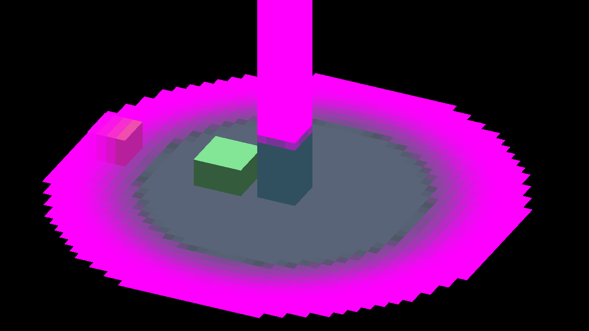
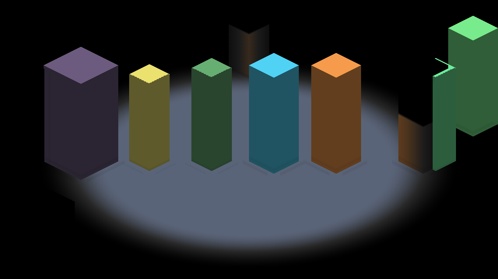
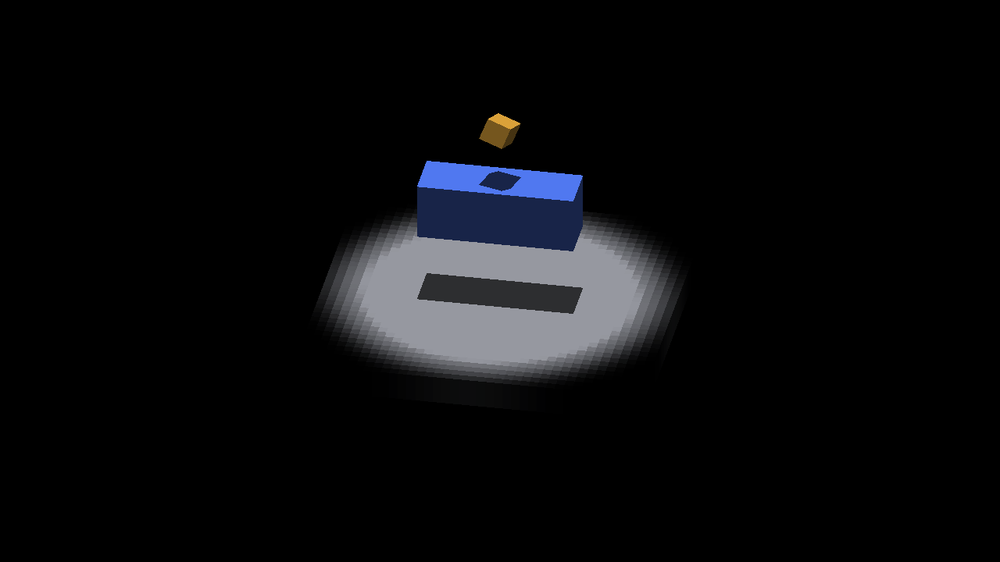

# Fog-composing surface lighting on Windows/OpenGL

The fog-composing GLSL twins that `IR_PERAXIS_SURFACE_LIGHTING=1` admits on a
`FOG_TO_TRIXEL` pipeline have only run on Metal so far
([fog-surface-receiving](../4757-fog-surface-receiving/README.md)). The twins are
the cardinal `lit_voxels_fog` program, the per-axis `surface_lighting_fog`,
`visible_lighting_fog` and `query_stats_fog` programs, the sampler-read fog
variants, and the flat `vFogCarrier` varying. This directory is the Windows/OpenGL
run of the same witnesses and oracle, on master `a6b9953c3`.

Host, driver and binary hashes are in [artifacts.txt](artifacts.txt): NVIDIA
RTX 3060 Ti, driver 581.80, `windows-debug`. No code changed.

## Route witnesses (IRFogDemo)

`IR_PERAXIS_SURFACE_LIGHTING=<0|1> fleet-run --timeout 900 IRFogDemo <case> --auto-screenshot 30`,
driven by [fogdemo.py](drivers/fogdemo.py.txt). [fogdemo/summary.json](fogdemo/summary.json)
holds the routes, results, frame hashes and the off/on pixel census. Every run's
full log is in `fogdemo/<case>-surface<0|1>/run.log`.

All 16 runs report `RESULT=CLEAN`, and no log has a `[critical]` or `[error]`
line. A GLSL compile or link failure is `IRE_LOG_FATAL` plus an assert in
`opengl_shader.cpp`, so it cannot end CLEAN. Each case logs the same opt-in
route as Metal and takes the same number of shots.

| Case | Opt-in route (GL = Metal) | Off/on changed px, GL (1280×720) | Metal (2560×1440) |
|---|---|---|---|
| default | cardinal compose | 0 (3 shots) | 0 |
| body `--entity-reveal-soft-edge` | cardinal compose | 1,828: 1,530 by ≤ 2 LSB, max Δ72 | 10,256: 9,056 by 1–2 LSB, max Δ72 |
| zcost `--edge-zcost` | cardinal compose | 0 | 0 |
| moving `--moving-observer` | cardinal compose | 0 | 0 |
| ceiling `--ceiling-treatment --reveal-treatment` | cardinal, then per-axis compose | 0; 255 px by exactly 1 LSB | 0; 0 |
| overflow `--peraxis-overflow` | cardinal, then per-axis compose | 1,250, max Δ72 | 4,992, max Δ72 |
| los `--occlusion=high-ground --los-softness=1` | **fallback** `fog=fallback fogComposed=0` | 0 | 0 |
| memory `--explored-decay` | **fallback** (canvas-readback probe stays on compute) | 0 | 0 |

The GL counts are at 1×, so they cover about a quarter of Metal's 2× pixels for
the same area. Overflow shows the same pillar-base band as Metal. Body shows the
same LSB-level body difference plus contact-edge pixels. The extra ceiling shot
differs by 1 LSB only. That is the quantization class the Metal README records:
compute fog transforms the rgba8 lit colour, while the composite transforms the
unquantized fragment colour.

| Overflow, opt-in on (GL) | Body, opt-in on (GL) |
|---|---|
|  |  |

## Receiver-shadow polygon oracle (IRCanvasStress)

The drivers are [cap.py](drivers/cap.py.txt), [matrix.py](drivers/matrix.py.txt) and
[matrix_defs.py](drivers/matrix_defs.py.txt). They use the Metal capture argv
unchanged (`--fog-reveal 16`, the `shadowbox,floor` fixture, the same offscreen config),
across the 18 recorded placements and the default, `--sun-ambient 0.15`,
`--sun-ambient 0.55` and local-light (with lit and dark references) palettes.
[grade.py](drivers/grade.py.txt) runs `scripts/render_receiver_shadow_polygon.py`
unchanged and compares each count dictionary with the Metal `results.json` rows.
[audit.py](drivers/audit.py.txt) checks that every capture has exactly one frame,
the recorded hash, a `SURFACE-ROUTE` line in its log, and `RESULT=CLEAN`.
[polygon/results.json](polygon/results.json) records every command, route, probe
line, frame hash, count and Metal comparison.

All 116 captures are `RESULT=CLEAN`: 84 matrix frames (64 graded, 20 route-only) plus
32 local-light references.
Every opt-in capture logs `fog=compose fogComposed=1`. Every opt-out capture logs
`fog=fallback fogComposed=0`.

### What this host can grade

The oracle is fixed to Metal's 2560×1440 retina frame. On GL the same
1280×720 config produces a 1280×720 frame. A 2560×1440 window is not possible
here: Windows caps the window at 1460 rows (`SM_CYMAXTRACK`), which leaves a
1421-row client area, and the offscreen target takes the window's framebuffer
size.

`grade.py` therefore upscales each frame 2× by nearest neighbour. This is exact
only where the camera's screen residual is zero, at the eight origin placements.
At the other ten placements (`near`, `mid`, `subpos`, `subneg`) the residual
puts edges on odd 2× pixels that a 1× frame cannot express. Those placements are
route witnesses only, recorded as `"graded": false`. The fallback arms below
reproduce Metal's failing counts exactly, which checks that the upscale maps
every receiver sample correctly.

| Palette (origin, 8 yaws) | Opt-in on, fog composed | Opt-in off, fog fallback (control) | Count dictionaries equal to Metal |
|---|---|---|---|
| default (ambient 0.30) | **8/8 pass, 0/0/0** | 60/52, 64/59 cardinal; 18/638, 32/650 at +0.6 | 16/16 |
| ambient 0.15 | **8/8 pass, 0/0/0** | same counts | 16/16 |
| ambient 0.55 | **8/8 pass, 0/0/0** | same counts | 16/16 |
| local light (8,0,−20), lit/dark references | **8/8 pass, 0/0/0**, 0 invalid reference samples | same counts | 8/16; the other 8 differ only in `local_light` |

Counts are missing / excess / unknown. Every case has at least 24,792 eligible
samples. `eligible`, `valid`, `inside`, `outside`, `boundary`, `missing`, `excess`
and `unknown` equal the Metal values in all 64 graded rows.

`local_light` counts the receiver samples whose dark reference differs from the
analytic shadow colour. That is a positive witness that the local light reached
the receiver. At the four +0.6 yaws GL matches Metal exactly. At the four cardinal
yaws the GL count is 24–72 lower (yaw 0: 24,900 against 24,924), identically
in the opt-in on and off arms. GL rounds the local term to zero on a few more
samples there. The minimum, 24,462, equals Metal's, and every reference pair
passes the oracle's sun-term contract.

| Retained (`polygon/retained/`) | Arm |
|---|---|
| `default/origin-yaw0-fog16-surface{1,0}` | cardinal compose (pass) / fallback (60/52) |
| `default/origin-yaw0.6-fog16-surface{1,0}` | per-axis compose (pass) / fallback (18/638) |
| `ambient0.15/origin-yaw0-fog16-surface0`, `ambient0.55/origin-yaw0-fog16-surface1` | the Metal retained pair |
| `local/origin-yaw0-fog16-surface0`, `local/origin-yaw0.6-fog16-surface1` | with `lit.png` / `dark.png` references |

Each retained case keeps its frame, `run.log`, `config.lua` and `capture.json`.
A regrade needs the 2× upscale in `grade.py`. Pillow was not installed on this host,
so the grade used a stdlib PNG reader ([pil_image_shim.py](drivers/pil_image_shim.py.txt),
built on `scripts/render-compare.py`'s `read_png`). Before grading anything, it
regraded the four committed Metal retained frames and reproduced their
`results.json` counts exactly.

## Engine tests

`fleet-run IrredenEngineTest --gtest_filter='Fog*:SurfaceFogRoute.*:PerAxisSurfaceLighting*'`
→ `[  PASSED  ] 235 tests.` ([engine-test.log](engine-test.log), the gtest lines).

## Not covered here

- The 10 non-origin placements are route witnesses only (see above). They need a
  2560×1440 GL framebuffer, which needs either an engine change to size the
  offscreen target independently of the window (#4852), or a GL host with a
  taller desktop.
- Fog-free arms (`--fog-reveal 0`) were not rerun. They exercise no fog twin, and
  the criterion asks only for the fog-composed and fallback arms.
