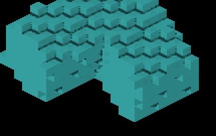
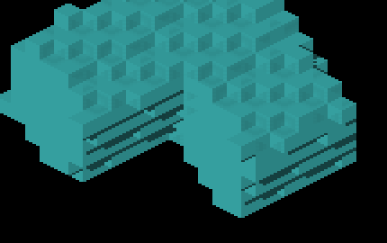

# Legitimate stepped occlusion

The settled GRID impulse fixture shows new thin dark lines after exact surface
sampling. This is not enough to classify them as a rendering defect. An
independent inverse-rotated occupancy model and world-space ray/slab oracle
explain the sampled line and its adjacent lit micro-rows.

At framebuffer pixel (838,591), the surface point is
`(10.5,-17.125,-11.375)` on cell `(11,-17,-11)`'s -X face. The ray toward
normalized `(-.42,-.60,-.55)` enters occupied cell `(10,-18,-13)` at
`t=1.873462179`. It intersects the exposed -X face of `(10,-19,-13)` at
separation `2.180749627`. The adjacent three micro-rows are unblocked.
The shadowed native pixel changes `(43,130,130)` to `(21,63,63)`; the three
adjacent lit pixels stay `(43,130,130)`.

Moving the receiver outward by half a voxel misses this real occluder. That
control isolates the displacement; it is not an emulation of every old
raster-recovery operation. The executed production emitter/reconstruction/finite
face-query test agrees on both trixel halves and both backends. Mutations that
restore the half-voxel offset, replace microface centers with a whole-face center,
or remove finite face bounds are rejected.

Native shader counterfactuals corroborate the query route: forcing a complete
all-face reference, disabling nearest-tap fallback, or disabling the PCF layer
leaves this frame RGB-identical. Disabling exact face queries removes the lines;
shadows-off does too. The controls temporarily changed staged shader assets and
restored them afterward; they are not shipped rendering options. The large
all-face scan is diagnostic only, not a proposed performance solution.

| Prior receiver | Exact receiver | Exact queries disabled | Shadows disabled |
|---|---|---|---|
|  |  |  |  |

These are unscaled native crops of `(500,430,930,700)`. The witness proves this
specific stepped occlusion, not all staircase bands or every retained normal.
The deterministic regression is `scripts/tests/test_render_impulse_shadow.py`.
