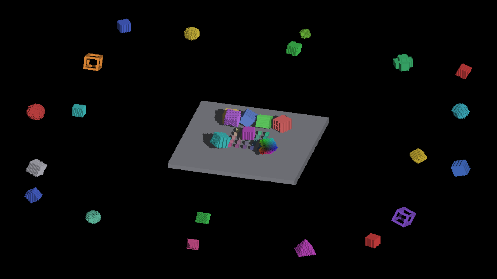
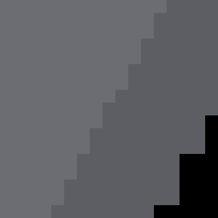
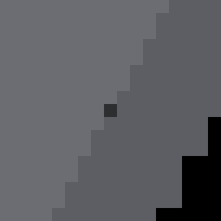

# Cardinal receiver reconciliation

Retain the producer-connected microface-center receiver from #4363, including
positive voxel provenance, the separate `NONE` reconstruction, and cascade depth
in world units. Import #4362's moving-caster fixture. Do not import its ray-plane
reconstruction or global `1e-4` face-edge tolerance.

This directory records the comparison behind that choice. It is not a new
throughput measurement or a Windows smoke run of the combined stack.

## Pinned inputs and replay

| Implementation | Immutable commit |
|---|---|
| #4363, microface center | `0e89e931c54ff4572300f2448ac25666e00e6e98` |
| #4362, view-ray plane and tolerance | `fef7e27fd6cf6f1b8ff1abf416d077dd62d218e5` |

From the repository root, with both commits available locally:

```sh
python3 docs/pr-screenshots/codex/4362-reconciliation/comparison_proof.py --repo . --output /tmp/cardinal-reconciliation
python3 docs/pr-screenshots/codex/4362-reconciliation/windows_reference_diff.py --repo . --output /tmp/cardinal-reconciliation-windows
```

The first command needs Python and a C++17 compiler named `c++`. It extracts the
pinned GLSL and Metal functions into scalar CPU adapters and compiles only those
adapters. The second needs Pillow and reads committed PNGs; it launches no
renderer. Generated source, binaries, and full replay output stay in `/tmp`.
Both commands were replayed successfully on macOS with Apple Clang. Ruff check
and format checks pass for the two scripts.

## Reconstruction results

[comparison-results.json](comparison-results.json) contains matching results for
both shader twins. Each executes 301,104 actual producer publications: all four
cardinals, six signed faces, both published halves, dual-polarity emission,
densities 1/2/4/8/16, integer and fractional positions, even/odd canvases, and
three frame offsets. Independent cube vertices define the expected center.

| Mode | Publications per backend | #4362 wrong face plane | #4362 outside own micro-square | Different from center |
|---|---:|---:|---:|---:|
| `NONE` | 4,320 | 2,160 | 1,440 | 4,320 |
| Subdivided | 296,784 | 0 | 98,928 | 296,784 |

The tested #4363 centers all match the independent vertices. For an origin voxel
at density 1, its negative-X center is `(-0.5, 0, 0)`. #4362 instead returns
`(-0.5, 0.5, 0.5)` and `(-0.5, 0.5, 1)` for the two halves; the latter is outside
the voxel face. In `NONE`, the positive-X center must be `(0.5, 0, 0)`, but #4362
still reconstructs `x = -0.5`. Subdivided polarity is already encoded in the
emitted plane, whereas `NONE` requires its explicit signed-face offset.

These are producer-to-receiver math checks, not GPU coverage or ownership
emulation. The existing cardinal-receiver regression already checks the center
contract and rejects its geometry/provenance mutations; this pinned comparison
is retained as evidence rather than another copy of that CI test.

## Why the fixed edge tolerance is excluded

The replay executes both pinned `sourceFaceRaySeparation` implementations.
An identity projected basis accepts `u = 1.00004995` with #4362's tolerance,
although that value is 419 float32 ULPs beyond the closed face. The strict query
rejects the corresponding outside points. This is finite-footprint expansion,
not solely a correction for one rounding operation.

The index still uses the unexpanded four-corner projected AABB. With unit tile
width and `corner.x = 1.00002503`, the face's first tile is 1. A query at
`x = 0.999975026` lies in tile 0, yet the expanded primitive accepts it. Translate
the same outside relationship to `corner.x = 1.5` and both occupy tile 1. The
script executes the primitive; its tile calculation is an independent scalar
evaluation of the index's `floor` bound, not a simulated GPU index dispatch.

A future shared-edge correction needs a reproduced geometric crack. A derived
floating-point error bound can identify uncertain edge predicates; accepting
the whole uncertainty band still expands external faces and would require
matching index bounds. Prefer a more accurate predicate for uncertain signs,
and verify that neighboring producer records agree on their shared endpoints.
No such correction is established by this reconciliation.

## What the Windows pixels actually show

[windows-reference-diff.json](windows-reference-diff.json) compares the original
#4362 Windows references to that commit's parent. Coordinates are original
1280×720 image pixels. Each record includes the exact before/after RGB values
and a before-image 5×5 neighborhood color histogram (`[count, RGB]`).

| Shot | Changed pixels |
|---|---:|
| `revoxelize_solids` | 7 |
| `so3_grid_cross` | 8 |
| `so3_offsnap_disc` | 6 |
| `so3_offsnap_wide` | 7 |
| `so3_smooth_sweep` | 7 |
| `so3_wide_parity` | 7 |

The seven `revoxelize_solids` changes are isolated dark additions on a lit floor
rim. For example, `(814, 361)` changes from `(93, 94, 99)` to `(45, 46, 48)`;
its entire before-image 5×5 neighborhood is lit top/side color. The other six
coordinates are `(799,389)`, `(784,417)`, `(493,431)`, `(590,444)`, `(605,446)`,
and `(702,459)`. These images do not support describing those seven changes as
lit pinholes repaired inside a cast shadow.

| Original Windows reference before | Original Windows reference after |
|---|---|
|  |  |

| Pixel `(814,361)`, before | Pixel `(814,361)`, after |
|---|---|
|  |  |

The crops are 17×17 source pixels enlarged 16× with nearest-neighbor sampling.
Two red-object edge pixels in `so3_offsnap_wide` plausibly repair lit gaps; other
object changes remain ambiguous. Images alone do not establish their geometry
or identify the responsible candidate record. The original PR attributes these
non-cardinal changes to tolerance; this directory does not contain a fresh
Windows epsilon-only render control.

## Imported native fixture

The consolidated demo retains `IRShapeDebug --moving-caster`: nine captures at
zoom 2 with the caster translated by a quarter voxel per shot. Parent-run Metal
references live in
[`shape_debug/test/references/macos-debug`](../../../../creations/demos/shape_debug/test/references/macos-debug),
from [`moving_caster_0.png`](../../../../creations/demos/shape_debug/test/references/macos-debug/moving_caster_0.png)
through [`moving_caster_8.png`](../../../../creations/demos/shape_debug/test/references/macos-debug/moving_caster_8.png).
They extend native moving-caster coverage. This evidence review does not treat
them as an independent exact shadow oracle or infer determinism from one set of
images. Combined-stack native validation and cross-host status belong to the
parent validation report.
