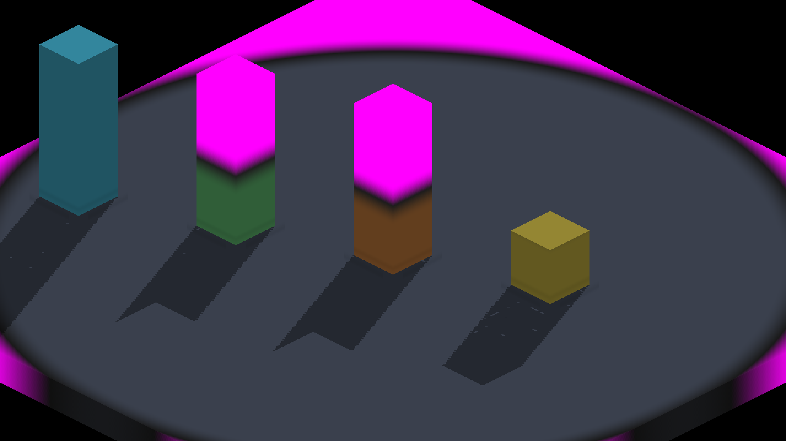
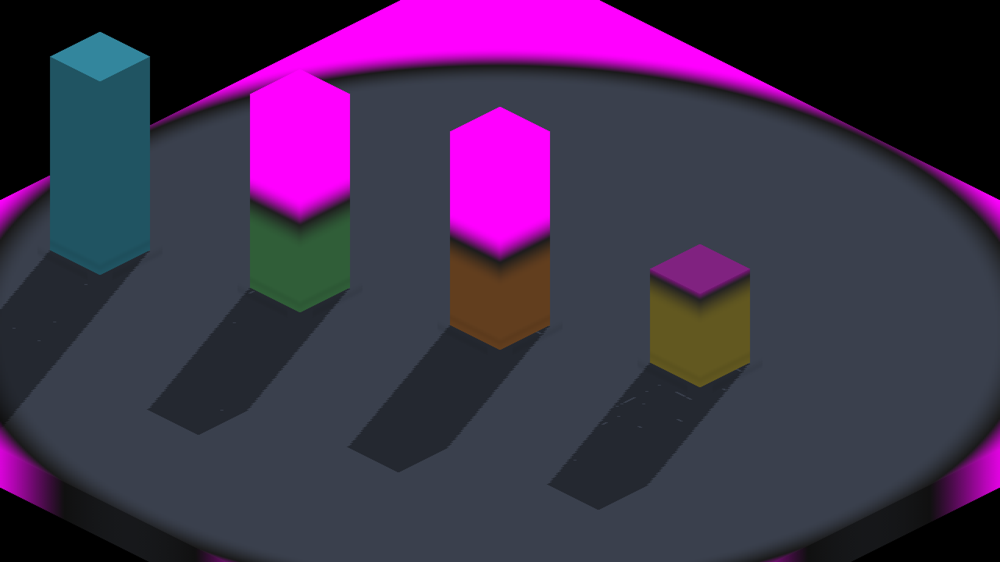
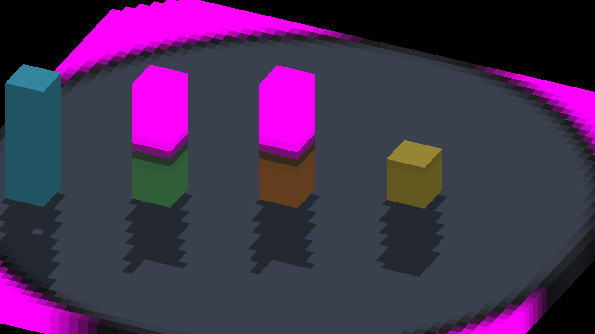
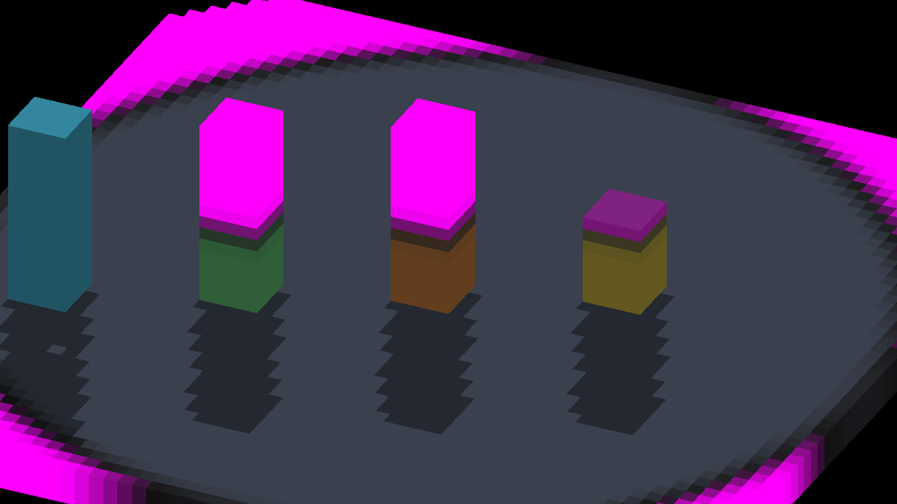

# Fog-cut voxel boundary repair

The final integration sweep exposed a bad ceiling-shadow control. At the
fixture's density-one cardinal probe, the original tall column snaps to centers
`z=-11..4`; the inclusive ceiling midpoint retains eight layers, `z=-3..4`.
The old six-layer control could appear to agree because the bake discarded the
upper voxels without exposing the new top boundary of the retained solid.

The finite voxel bake now admits an originally hidden face when the same FIELD
ceiling predicate rejects its signed, rotated neighboring voxel center. Existing
exposed faces, BODY casters, and disabled ceilings retain their paths. No new
buffer, dispatch, receiver bias, or filtering is introduced. Neighbor evaluation
is restricted to hidden FIELD faces under an enabled ceiling. This repairs the
current midpoint policy; it does not implement the future retained-set and
animation policy tracked by #4305 / #4381, or analytic FIELD cut caps.

## Geometry and negative controls

The fixture uses integral lane translations and an eight-layer authored control.
Its probe requires exact translated retained-voxel occupancy agreement, measures
actual top-floor microface centers, and checks shadow witnesses whose rays hit
the interior of the new cut cap. The existing reach threshold is unchanged.

Native Metal results:

- Corrected cap: all 16 cap witnesses in each voxel FIELD/control lane are
  shadowed; centre/rim reach `17.460`, control `17.079`, BODY `20.996`,
  sun texel `0.463`. The run exits 0 with `RESULT=CLEAN`.
- Disable the new cap in the staged Metal shader: the cap-interior assertion
  rejects the run. This is an intentional negative control, not a successful
  capture.
- Restore the six-layer control in the demo: the occupancy assertion rejects
  the run before the footprint comparison. Source and staged shaders are then
  restored and rebuilt.

`scripts/tests/test_render_fog_cut_voxel_faces.py` executes extracted production
GLSL/Metal eligibility and face emission against an independent retained-cell
ray/slab union: 19,740 rays per backend, including yaw and tilt, BODY and disabled
ceilings, and a second covering source. Missing-cap, reversed-neighbor, and
missing-BODY-guard mutations fail.

## Captures

Both columns in the middle have unchanged authored geometry and fog settings.
Before uses the old six-layer control at right; after uses eight layers. Both
use the same integral lane positions. The control's geometry change is deliberate;
the disappearance of the notches in the middle columns' floor shadows is the
cut-boundary repair.

| View | Missing cap / six-layer control | Correct cap / eight-layer control |
|---|---|---|
| Cardinal |  |  |
| Yaw 0.35 |  |  |

Commands: `fleet-build --target IRFogDemo -j4`, then
`fleet-run IRFogDemo --ceiling-shadow --auto-screenshot 10`.
These images were captured from the final shader/fixture implementation on top
of `756130b472c075c8914633461e1f2c8ec014a32a`; subsequent formatting and probe-log
ordering do not affect rendering. Backend-specific references are refreshed only
after inspection. Windows presentation of the combined changes remains unverified.
