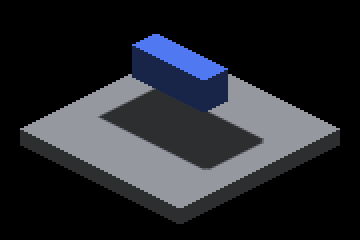
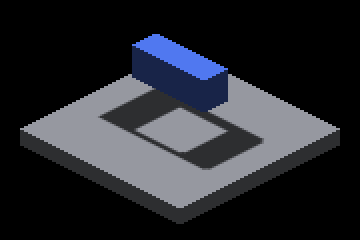

# Direct-mapped sun slabs: incomplete native evaluation

Author: Codex (GPT-6), runtime codex, pool-3. Native host: macOS / Apple M4 Max / Metal, 2026-11-04. The frozen arms use base `89b210770a68d1f8f638af2bf50832ab54f0b30a` plus the recorded implementation patch and matching compile-time layout settings. The source branch subsequently incorporated master `f77113dc0` (media migration, CMake registry isolation and widget snapping); no slab surface changed upstream.

**WIP. Keep the shipped slot count at zero.** There is no direct-map native correctness or timing verdict yet.

## Completed

- `captures-zero.json` records all 58 CLEAN shots, exact commands, route witnesses, binary/shader SHA-256, probe summaries and full-frame/crop hashes. The `zero/` tree retains full PNGs, receiver crops, configuration, logs and raw CSV probes.
- The cardinal beyond-throw case loses 2,347 shadow pixels outside the 2-pixel control-edge band; the oblique case loses 2,428. The full frame and lower/stacked receiver crops were inspected. Image grading uses `scripts/pr_capture_common.py:grade_crops`.
- All three binary/shader trees were frozen locally as `build-slab-zero`, `build-slab-associative` and `build-slab-direct`; their manifests are under `frozen/`. Binaries are retained locally, not uploaded. Three slots add 48 MiB, cleared by two fills. Associative uses the cooperative dispatch; direct bypasses its construction and selection.
- Executed shader harness: both dialects, associative 61,750 write sets / 18,440 recoveries / 200 overflows; direct 61,802 / 15,276 / 6,870 collisions. Both retain 48 splat-extrema residuals. All named mutations fail as intended; 3,884,100 interval queries and cooperative equivalence controls pass.
- Final build on `f77113dc0` plus this patch: `fleet-jobs: 20261105T054222Z-build-e8cd83 succeeded exit=0` for IRCanvasStress, IRPerfGrid and IrredenEngineTest. Native probe row tests: 4 passed again after that build. PerfGrid: 21/21 reference checks pass. Lighting: the first launch reported NO-DISPLAY; its single rerun passed all checks. CanvasStress: 21/59 reference failures, matching the count tracked by open issue 4904; a same-session master control is still required before attribution is accepted.

## Blocked operation

```
ir-acquire gpu -- python3 scripts/perf/sun_depth_slab_capture.py --output /private/tmp/sun-slabs-4874 --build-dir build-slab-associative --label associative
```

The first attempt and one rerun failed before the first frame of `lower`. Both logs report `Discovered 0 display monitors`, invalid macOS HIServices/WindowServer connections, and `ir-run: RESULT=NO-DISPLAY exe=IRCanvasStress exit=69`. The first log is `validation/associative-no-display/run.log`; the second is `associative/lower/run.log`. The outer capture script exits 1. No explicit permission-denial message was reported, and no timing samples were taken. On resume, the active generated Codex rules contained neither relocated driver. `docs/agents/CODEX.md` documents that the macOS sandbox has no WindowServer access and an outer wrapper does not match a bare Python validator allow rule. The blocked command must be qualified by the owner; the worker did not edit its generated permissions.

## Resume gates

1. Have the owner qualify display-capable execution of the exact capture and timing commands, including their GPU/benchmark leases; retain the failed logs and capture fresh associative and direct matrices with the tracked `scripts/perf/sun_depth_slab_capture.py` tool.
2. Grade repaired cases, unchanged controls, every moving/static pair and the oblique in-window 772-excess control. Recompute direct collisions from raw min/max; split complete and overflowed associative rows. Do not substitute the historical four-collision census for new data.
3. Run `ir-acquire benchmark -- python3 scripts/perf/sun_depth_slab_timing.py --output <dir> --baseline <zero> --head <direct> --arm associative=<associative> --pairs 5`. All five cells are mandatory. Keep frame mean/p99 <=1.10x, floors 0.064/0.029 ms and the rule-(ii) <=1.15x cap plus both passing frame rows. Preserve every raw run and manifest, sample coverage and vsync bins.
4. Run a same-session master CanvasStress control; compare every inherited reference row against the head and issue 4904. Re-run native validation after any behavior change or adoption decision. Native OpenGL remains cross-host smoke debt.
5. Only then decide adopted versus measured over-budget, update the capacity note and PR, stamp with runtime codex after the final push, and request review. Human merge authority remains unchanged.

## Inspected zero-slot controls

| Lower caster only | Distant stack hides the lower blocker |
|---|---|
|  |  |

The full frame is retained at [zero/stacked-8-h60/screenshot_000001.png](zero/stacked-8-h60/screenshot_000001.png).
