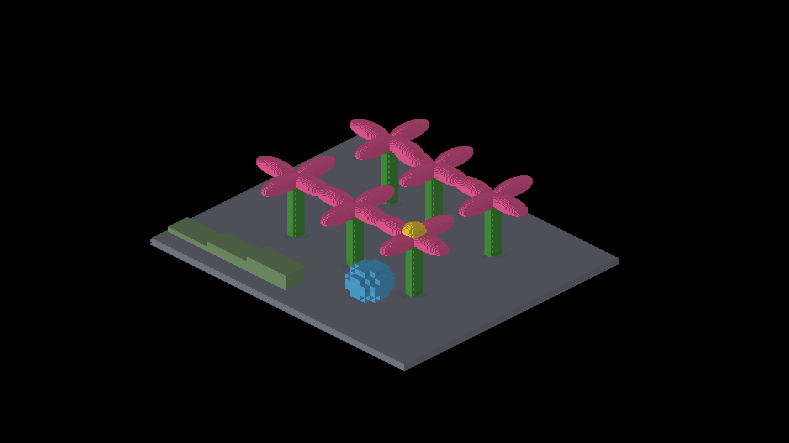
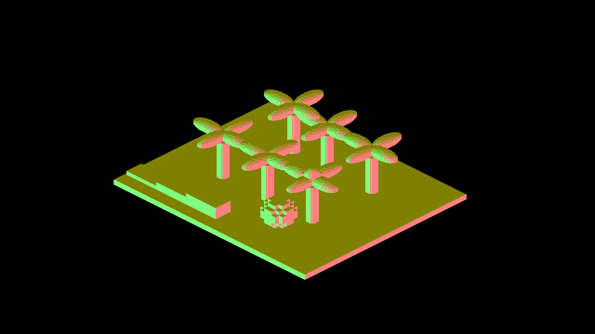

# Filled DENSE sphere: finite-face proof

The yaw180 blue sphere's coverage and face-normal ownership match its discrete
voxel geometry. Independent rays through its 136 occupied unit cubes predict
every visible material pixel and normal. Paired native Metal
captures have **zero missing, extra, or wrong-normal pixels** across a padded
41,800-output-pixel region; the object occupies 17,664 pixels.

| Material, sun shadows disabled | World normals |
| --- | --- |
|  |  |

The captures use the same binary, revision, six camera poses and resolution;
`paired-provenance.json` records their equality. Both six-shot runs exited CLEAN.
Only the yaw180 PNGs are retained here; their manifests/logs cover all six shots.
The independently repeated beauty run also passes its four incompatible-option
controls and exact first/restored-frame check. All six beauty images are
byte-identical to the existing references after integrating master `9d9cecc3f`.
The [full integrated regression](integration-regression.txt) passes all 62
ShapeDebug checks without further reference or tolerance changes.
This is correctness evidence, not a frame-time measurement or Windows smoke.
Local account/worktree paths in text evidence are normalized; the export
inventory preserves original and exported file hashes. PNGs are unmodified.

## Geometry and sampling contract

The authored fine variant retains centers from `{-2.5,-1.5,-0.5,0.5,1.5,2.5}³`
whose squared radius is at most 9. At shot 3 its parent translation is
`(13,18,-3.5)`; cardinal yaw180 maps centers to `(-world.x,-world.y,world.z)`.
The nearest entering view faces map to world `+X`, `+Y`, and `-Z`. A smooth
sphere normal would be incorrect for this occupied-cell representation.

At zoom4/density4 the cardinal rectangular gather has a `(2,1)` game-pixel
pitch. The six face offsets and Z1 origin `(-1,-1)` publish representative
rows Z=`(-1,-1),(0,-1)`, X=`(0,0),(0,1)`, Y=`(-1,0),(-1,1)`.
These rows select rays at game `(x+0.5,y)`. This comes from the producer/gather
contract, not tuning against an image. Continuous triangle rasterization uses
different sample centers; substituting it here changes boundary ownership.
The uniform half-cell center/low-corner displacement lies along `(1,1,1)` and
cancels under isometric projection.

The validator uses `render_revox_lattice.camera_face_hits`: independent box
slabs select the nearest finite face, without production depth packing,
triangle parity or draw ordering. Material coverage is checked separately
because a missing top face can expose a floor with exactly the same normal.
The fixed blue-color classifier is valid only for this fixture with sun shadows disabled.
AO and ordinary face lighting remain enabled; passing does not certify their
intensity, analytic petals, other poses, or ground-shadow coverage.

## Repeat and failure controls

Capture `IRShapeDebug --lod-scene --pivot-origin --auto-screenshot 20` twice,
adding `--debug-overlay normals` for one run and `--no-shadows` for the other.
Use `fleet-run` and preserve the full logs. Select the fourth full-frame image
from each run (`lod_scene_return_yaw180`), after verifying identical binary,
camera witnesses and render configuration except for the diagnostic flags.

```bash
python3 scripts/render-lod-dense-face-metric.py --normals <normals.png> --material <no-shadow.png>
python3 scripts/tests/test_render_lod_dense_face_metric.py
```

Ten tests exercise the native pair, integer output scales, exact face colors, single-channel
corruption, a missing top face with unchanged floor normal, an extra material
pixel, swapped axes, shifted rows, invalid dimensions and PNG CLI exit status.
The native paired image comparison is manual; CI tests the validator. A changed
authored pose or material requires revisiting this bounded fixture contract,
not widening tolerances.
