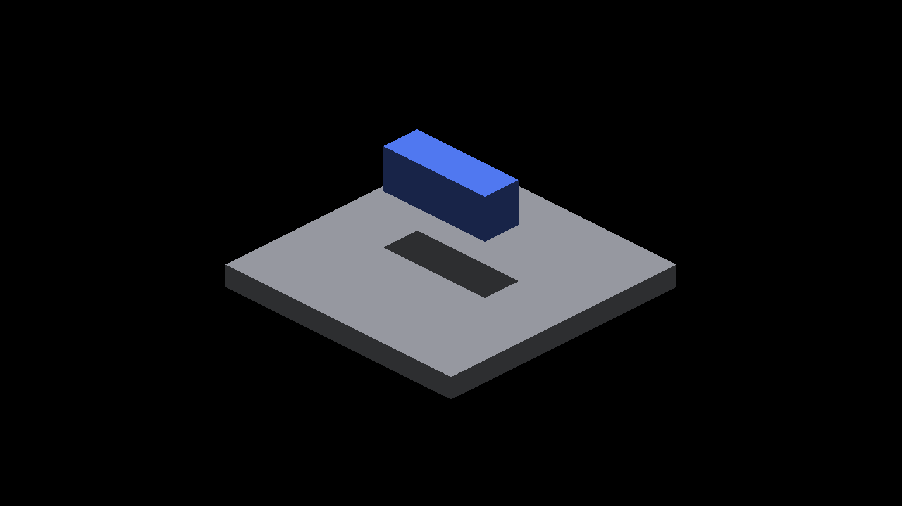
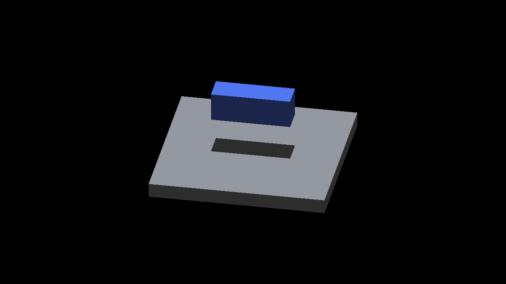

# Surface-lighting profiling subjects

Native Metal, 2560×1440 framebuffer, 2026-10-19. These are two views of the
same fixture, not before/after images. They document the geometry exercised by
the new timing rows. The shadow algorithm and geometry are unchanged by the
profiling and predicate cleanup in this slice.

| Cardinal yaw | Continuous yaw, 0.6 radians |
|---|---|
|  |  |

The lower source box casts onto a GRID floor. Eight coincident upper casters
are above the view and outside the floor's finite shadow throw. Both views use
zoom 4, subdivision 1, downward light, no AO, and frozen camera/object motion.
The floor shadow remains a bounded solid footprint. This does not certify
all caster/receiver combinations or the known failing sixteen-caster case.

The PNGs are unmodified native captures. [captures.json](captures.json) records
the exact commands, runtime hashes and original paths. Both runs exited CLEAN.
They preceded the capture-free exit mode; screenshot readback contaminated
their frame tails and the outer matrix reported a quiet-window breach. Their
timings are therefore not benchmark evidence. Subsequent profiling uses
`--profile-frames` without captures; see the
[profiling driver](../../../../scripts/perf/README.md#surface-lighting-scene-controls).
