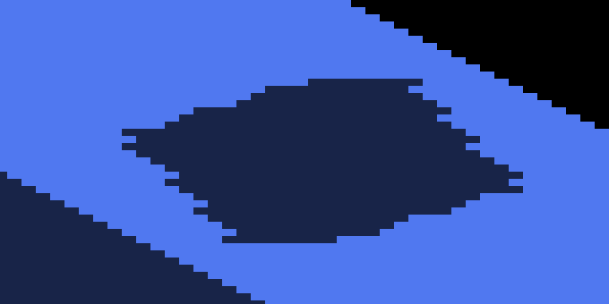
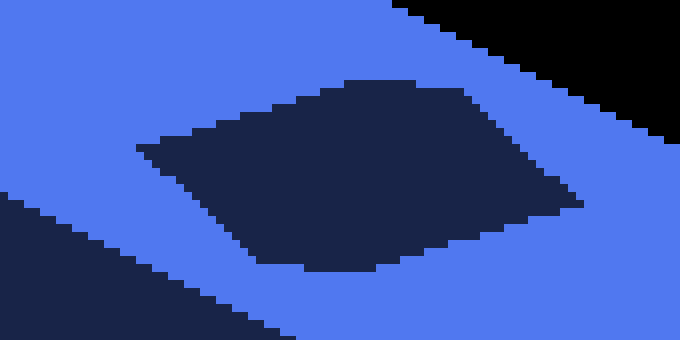

# Cardinal surface shadow evidence

Native macOS/Metal, IRCanvasStress, 2560×1440 framebuffer, 2026-10-18.
Before is parent `892522392a186cfd88ee39e16bdf134b7d265e30`; after is the
implementation shipped with these images. Both captures exited `RESULT=CLEAN`.
The final profiled yaw-zero capture is pixel-identical to the initial after run.

| Before | After |
|---|---|
|  |  |

The detail images are nearest-neighbor 4× crops of `(1190,420)..(1360,505)`
from [before.png](before.png) and [after.png](after.png). No filtering or
retouching was applied. The shadow edges now follow the continuous receiver
plane instead of repeating each finite microface-center sample over rectangular
storage texels. Screen-pixel stair steps remain visible at this magnification.

## Reproduction

Build with `fleet-build --target IRCanvasStress --parallel 2`, then run:

```sh
fleet-run --timeout 180 IRCanvasStress --only shadowbox,floor --probe-grid --probe-floor-mode grid --probe-floor-span 40 --sun-direction 0 0 -1 --no-spin --no-auto-rotate --pivot-origin --yaw 0 --zoom 4 --subdivisions 1 --no-ao --auto-screenshot 10 --sweep-frames 1 10 --sun-face-index-probe --probe-overlapping-source
```

Use an offscreen config preset with a unique `screenshot_output_dir`. The
profiled matrix uses 60-frame screenshot warmup, `--sweep-frames 1 60`,
`--auto-profile`, and `profiling_enabled=true,gpu_stage_timing=true` in that
preset. Acquire `ir-acquire benchmark` around the sequence; the run wrapper
handles the nested GPU lease. Exact per-case arguments and clean-result markers
are retained in [matrix.json](matrix.json). `<output>` denotes that run's
chosen artifact directory. Each case retains its image and native profile.

| Case | Receiver / view | Native result |
|---|---|---|
| grid-q0..q3 | GRID floor, yaw 0/90/180/270°, zoom 4 | 4 CLEAN |
| grid-near-cardinal | GRID floor, yaw .01 radians, zoom 4 | CLEAN |
| grid-yaw | GRID floor, yaw .6 radians, zoom 4 | CLEAN |
| grid-zoom1 | GRID floor, yaw 0, zoom 1 | CLEAN |
| floor-source | Rigid source floor, yaw 0, zoom 4 | CLEAN |
| floor-sdf | SDF floor, yaw 0, zoom 4 | CLEAN |
| floor-revoxelized | Revoxelized floor, yaw 0, zoom 4 | CLEAN |
| unlit | GRID floor, unlit overlay, yaw 0, zoom 4 | CLEAN |

These are static poses, not a temporal continuity proof. Floor representation
changes do not change the blue receiver's GRID mode. This matrix checks the
mixed routes, not every caster/receiver combination. The near-cardinal route
still has its own caster rasterization; this change does not standardize caster
occupancy across route transitions.

## Scope and cost

The production shader-plane oracle checks GLSL and Metal arithmetic against
independent projected face vertices, including extrapolated points beyond an
owning micro-square. Phase, plane-intersection and clamping mutants fail.
The producer/consumer test executes actual eligibility, readiness, carrier and
cut-face gates; the per-axis eligibility test covers 131,072 combinations.
Shape, layer-union, impulse and detached-triangle receiver tests also passed.

The yaw-zero micro-scene's fragment gather averaged 0.168 ms in this one native
profile. This is a cost sanity check, not a speedup or million-entity benchmark.
The existing compute shadow stage still executes; eliminating redundant queries
requires profiling with all other shadow consumers present. No additional
texture allocation, capacity increase, blur, or subdivision is used.

Native OpenGL/Windows execution remains outstanding. Fog and trixel-glitch
pipelines retain their sampled compute-lighting path. Crowded index overflow
and detached local-triangle interpolation remain separate work.

## Existing lighting-reference mismatch

`python3 scripts/light-verify.py --no-build --if-changed` completed all three
native passes CLEAN and passed domain-state checks. Image comparisons passed
45/46; `hover_h024` failed the committed baseline at 99.475% match. A fresh
parent-revision build and five-shot `--hover-sweep --auto-screenshot 10` run
produced pixel-identical images to this branch for every hover shot. This is an
existing baseline mismatch, not a new visual delta. The shared failing image is
[hover_h024.png](hover_h024.png); both sets of PNG hashes are retained in
[lighting-parent-control.json](lighting-parent-control.json). References were
not updated. Parent source was restored for that control and the implementation
was then restored and rebuilt.
