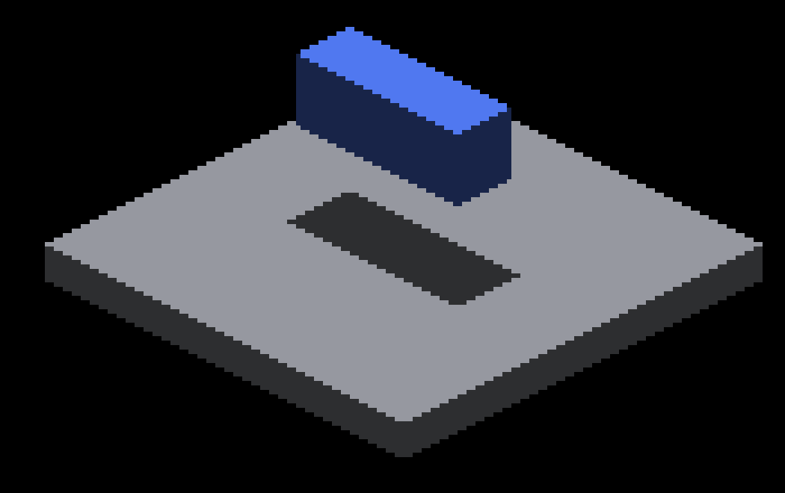
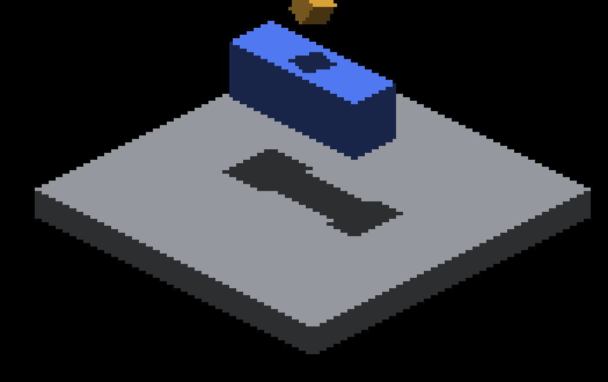
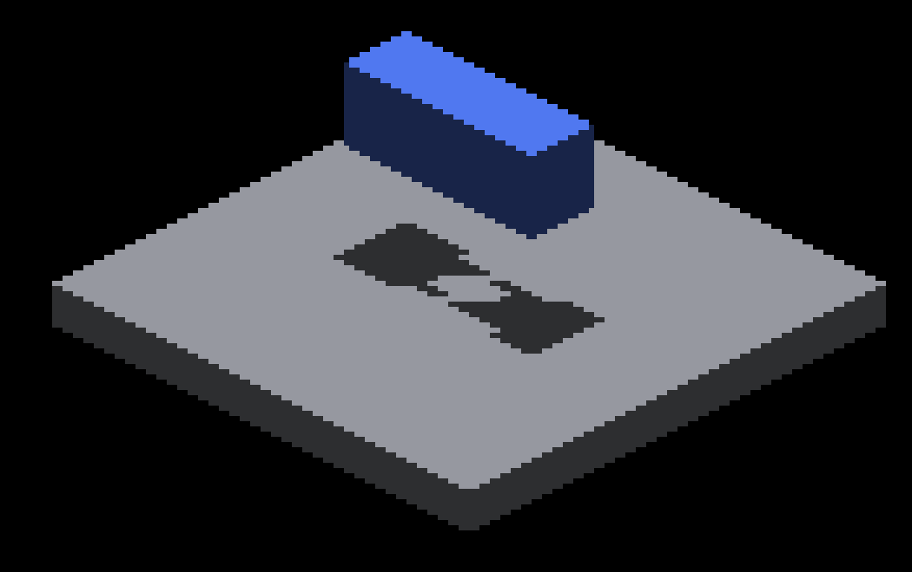

# Crowded overlapping caster regression

This diagnostic reproduces missing floor shadow on native Metal, after the
independent-layer union fix. It does **not** fix same-layer depth loss or certify
the original Windows scene. The renderer is unchanged by this slice; the demo
gains a bounded count of coincident source casters, defaulting to one.

## Geometry and invariant

The lower source-voxel box is 18×6×8, centered at (0,0,-12), above a GRID floor
whose top is z=2. Sunlight travels along +Z. The upper 3×3×3 source cube is
rotated 0.47 radians about (1,1,1), centered at z=-24 plus the requested offset.
Each duplicate has its own canvas/pool but exactly the same occupied volume.
Duplicating an opaque caster cannot remove an existing floor shadow.

With offset -60, the upper cube is wholly beyond the floor's 64-unit shadow
window; the lower box remains inside it. The upper object stays visible at
zoom 1. There is no AO, camera motion, entity spin or blur adjustment. These are
fixed-pose controls, not a temporal stability test.

## Native results

Apple M4 Max, macOS/Metal debug, 2560×1440 captures, effective subdivision 1.
All 17 runs exited cleanly. Counts below describe both cascades together; index
counters are construction witnesses, not receiver-query or performance counters.

| Upper casters | Offset Z | Incomplete tiles | Maximum tile count | Brightened floor pixels |
|---:|---:|---:|---:|---:|
| 0 | — | 0 | 60 | 0 |
| 1 | 0 | 0 | 77 | 0 |
| 128 | 0 | 8 | 2744 | 288 |
| 1 | -60 | 0 | 77 | 0 |
| 8 | -60 | 0 | 224 | 0 |
| 16 | -60 | 4 | 392 | 288 |
| 128 | -60 | 8 | 2744 | 528 |
| 128, repeat | -60 | 8 | 2744 | 528 |
| 128 | -36 | 8 | 2744 | 336 |
| 128 | -40 | 8 | 2744 | 528 |
| 128 | -44 | 8 | 2744 | 528 |

The near crowded case shows edge loss from the sampled fallback. Moving the same
crowded upper object beyond the throw window additionally opens a central hole.
The counter at the floor center becomes incomplete in both cascades by count 16.
Record and spill pools remain below their global capacities: the largest run
requests 5,164 records and 1,536 spill nodes. This isolates tile-local density
from global resource exhaustion.

| Lower only | Crowded upper, nearby | Crowded upper, distant |
|---|---|---|
|  |  |  |

Crops use the same (1100,620)–(1450,840) rectangle and 3× nearest-neighbor
magnification. Full captures: [lower](lower.png), [near](near-128.png),
[distant](far-128.png). The far upper cube is visible above the crop in the full
frame. These are input variants of one implementation, not before/after fixes.

## Deterministic replay

Build the demo, then run from the worktree root with a new output directory:

```sh
fleet-build --target IRCanvasStress --parallel 2
ir-acquire gpu -- python3 docs/pr-screenshots/codex/crowded-shadow-overlap/capture.py --output /tmp/crowded-shadow-replay
```

The driver uses the native launch adapter on Windows, takes an outer GPU
reservation through CSV collection, and uses the shared index parser. Each run
has a 180-second wrapper watchdog; timeout is a failed capture. A crash, absent
capture, changed unlit receiver, missing shadow signal, or failure to exercise
both complete and incomplete tiles raises an error rather than passing.

**Expected current result: exit 1**, with `monotone: false` in `report.json`.
This is a diagnostic known failure, not a CI baseline to bless. Future fixes
must preserve shadows and explain any change to the index-pressure witness.

The metric uses the floor's exact unlit material color in the fixed receiver ROI
(1100,700)–(1450,820), scaled with output width. It counts originally shadowed
floor pixels whose RGB increases by more than one. Six unlit controls verify
that this ROI is identical at every distinct upper pose. The floor-only color
mask excludes the lower blue object's visible pixels. The repeat is a second
fresh process; it does not establish motion stability or allocation-order
independence under arbitrary scheduling.

[Report](report.json) records commands, binary and image hashes, receiver ROI,
index summaries and world-point tile witnesses. [Source patch](source.patch)
records the demo change relative to the report's source revision.
[Clean exits](run-results.txt) were extracted from the wrapper logs.
Raw [lower](lower-index.csv.gz) and [crowded](far-128-index.csv.gz) index CSVs
are retained compressed; replay stores all raw CSVs and logs in its output.

The portable `test_render_shadow_layer_union.py` additionally executes both
production shader sampler bodies for 30 complete-list height/cascade/capacity
combinations per backend, plus distant-only controls. Bypassing the complete
query fails specifically on the hidden lower blocker. Complete queries remain
the correctness reference; the native crowded run deliberately exceeds that
representation's tile capacity.

## Next work

The [capacity design](../../../design/sun-face-index-capacity.md#overlapping-casters-and-finite-shadow-range)
owns the remaining representation/query work. Native Windows reproduction,
mixed rendering modes, oblique light, and moving-height verification remain
pending. No GPU throughput claim follows from these capture-only runs.
