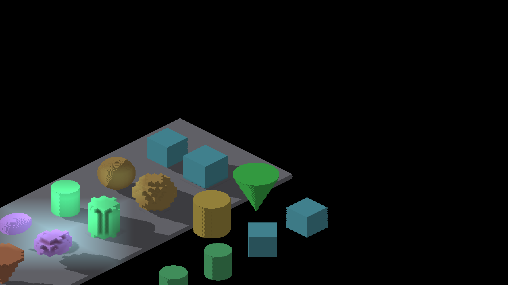
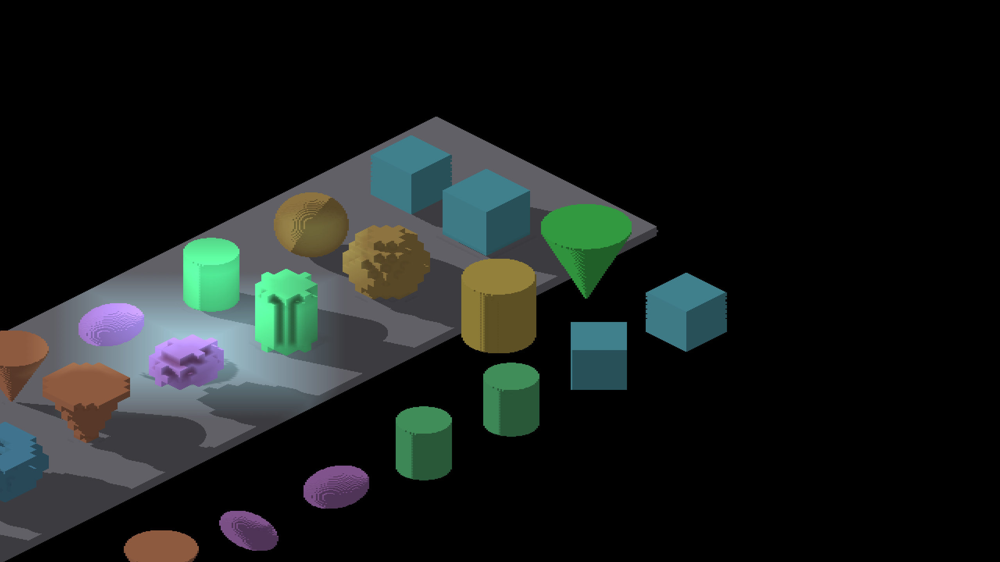

# Master lighting integration

The two yaw-90 reference conflicts are regenerated from the combined cardinal
AO/local-light depth fix and retained cylinder shadow receiver. Neither side
is selected wholesale. The other 19 default reference files are retained; captured differences
are checked by the existing harness thresholds.

Native Metal Debug capture: 21 shots, exit 0, `RESULT=CLEAN`. The manifest
records the binary hash and camera poses. The source is the merge of
`565405a77` and `6bdca410c`; no shader edits were made during resolution.

| Centered yaw 90 | Panned yaw 90 |
|---|---|
|  |  |
