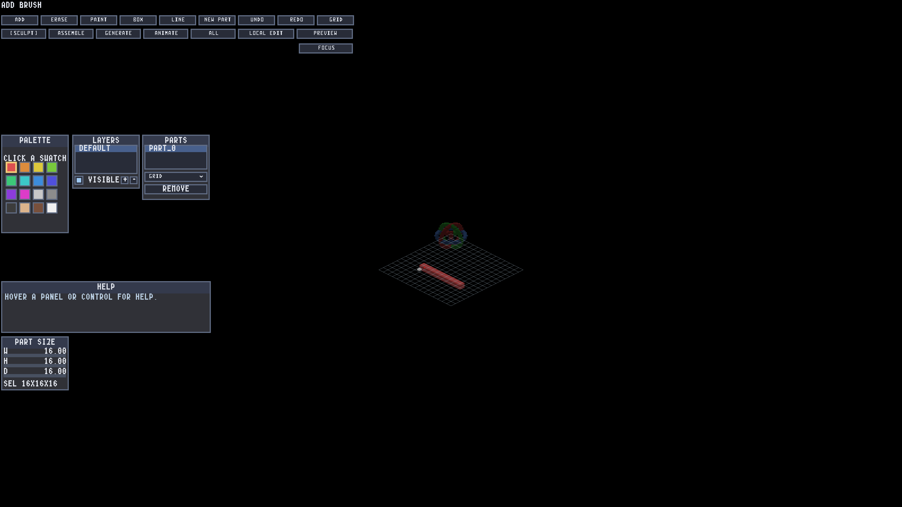

# Voxel placement and construction-grid validation

Native macOS Metal captures. The before image comes from the parent editor build
at `598b23b38ca3dd3423becb31375883b1e15951e5`; the after image exercises the same
continuous stroke. Images are unmodified full-frame PNGs.

| Before | After |
|---|---|
|  |  |

The grid uses the bottom support plane and existing voxel depth. Preview faces
cover a full cell, blend at 35% opacity, and have a distinct outline. The editor
suppresses the red trixel cursor. F12 writes the composite to
`save_files/screenshots` beside the executable.

## Independent screen oracle

`screen_alignment` chooses mouse positions from captured albedo/normal pixels,
without using the engine projection, inverse ray or authoring occupancy model.
Each angle injects five interior samples (extremes plus center; small faces may
repeat the center), then places on the observed face and on the blank floor.
The PNG oracle compares independent grid-off/on, preview/commit, and disjoint
occluder/preview pairs.

Both runs cover 0°, 30°, 45°, 67°, 90°, 180° and 270°, zoom 4/8 and nonzero pans.
The normal window is 1600×900 points / 3200×1800 pixels at FIT output scale 2.
The letterboxed window is 1200×800 points / 2400×1600 pixels at FIT output scale 1.
Both measured DPI ratios are 2; a native 1× DPI host was not tested.

Each run passed 70/70 GUI assertions, zero layout findings and a CLEAN exit,
with 71 PNGs including an additional F12 capture. Every angle reported all five
mouse samples seen and matching. Pixel results in the adjacent JSON files show:

- zero grid or preview pixels through solid interior pixels;
- grid contact at the rendered bottom-footprint corners;
- preview interior coverage at least 97.5%, with the same translucent fraction;
- zero fill outside a one-game-pixel raster boundary, and zero outline outside
  a two-game-pixel band (centered line width plus raster boundary);
- blank-floor committed silhouette intersection-over-union exactly 1.0.

The separate fill/outline limits scale with actual FIT output scale, not DPI.
The oracle's 17 positive/negative controls reject shifted, tiny, opaque and
oversized previews, leaking/misaligned grids, missing occlusion, wrong cursor
coordinates and incomplete/F12-missing logs. The dependency contract has 12 tests.

## Reproduce

From the repository, run `python3 scripts/gui-verify.py IRVoxelEditor -- --gui-session
screen_alignment --gui-layout-check`, retaining its complete stdout as `run.log`.
Then run `python3 scripts/editor-screen-alignment.py --log run.log --screenshots
build/creations/editors/voxel_editor/save_files/screenshots`. Repeat with the
additional creation argument `--config-preset test/alignment_letterbox.lua`.

This host reported zero monitors, while native Metal offscreen frames were
available. Capture runs used the documented bounded `IR_RUN_NO_DISPLAY_GRACE=30`
setting; watchdogs, CLEAN-exit checks and GUI/layout gates remained enabled.
These are rendered-pixel automation and visual review, not a human usability pass.
Windows/OpenGL execution remains untested.

Additional checks: 135 focused C++ tests; sculpt workflow 46/46 (including bone
and class mode preview suppression/restoration); fill preview 32/32; local canvas
10/10; cardinal face picking 10/10; lighting regression 46/46; formatting, Python
lint, header conventions and shader counterpart parity.

## Manual feedback flows

1. Hover an empty floor, draw quickly, orbit slowly and continue drawing. Report
   any jump between pointer, translucent preview and committed cell.
2. Stack voxels, pan and zoom; rotate through intermediate angles. Grid lines
   should meet bottom faces and disappear behind solids.
3. Try ADD, ERASE, PAINT, BOX and LINE; move onto UI and switch alternate paint
   modes. Report a missing, stale or misleading preview.
4. Edit a rotated child through LOCAL EDIT, return to the assembly, then press
   F12. Check the saved screenshot contains the view and UI you expected.
