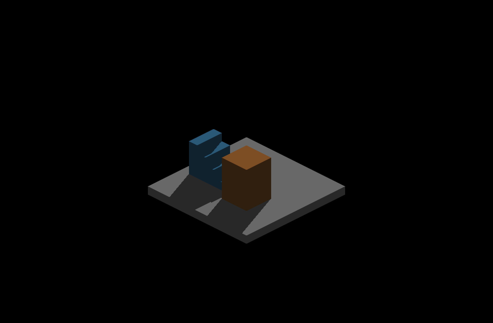
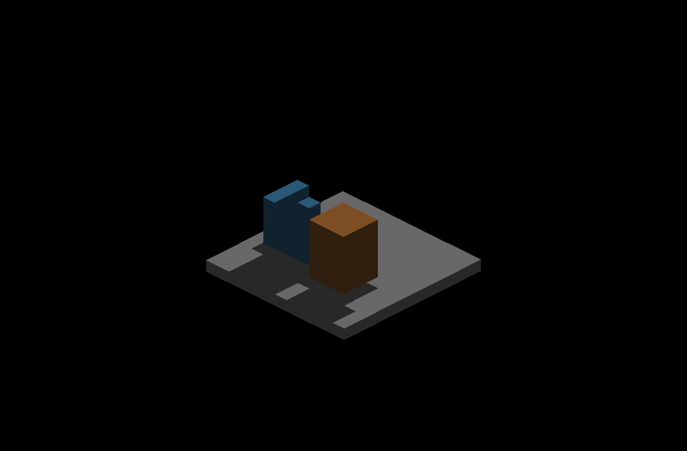

# Orbit ownership and shadow investigation

Native macOS Metal Debug, 1600×900 game resolution and 3200×1800 captured
framebuffer. Parent: `79591cc65f66e93d80bc0694597c0068baa7d690`.
The diagnostic fixture is included in this change. Both shadow arms used the
same executable and shader build; only `IR_PERAXIS_SURFACE_LIGHTING` changed.
Production shadow defaults remain unchanged.

## Shadow evidence

The fixed scene has 219 authored voxels, sun direction `(0.35,0.85,-0.4)`,
intensity 1, ambient 0.2, AO disabled, zoom 8, origin pivot and zero pan.
Each of 20 poses captures shadows on/off. Poses include 0, 0.25, 30, 44.75,
45, 45.25, 67, 89.75, 90 and 90.25 degrees, followed by reverse and repeated
exact poses. The authored-record fingerprint stays constant.

| Default, 0° | Default, 0.25° | Existing opt-in, 0.25° |
|---|---|---|
|  |  |  |

These are unscaled world crops `(640,270)–(2560,1530)` of the adjacent full
frames. The default changes from per-fragment cardinal shadow sampling to
face-center sampling off-cardinal. The opt-in preserves diagonal boundaries.
All ten unique poses' shadows-disabled crops are RGB-identical between the
two arms; exact cardinal lit crops are also identical.

| Adjacent angles | Default changed shadow-mask pixels | Opt-in changed shadow-mask pixels |
|---|---:|---:|
| 0 → 0.25 | 5,772 | 1,240 |
| 44.75 → 45 | 692 | 640 |
| 45 → 45.25 | 1,024 | 1,216 |
| 89.75 → 90 | 4,572 | 832 |
| 90 → 90.25 | 4,708 | 928 |

These counts include expected movement and raster changes. They measure this
comparison, not geometric accuracy or a universal continuity threshold.
Both arms pass 40/40 GUI assertions, zero layout findings and CLEAN exit.
Every repeated pose restores the measured lit and unshadowed image exactly:
zero changed RGB pixels. This fixture does not reproduce persistent shadow
state after returning to the exact pose.

The continuous option remains experimental; its wider-scene cost and remaining
validation gates are recorded in the [existing evidence](
../peraxis-surface-lighting/README.md#measured-cost-and-decision).
This investigation does not enable it by default or change shadow shaders.

## Input fix

Alt+left previously reached both camera orbit and inward placement. Camera
navigation now owns the entire pointer gesture through release. Shared gizmos
use the same engine helper, and editor recipe handles respect that ownership.
Custom right-drag/Q/E bindings are supplied by the editor. Inward placement is
I+left, with the existing Lua `clickBelow` API preserved.

The final native editor passes `camera_gestures` 44/44, `place_below` 7/7 and
module `test_recipe_handle` 25/25, all with zero layout findings and CLEAN exits.
The camera fixture requires actual camera movement, stable authored data during
orbit, no release edit, a working fresh click and Undo. It covers interrupted
BRUSH/BOX/LINE and PAINT as well as Alt/right/middle/keyboard/pan chords.
Forty focused C++ tests cover shared ownership, combined press/release input,
gizmo lifecycle and Lua session bindings. Eight metric controls and twelve
dependency-contract tests pass. The required lighting regression also passes all 46 checks.

## Reproduce

Build with `fleet-build --target IRVoxelEditor`. Run
`python3 scripts/gui-verify.py --no-build IRVoxelEditor -- --gui-session
shadow_rotation --gui-layout-check`, once with `IR_PERAXIS_SURFACE_LIGHTING=0`
and once with `1`. Preserve stdout and each run's newly written PNGs. Grade
each arm with `python3 scripts/editor-shadow-rotation.py --log <run.log>
--screenshots <capture-dir> --surface <0-or-1> --output <metrics-dir>`.
Trimmed logs and metrics are adjacent; full capture sets remain at
`/tmp/irreden-shadow-rotation/` on the authoring host.

This host reported zero monitors; native offscreen captures used the documented
bounded `IR_RUN_NO_DISPLAY_GRACE=30`. A sandboxed attempt had no WindowServer
connection and produced no captures; the graphics-enabled runs supplied this
evidence. Native Windows/OpenGL and a human usability pass remain unverified.

## Manual follow-up

1. Hold Alt and drag with left mouse over empty space and existing voxels. Try
   releasing Alt before the mouse. The object must not change.
2. Start a brush stroke, then orbit; try the same with a pending BOX or LINE.
   Existing brush cells form one completed stroke; the deferred box/line cancels.
3. Orbit over a transform or recipe handle. It must not move or regenerate the
   part. Release, then use a fresh drag to verify the handle still works.
4. Use I+left for inward placement. For shadow feedback, compare an exact Q/E
   cardinal view with a tiny Alt-drag away; capture both with F12.
