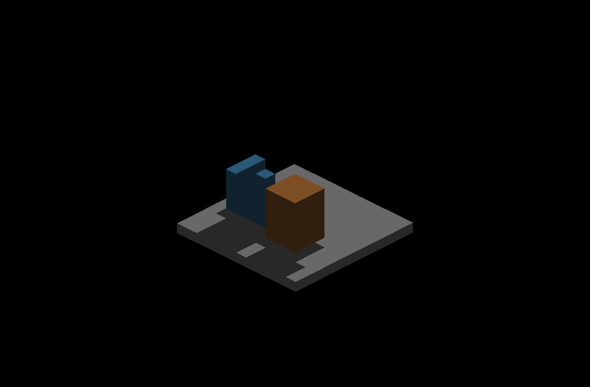
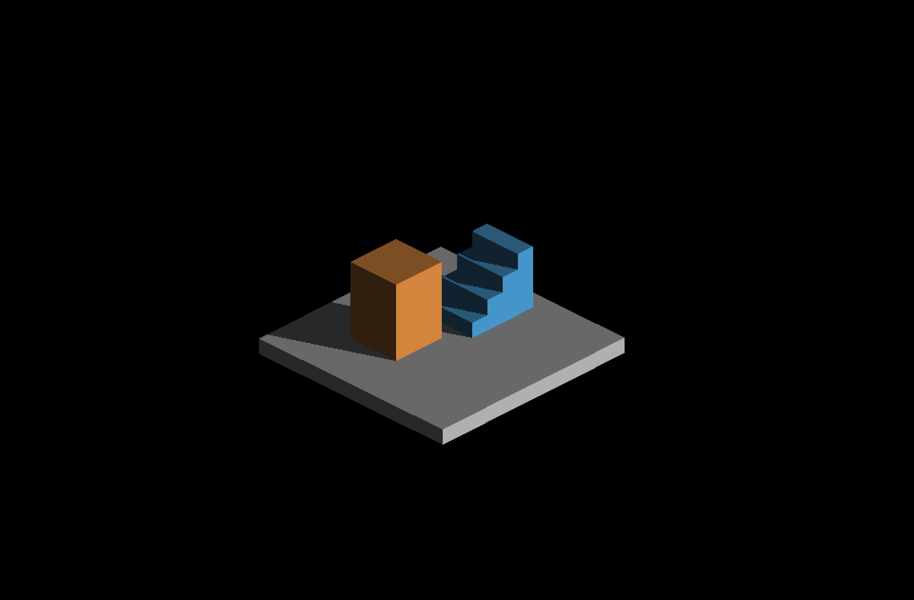
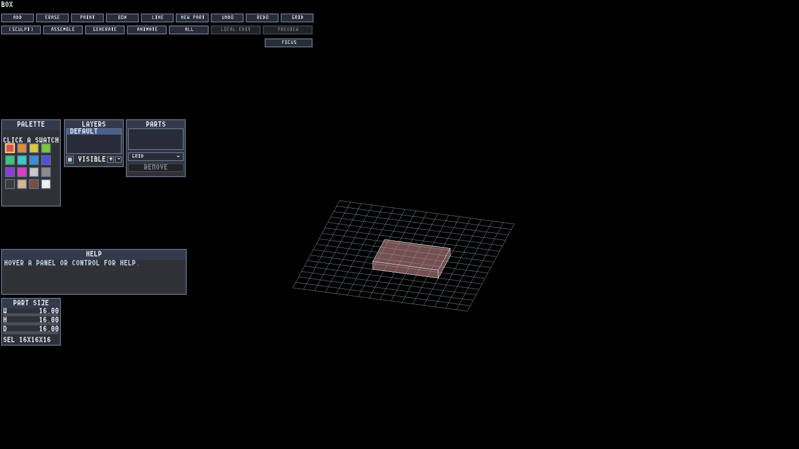
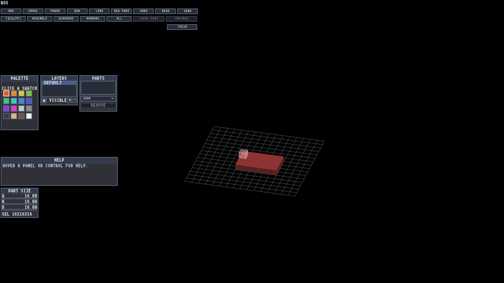

# Construction-grid region tools and continuous voxel shadows

The voxel editor enables the existing continuous surface-lighting path by
default. Explicit `IR_PERAXIS_SURFACE_LIGHTING=0` selects the prior coarse path
for comparison. Other creations retain their default. The visibility prepass
remains off. Native measurements and captures use macOS Metal on Apple M4 Max;
OpenGL remains untested on this host.

## Why CanvasStress looked different

`IRCanvasStress` defaults its floor to an analytical SDF box. Shape presentation
already shades the actual visible surface point, independently of the voxel
surface-lighting switch. The editor's voxel faces previously switched to
face-center shading under yaw. CanvasStress also defaults to a much smaller
zoom, different sun and ambient level; those views are not a controlled A/B.

The accurate voxel path reconstructs the continuous point on each rasterized
finite face, then queries the existing sun-space geometry index. It changes
receiver sampling, not caster geometry or shadow-map resolution. Its finite
record-pool overflow fallback remains approximate; this change does not claim
unlimited dense-scene shadow accuracy.

## Shared performance change

`PerAxisSurfaceLighting::resolveRoute` supplies the same eligibility decision
to shadow production and lighting, evaluated from current-frame inputs. When
per-axis presentation will shade the faces, its compute-lighting consumer is
skipped, so the three sampled axis-shadow dispatches now skip too. Main-canvas
shadow production and the sun geometry bake remain. Debug, missing-resource,
missing-consumer and fog fallbacks retain their sampled textures. No shaders,
shadow filtering or finite-intersection tests changed.

The executed routing controls cover both publishers and the consumer, including
live fog/toggle changes. Mutations that always sample, always skip, ignore the
lighting consumer or reuse stale route state fail. Five routing test methods
pass; the per-axis harness executes 131,072 readiness configurations.

## Measured cost

A guarded Release Metal comparison uses five alternating before/after pairs at
each of two zooms (20 runs, 300 frames each), with frozen executable hashes and
common shader/runtime assets. The sampled-shadow GPU scope drops consistently:
0.927 to 0.171 ms at zoom 1 and 0.421 to 0.126 ms at zoom 4. Whole GPU-envelope
means change from 6.009 to 5.701 ms and 4.504 to 4.375 ms, respectively, but the
paired intervals include zero. This supports removal of redundant dispatches;
it does not establish a whole-frame speedup. GPU scopes overlap and cannot be
summed. Runs used battery power on this host.

[Paired results, raw reports, identities and reproduction](performance/optimization-paired-summary.md)
retain the qualification and limitations. The earlier sandbox launch failed
before producing valid timing and is excluded.

A separate editor throughput matrix is incomplete: automatic-worker Release
runs intermittently timed out in the CPU task scheduler, including a later
default-accurate run. Successful controls do not remove that reliability finding.
No editor throughput claim is made. Both final default-accurate, stage-timing-off
controls completed 360 frames at 30°/zoom 4 and 67°/zoom 8; three invalid CLI
combinations correctly exited 2. [Diagnosis and retained failed runs](performance/editor-scheduler-diagnosis.md)
record the limits. The pinned scheduler lacks the atomic-ordering fixes described
in [upstream enkiTS issue 91](https://github.com/dougbinks/enkiTS/issues/91);
local causal confirmation requires testing that correction separately.

## Native pixel evidence

Editor captures are 3200×1800, game resolution 1600×900, zoom 8. The same fixed
219-cell scene uses sun `(0.35,0.85,-0.4)`, intensity 1, ambient 0.2, AO off,
origin pivot and zero pan. Widgets, grid and ghost are hidden only in this
shadow diagnostic. Both default and explicit coarse arms pass 80 assertions
and have CLEAN exits with zero layout findings. Each of 40 poses captures
shadows on/off; poses include 30°,67°, quarter-degree offsets around 0°/90°/
180°/270°, intermediate quadrants and exact returns. All repeated poses restore
identical RGB pixels; all 40 unshadowed crops are identical between arms.

| Coarse at 0.25° | Editor default at 0.25° |
|---|---|
|  |  |

| Coarse at 270.25° | Editor default at 270.25° |
|---|---|
|  |  |

Crops are unscaled world rectangle `(640,270)–(2560,1530)`; adjacent files
without `-crop` retain full frames. Return comparisons establish repeatability,
not physical correctness. The separate finite source-face oracle uses an
identity GRID frame at 22.5°,112.5°,202.5°,292.5°, zoom 4, albedo `(150,90,235)`,
AO/palette/HDR/local lights off and declared sun settings. It independently
intersects unit boxes and excludes only one screenshot pixel at geometric and
shadow boundaries. Across 208,344 sun-facing interior pixels the accurate route
has zero false/missed shadows or invalid colors. The coarse 22.5° negative
control has 225 false and 185 missed shadow pixels.

The optimized and baseline accurate paths are RGB-identical across all four
full source-frame images. The explicit coarse paths also remain identical in
all four views. `optimization-pixel-comparison.json` records those eight pairs;
therefore the retained analytic result transfers to the optimization unchanged.
The complete capture sets and raw logs remain in `/tmp/irreden-yaw-lighting/`
on the authoring host; selected full frames, metrics and trimmed logs are here.

The full render harness passes all 126 suites. The native lighting regression
gate also passes all checks; raw outputs are retained alongside these images.

## Box and Line

Both tools now start on the selected canvas's empty floor, preview while held
and commit on release. Line follows the dominant axis. Surface starts continue on the initial face plane when
the pointer leaves geometry. Floor provenance is explicit, so another part
under the cursor cannot redirect the drag. The regression selects real toolbar
buttons at 30°/67°, checks exact 24-cell rectangles and 6-cell lines, toolbar Undo
and Escape. An overlapping unselected blue slab is proven to own the raw pick;
the selected floor still receives the edit and the slab fingerprint is unchanged.

Native final results: region tools 25/25, camera gestures 44/44, inward placement
7/7; all CLEAN with zero layout findings. Held previews, commits and Undo were
visually inspected, including the slab's expected occlusion of the preview.

| Box preview at 30° | Committed rectangle |
|---|---|
|  |  |

## Reproduce and manual follow-up

- `python3 scripts/gui-verify.py --no-build IRVoxelEditor -- --gui-session region_tools --gui-layout-check`
- The same command with `camera_gestures`, `place_below` or `shadow_rotation`
  selects those fixtures. Grade the last with `scripts/editor-shadow-rotation.py
  --log <log> --screenshots <dir> --surface <0|1> --output <metrics>`.
- Ordinary launch needs no shadow environment flag. Draw a Box/Line on an empty
  floor, orbit to an intermediate angle and draw again. Preview must match the
  released cells; Undo should remove the whole edit.
- During a pending region drag, right-drag to orbit; release right before left.
  The region must cancel. Separately start Alt+left orbit and release Alt before
  left; no edit should occur. Start a fresh edit afterward.
- Compare a diagonal cast shadow at a cardinal and just off-angle; use F12 for
  screenshots. The boundary should continue through voxel faces rather than
  turning whole faces dark. Report scene size, zoom and any noticeable slowdown.
