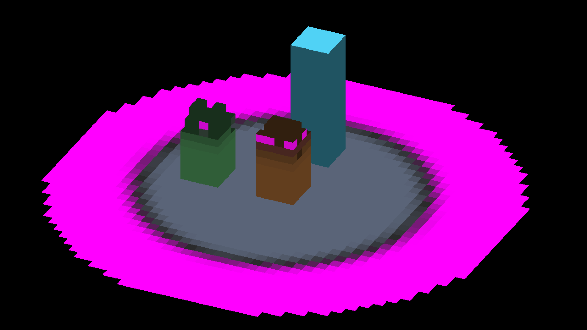
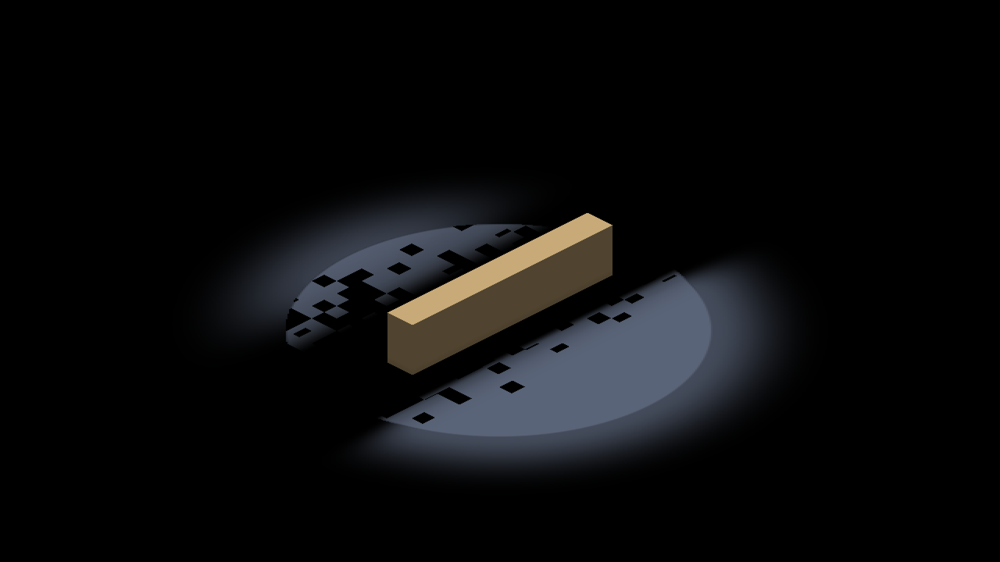

# Shared fog color composition

The GLSL and Metal compute paths now call resource-free fog color helpers.
This preserves the current result while allowing surface lighting to reuse
the same composition later. Continuous fog receiving is **not enabled** by
this change. No dispatch, resource binding, visibility march, or default changes.

## Native comparison

Captured on Apple M4 Max, macOS, Debug Metal, using `IRFogDemo`. All six
before and six after runs exited CLEAN. The 13 full-frame pairs and seven
demo-generated body crops have identical decoded RGBA pixels: zero changed
pixels, maximum channel difference zero. See [comparison.json](comparison.json).
This is a regression control, not a performance measurement or a claim that
all existing fog visuals are correct.

| Case | Arguments | Full frames | Additional crops |
|---|---|---:|---:|
| soft-rim | `--edge-smooth` | 3 | 0 |
| overflow | `--peraxis-overflow` | 1 | 0 |
| ceiling | `--ceiling-treatment --reveal-treatment` | 2 | 0 |
| los | `--occlusion=high-ground --los-softness=1 --reveal-treatment` | 1 | 0 |
| body | `--entity-reveal-soft-edge` | 1 | 7 |
| memory | `--explored-decay` | 5 | 0 |

The ceiling and LOS full frames were also visually inspected. The LOS fixture
has black holes around the wall in both phases; equality preserves that
pre-existing artifact, rather than proving its correctness. Isolate reveal
coverage, cut-face admission, and LOS before extending that path.

| Ceiling treatment before | After |
|---|---|
|  |  |

| LOS control before | After |
|---|---|
|  |  |

## Reproduction and provenance

Baseline active source: `cbbe141e5c539d63dea5b3baefcf54b28389e1cc`.
After: the source files in this commit, captured before commit creation.
The two common fog files were restored to the parent for baseline captures,
then the saved extraction patch was reapplied and the target rebuilt. The
new helper files were present but unreferenced during the baseline. No active
source changed during a capture. Runtime hashes are in
[before-runtime.json](before-runtime.json) and [after-runtime.json](after-runtime.json).
The executable SHA-256 is identical; only the two common shader hashes differ
because they begin including the already-staged helpers.

Build with `fleet-build --target IRFogDemo IrredenEngineTest`. For each phase
and case, use its committed `config.lua` and arguments above:

```text
fleet-run --timeout 60 --result-file <absolute-case-directory>/result.json IRFogDemo --config-preset <absolute-case-directory>/config.lua <case-arguments> --auto-screenshot 10
```

Configs retain their capture output paths; change that path for a new worktree.
Full frames are 2560×1440 physical pixels at 1280×720 game resolution. Use the
`CaptureCamera` log lines for effective zoom and subdivisions: the soft-rim
labels 5/9/14 actually snap to 4/8/16. Each directory retains its config and
compressed complete run log. The initial baseline soft-rim result JSON was
not saved at the intended path; its complete log records `RESULT=CLEAN`.
The remaining 11 directories also retain wrapper result JSON.

## Deterministic checks

- Existing `FogCrossSectionShaderParity.*`: 25/25 passed.
- `test_render_fog_composition.py`: 102,060 numerical cases per backend,
  with seven discriminated mutations per backend covering cap, rim, alpha,
  treatment band, and observer forwarding.
- Both focused extraction/duplication reviewers reported no findings.

The CPU adapters exercise actual extracted GLSL/MSL formula bodies. Native
Metal captures additionally validate includes and bindings; native OpenGL
validation remains a separate cross-host check.
