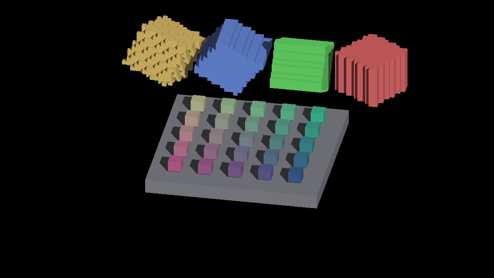

# GRID receiver visibility controls

The continuous receiver prepass rejects hidden candidate fragments in the
existing CanvasStress GRID scene without changing any decoded RGBA pixel in
these four paired Metal captures. This is an image-equivalence result, not an
absolute geometry oracle or a performance measurement. No renderer defaults
or shaders change in this slice.

| Zoom | Base subdivisions | Candidate fragments | Retained | Rejected | Changed pixels |
|---|---|---:|---:|---:|---:|
| 1 | 1 | 17,684 | 13,590 | 4,094 | 0 |
| 1 | 4 | 17,684 | 13,590 | 4,094 | 0 |
| 4 | 1 | 282,102 | 217,345 | 64,757 | 0 |
| 4 | 4 | 282,102 | 217,345 | 64,757 | 0 |

All eight runs report `RESULT=CLEAN`. Prepass-off runs emit no visibility
counter row; each prepass-on run emits one row whose retained plus rejected
counts equal its candidate count. The surface-lighting switch is explicitly
enabled in both arms. The captures use yaw 0.6, frozen object pose 0.55,
sun direction (-0.42, -0.60, -0.55), no AO, and a GRID floor of span 40.

## Zoom 4, base subdivisions 1

Prepass off:

Prepass on:

The scene contains a grid of small cubes and four rotated voxel objects.
Their stepped silhouettes and face patterns are present in both arms. Image
equality cannot certify those features as geometrically correct or close the
[sampled receiver defect](../receiver-shadow-polygon/README.md).

## Reproduction and provenance

`scripts/perf/surface_lighting_controls.py --scene grid-overlap` exposes eight
camera/zoom/subdivision cases, or 32 cases with `--adoption-matrix`. Its shared
`scene_arguments()` and `cases()` helpers supply the capture arguments.
[capture.py](capture.py) preserves the executed local capture driver, including
its frozen build path; run from the repository root with a fresh output path.
It uses `fleet-run` for every launch. A different host needs its own configured
build path and newly captured evidence.

[captures.json](captures.json) records commands, explicit switches, image
hashes, counters and full-frame RGBA comparisons. Compressed logs preserve raw
stdout without whitespace rewriting. [manifest.json](manifest.json) hashes all
capture artifacts. The frozen build's 319 file hashes were verified after the
runs and its artifact descriptor matches the retained
[runtime/source archive](../../../perf/sun-overflow-production/guarded-depth/timing/artifacts/guarded-depth/artifact.json)
byte for byte. That archive's source overlay identifies the runtime; the
current Python driver's commit does not identify the older frozen binary.

## Limits and next checks

- Base subdivisions 1 and 4 yield the same decoded images and counters at each
  zoom. The logs confirm effective subdivision values; zoom 4/base 4 also
  reports the per-axis density cap from 16 to 8. This is configuration coverage,
  not evidence for distinct subdivision workloads.
- About 23% rejection establishes useful hidden-fragment work in this fixture.
  Prepass construction and drawing also cost time; no net speedup follows from
  these counters. Stats readbacks and screenshots are outside timed controls.
- The captures cover one intermediate yaw and fixed poses on Metal. Cardinal
  cases are exposed by the driver but not captured here. Moving objects,
  near-cardinal transitions, fog, Windows/OpenGL and guarded cost remain open.
- Keep accurate continuous receiving and the visibility-prepass default as
  separate decisions. The previously rejected quiet-window timings remain
  unqualified.
