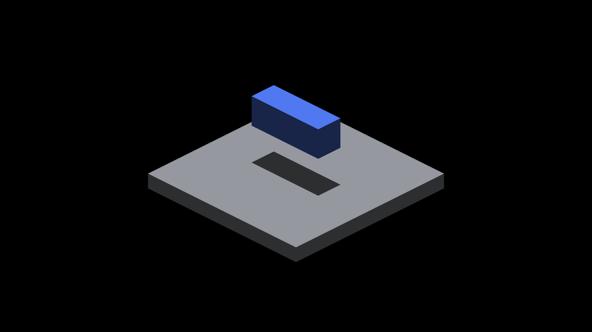
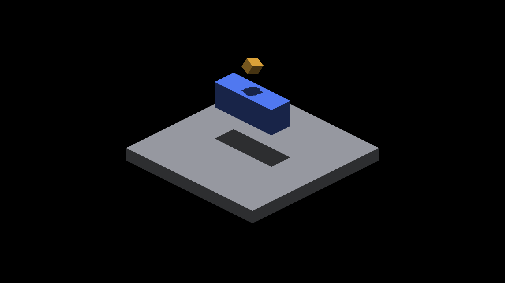

# Overlapping caster shadow controls

The filtered receiver must test the primary and indexed depth layers separately.
An upper caster outside the throw limit must not hide a lower, valid blocker
stored in the other layer. Each filter tap contributes at most once. Both GLSL
and Metal implement this union; the change adds no map storage, blur or bias.

## Executed sampler evidence

`python3 scripts/tests/test_render_shadow_layer_union.py` executes the full
production sampler body through the shared C++ adapter. Each backend passes 48
height/layer-order/marker/cascade comparisons, weighted-overlap, range-only,
stale-index, coplanar-splat and complete-finite-miss controls. Three deliberate
mutations fail: omitting the second layer, double-counting overlap and removing
the throw limit. The parent shader failed the added-caster monotonicity check
on both backends before the fix.

Native Metal on Apple M4 Max also reproduces the failure with the actual shader
compiler and runtime defaults. The parent at
`ec026219cf65b9f0560bf4241523fa7e1aa4e4b7` fails at cell 1, receiver 0
([log](native-parent.log)); the patched sampler passes all outputs with counters
off and on ([report](native-fixed.json)). The five fixtures are: primary only,
valid primary plus distant indexed, distant primary plus valid indexed, both
valid, and indexed only. Each runs twice with 256 identical receivers. This is
isolated query validation, not an engine throughput or index-construction test.

Replay from the repository root, using an empty output directory:

```sh
ir-acquire gpu -- python3 docs/pr-screenshots/codex/overlapping-caster-shadow/native_control.py --output /tmp/shadow-layer-fixed --validate-only --queries 256
ir-acquire gpu -- python3 docs/pr-screenshots/codex/overlapping-caster-shadow/native_control.py --output /tmp/shadow-layer-parent --validate-only --queries 256 --parent
```

The second command intentionally exits nonzero on the fixed parent reference.
This evidence does not certify native OpenGL on Windows.

## Full-frame regression control

These unmodified 2560×1440 engine captures show an exact GRID receiver/caster and
a small rigid caster above it. The complete finite-face path already preserves
the lower shadow. The before/after pair is RGB-identical; it is a regression
control, **not** a visual reproduction of the reported Windows noise.

| Lower caster only | With upper caster, parent | With upper caster, patched |
|---|---|---|
|  |  |  |

Built with `fleet-build --target IRCanvasStress`, then captured with:

```sh
fleet-run IRCanvasStress --only shadowbox,floor --probe-grid --probe-floor-mode grid --probe-floor-span 40 --sun-direction 0 0 -1 --no-spin --no-auto-rotate --pivot-origin --yaw 0 --zoom 4 --subdivisions 1 --no-ao --auto-screenshot 10 --sweep-frames 1 10 --sun-face-index-probe --probe-overlapping-source
```

Each run used a config preset selecting a distinct screenshot directory and
offscreen output, with profiling and GPU stage timing disabled. The lower-only
control omits `--probe-overlapping-source`. Effective subdivisions are 4 at this
zoom, and all captures exited cleanly. Fixed poses make a temporal clip
uninformative for this control.

## Remaining investigation

The sampler still cannot recover another depth overwritten inside a single
sampled layer. A separate CPU probe of both backends demonstrated this at an
incomplete 257-candidate tile: receiver depth 10, lower face depth 2, upper face
depth -100 and throw 100. Replacing the fallback depth changed shadow 1 to 0,
despite the independent ray oracle retaining the lower blocker. With a complete
64-candidate list the same sampled-depth change preserved shadow 1. This is a
diagnosed capacity/range limitation, not fixed by the cross-layer union.

Next: reproduce the moving scene on Windows, distinguish complete/incomplete
queries and same-layer loss, then measure a bounded depth-preserving fallback.
The [capacity design](../../../design/sun-face-index-capacity.md#overlapping-casters-and-finite-shadow-range)
records the correctness requirements. No claim of resolving the full scene
report or improving frame rate follows from these controls.
