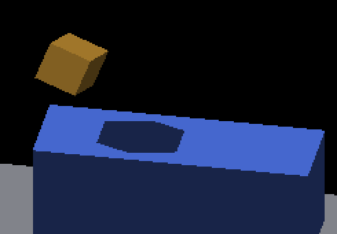

# Oblique sunlight on the GRID receiver

The independent shadow checker now covers oblique light and authored caster
offsets. Native Metal captures confirm that the continuous surface-lighting
opt-in matches integer-position geometry across four camera quadrants and both
light directions. The default sampled path still misses and over-shadows pixels.
A separate fractional-caster placement mismatch remains even with the opt-in.
**This change diagnoses those defects; it does not fix the renderer or change
defaults.**

| Control | Cases | Missing / excess shadow pixels | Verdict |
|---|---:|---|---|
| Integer caster, four intermediate camera quadrants, both sun directions | 8 | 0 / 0 each | PASS |
| Near integer caster, yaw 0.6, both sun directions | 2 | 0 / 0 each | PASS |
| Near integer caster, cardinal camera, both sun directions | 2 | 0 / 0 each | PASS |
| Fractional caster, positive sun X | 1 | 392 / 434 | FAIL |
| Fractional caster, negative sun X | 1 | 388 / 399 | FAIL |
| Default sampled path, integer caster, positive sun X | 1 | 135 / 382 | FAIL |
| Default sampled path, integer caster, negative sun X | 1 | 498 / 134 | FAIL |

All 16 cases have valid geometric coverage and zero unknown-color pixels. Counts
exclude the unchanged one-pixel shadow boundary band. Full denominators,
projected polygons, arguments and verdicts are in [captures.json](captures.json).
Process completion is recorded separately: all runs exited CLEAN, including
the four visually failing controls.

| Integer caster, continuous | Integer caster, sampled | Fractional caster, continuous |
|---|---|---|
|  |  |  |

These are matched route/placement controls from the same runtime, not a
before/after rendering fix. The fractional shadow still has straight edges but
is in the wrong position; inspecting only its jaggedness would miss this defect.
The sampled shadow has coarser steps. Full frames are retained beside each crop.

## Geometry and independent verification

The [original fixture contract](../receiver-shadow-polygon/README.md) still
defines the receiver, camera projection and sample eligibility. This extension
accepts `--sun-direction X Y Z` and `--source-offset X Y Z`. For normalized
direction toward the sun `s`, the authored cube center is
`(0,0,-12) + 12*s + source_offset`. The cube has side length 3 and a rigid
rotation of 0.47 radians about `(1,1,1)`. Its whole volume must remain above the
receiver plane `z=-16`.

Each rotated world corner `p` projects to the receiver by
`p + ((-16-p.z)/s.z)*s`. The convex hull of those eight projected corners is the
expected shadow. The checker uses authored coordinates, never image fitting,
the engine's occupancy records, or its shader intersection implementation.
Separate tests inverse-transform receiver rays into an oriented box and apply
slab intersections, checking the hull across four camera quadrants, both light
directions and multiple caster offsets.

The two sun directions are `(±0.6,0,-0.8)`. With fixed ambient 0.30 and intensity
1, the top-face Lambert factor is `0.30 + 0.70*0.8 = 0.86`: lit RGB8 is
`(69,103,206)`, shadow RGB8 remains `(24,36,72)`. Unknown colors, unexpected alpha,
insufficient coverage and wrong palettes fail. No AO or HDR is enabled.

Near integer controls use offsets `(∓0.2,0,-0.4)`, giving centers `(±7,0,-22)`.
The four-quadrant controls use `(±5.8,0,-8.4)`, giving `(±13,0,-30)`.
Moving the caster by `(±6,0,-8)` along the same sun ray preserves the projected
shadow while exposing enough receiver pixels in every quadrant. An initial near
caster sweep lacked the required outside coverage at two angles; the final
capture moves the fixture rather than lowering the coverage thresholds.
Eligible/interior/exterior minima remain 20,000/2,500/18,000 pixels, with a
three-pixel inset from the receiver silhouette.

CPU tests also deliberately use a wrong sun direction, a vertical-light shadow,
the old palette and a rounded-origin shadow against fractional authored geometry.
Retained native frames assert both the passing and failing diagnoses. A passing
test of a failing control means the checker detected the defect, not that the
renderer produced a correct frame.

## Remaining placement defect

With zero source offset, authored centers are `(±7.2,0,-21.6)`. In
`canvas_pose.hpp::CanvasPose::write`, `worldCellOffset_` rounds the owner
translation while `ownerWorldTranslation_` retains it. Shadow geometry in
`system_bake_sun_shadow_map.hpp::bakeVoxelFaces` uses the rounded world-cell
offset. Canvas screen placement in `system_entity_canvas_to_framebuffer.hpp`
uses the fractional pose translation, while composite depth uses a rounded
translation. The capture results agree with this source-level diagnosis.

The next fix must align rigid display, depth, caster and receiver coordinates.
Snapping the oracle to the engine's rounded caster would conceal the mismatch;
changing every mode's snapping would alter revoxelized occupancy semantics.
Neither is done here. The shared coordinate contract needs to distinguish rigid
source geometry from deliberately revoxelized geometry.

## Replay and provenance

```sh
python3 scripts/render_receiver_shadow_polygon.py docs/pr-screenshots/codex/receiver-oblique-shadow/positive-near-integer/screenshot_000001.png --yaw 0.6 --sun-direction 0.6 0 -0.8 --source-offset -0.2 0 -0.4
python3 scripts/render_receiver_shadow_polygon.py docs/pr-screenshots/codex/receiver-oblique-shadow/positive-fractional/screenshot_000001.png --yaw 0.6 --sun-direction 0.6 0 -0.8
python3 -m unittest discover -s scripts/tests -p test_render_receiver_shadow_polygon.py
python3 docs/pr-screenshots/codex/receiver-oblique-shadow/capture.py --output /tmp/receiver-oblique-replay
```

The second command deliberately exits 1. The capture driver requires a fresh
output directory and a built `IRCanvasStress`; every `fleet-run` acquires its own
GPU lease. Driver exit 0 means captures completed and runtime hashes stayed
stable, not that every image passed the oracle.

Capture source HEAD is `0d40e0fda6560b7a20532b17e2e4a7e8d8903146`, incorporating
master `3c23f000e`. The engine/creation [source patch](source.patch) is empty.
Binary SHA-256 is
`0b21a5715d7b1cf9a7ca9846e7f5a690dda06c59d83f2be30e9b53c5146570d5`.
[Runtime hashes](runtime-hashes.json) cover the binary and runtime shader/script
files and were checked unchanged after the sweep. Every case retains its full
2560×1440 frame, crop, config and compressed wrapper log. Commands retain their
original temporary output paths; use the driver for fresh paths.
[Artifact hashes](manifest.json) cover the evidence files, including this README.

Qualification is limited to native macOS/Metal, this opaque top receiver and the
fixed fixture. Side receivers, live route transitions, arbitrary materials,
Windows/OpenGL and the fractional placement fix remain open. No performance or
default-adoption claim is made.
