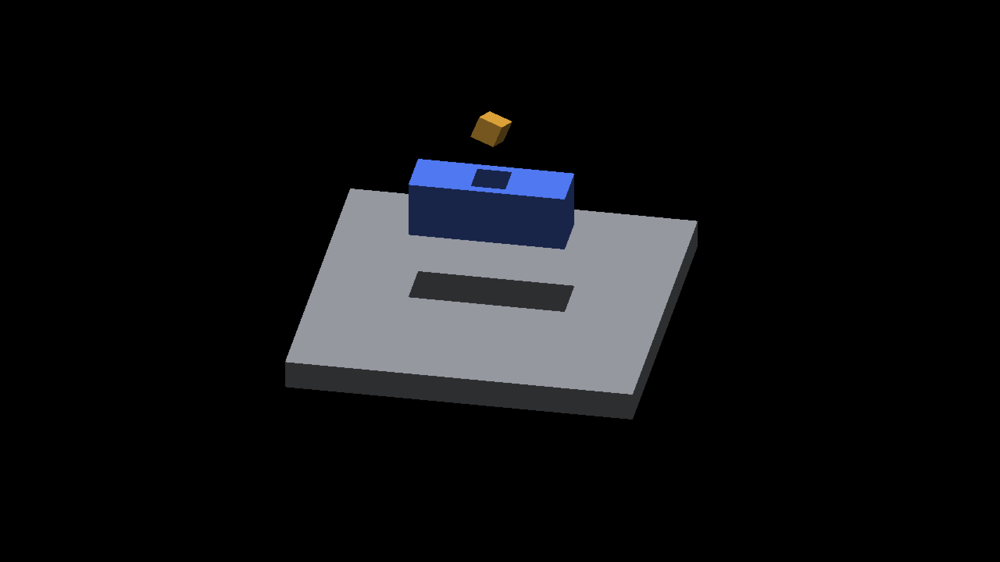

# Receiver shadows under camera phase and near-cardinal yaw

Fourteen native Metal captures of the opt-in continuous receiver pass the
independent rigid-cube polygon oracle. Two matching sampled-receiver controls
still fail with 18 missing and 638 excess pixels each. This expands the tested
continuous route; it does not fix or enable that route by default.

| Cases | Yaw | Camera iso offset | Surface receiving | Missing / excess / unknown |
|---|---|---|---|---|
| `near0` through `near3`, before/after | kπ/2 ± 0.002 | (-0.375, 0.625) | continuous | 0 / 0 / 0 in all eight |
| `mid0-phase` through `mid3-phase` | kπ/2 + 0.6 | (-1.375, -0.625) | continuous | 0 / 0 / 0 in all four |
| `sampled-phase` | 0.6 | (-1.375, -0.625) | sampled | 18 / 638 / 0 |
| `subpixel-positive`, `subpixel-negative` | 0.6 | (0.1, -0.2), (-0.1, 0.2) | continuous | 0 / 0 / 0 in both |
| `subpixel-sampled` | 0.6 | (0.1, -0.2) | sampled | 18 / 638 / 0 |

Each capture reports CLEAN. [results.json](results.json) retains every polygon,
sample count and verdict; [captures.json](captures.json) retains the exact
commands, switch values and image hashes. Each case includes its unmodified
full frame, config and losslessly compressed wrapper log. `CaptureCamera`
records the settled yaw, zoom, iso offset and subdivision count.

Sampled control:



Continuous receiver at the same pose:


## Independent camera transform

The [original geometry contract](../receiver-shadow-polygon/README.md) is
unchanged: authored receiver and rigid caster dimensions, vertical sunlight,
fixed zoom 4, effective subdivision 4 and a 2560×1440 output. The new
`--camera-iso X Y` oracle option matches the demo's origin-pivot convention:
camera offset is applied after yaw. Whole-cell placement, framebuffer snapping
and screen residual produce whole screenshot-pixel translations. In exact
arithmetic these sum to `(floor(16X), floor(8Y))`. The checker models the
float32 camera and whole/fraction split as well, because rounding near a
negative integer can carry the fractional part to one.
No outline is fitted and no observed-color mask determines eligibility.

The near/mid cases use offsets on the screenshot-pixel lattice. The two
additional continuous cases exercise noninteger ideal translations, landing at
(1,-2) and (-2,1) after snapping. Independent raster controls reject the incorrect
continuous-offset model rather than widening the tolerance. This is the fixed
Metal snapped-camera contract, not OpenGL or smooth-camera qualification.
Sampling is intersected with
image bounds; empty or insufficient visible coverage fails rather than wrapping
negative pixel indices or passing vacuously. Non-finite inputs are rejected.

The one-pixel shadow boundary band and three-pixel receiver inset remain
unchanged. This checks the receiver top, not side faces, arbitrary sunlight,
camera pitch, fog or every point along a live rotation. Near-cardinal cases
are separate fixed runs, not evidence of allocation/readiness transitions
within one process.

## Replay and runtime identity

```sh
python3 scripts/render_receiver_shadow_polygon.py docs/pr-screenshots/codex/receiver-shadow-phase/mid0-phase/screenshot_000001.png --yaw 0.6 --camera-iso -1.375 -0.625
python3 scripts/render_receiver_shadow_polygon.py docs/pr-screenshots/codex/receiver-shadow-phase/sampled-phase/screenshot_000001.png --yaw 0.6 --camera-iso -1.375 -0.625
```

The first exits 0; the second intentionally exits 1. The
[capture driver](capture.py.txt) and [subpixel extension](subpixel-capture.py.txt)
record the original local paths; a new host
needs its own configured build and output locations. All launches use
`fleet-run`.

The frozen guarded-depth runtime is identified by the retained
[artifact and source overlay](../../../perf/sun-overflow-production/guarded-depth/timing/artifacts/guarded-depth/artifact.json),
not by the current checker checkout. All 319 runtime file hashes were verified
after these runs. Binary SHA-256 is
`ff093ee5053bb699b6a48bbc3dba08fddf8fe85b0a0631b98a4b4d02cebe8206`.
[manifest.json](manifest.json) hashes the capture artifacts. No timing samples
from these screenshot runs inform performance claims; the separate
[guarded GRID comparison](../../../perf/grid-receiver-adoption/README.md)
records that measurement and its limits.
