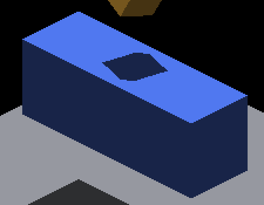
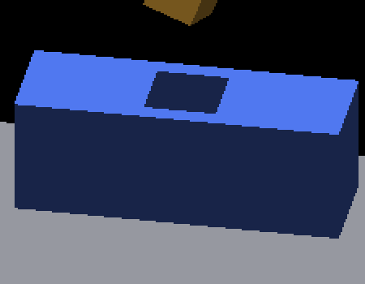
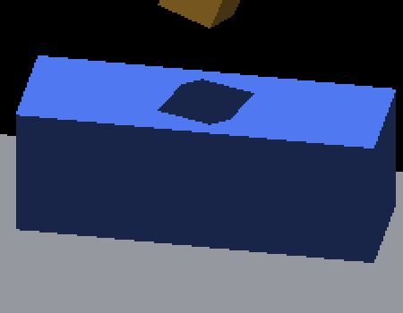

# GRID receiver shadow polygon controls

The rigid cube casts a straight finite silhouette onto the blue GRID receiver.
At the four cardinal camera angles, the frozen native Metal build matches the
independent polygon oracle with surface lighting off and on. At four intermediate
angles, the continuous surface-lighting opt-in matches; the default sampled route
still has missing and excess coverage. **This is a diagnosed remaining defect,
not a new rendering fix or a change to defaults.** The opt-in needs its full-scene
cost gates before default adoption.

| Camera yaw, radians | Surface lighting | Missing pixels | Excess pixels |
|---|---:|---:|---:|
| 0, π/2, π, 3π/2 | 0 and 1 | 0 | 0 |
| 0.6, π+0.6 | 0 | 18 each | 638 each |
| π/2+0.6, 3π/2+0.6 | 0 | 32 each | 650 each |
| All four intermediate angles | 1 | 0 | 0 |

Counts exclude a one-pixel shadow boundary band. All eligible receiver pixels
have one of the two expected blue colors; unknown-color counts are zero. Complete
polygons, sample denominators and counts are in [results.json](results.json).
The geometric occlusion exclusion is slightly larger than the earlier scratch
color mask at two angles; error counts agree, outside denominators differ.

| Cardinal, surface 0 | Intermediate, surface 0 | Intermediate, surface 1 |
|---|---|---|
|  |  |  |

## Independent geometry and sampling contract

The checker [render_receiver_shadow_polygon.py](../../../../scripts/render_receiver_shadow_polygon.py)
uses authored geometry and the shared rigid rotation, camera transform, isometric
projection and convex-hull utilities. It neither fits an outline to pixels nor
reads the engine's shadow map, projected-face records or shader intersection code.

The receiver is an 18×6×8 GRID box centered at (0,0,-12), with visible top z=-16.
The caster is a rigid 3×3×3 cube centered at (0,0,-24), rotated 0.47 radians about
(1,1,1). Parallel sunlight travels vertically; projecting its eight corners onto
z=-16 and taking their convex hull gives the expected shadow. Camera yaw is
Rz(-yaw). The fixed 2560×1440 image uses origin (1280,720) and isometric scales
(16,8), from zoom 4 and effective subdivision 4. Pixel samples use (x+0.5,y+0.5).
These values are fixture inputs, not inferred calibration.

Eligibility comes from the projected receiver polygon, inset three pixels to
avoid its silhouette. The independently projected caster silhouette, expanded by
one supporting-line pixel, excludes physically occluded receiver samples. There
is no observed-color eligibility mask. Every remaining sample, including the
shadow tolerance band, must be fully opaque and exactly lit blue (80,120,240) or shadow blue
(24,36,72). An unexpected color fails instead of hiding missing geometry.
Minimum eligible, interior and exterior sample counts reject empty coverage.
This strict palette is a fixture contract, not a general material classifier.

Signed margin is the minimum inward distance to a convex polygon's supporting
lines. Outside a corner this is not Euclidean distance to the finite polygon:
the exclusion band conservatively retains some corner extensions. Interior
samples farther than one pixel must be shadowed; exterior samples farther than
one pixel must be lit. The excluded band and outer receiver border are not a
claim of subpixel or silhouette correctness.

Replay a passing and a deliberately failing retained frame from the repository:

```sh
python3 scripts/render_receiver_shadow_polygon.py docs/pr-screenshots/codex/receiver-shadow-polygon/yaw0.6-surface1/screenshot_000001.png --yaw 0.6
python3 scripts/render_receiver_shadow_polygon.py docs/pr-screenshots/codex/receiver-shadow-polygon/yaw0.6-surface0/screenshot_000001.png --yaw 0.6
python3 -m unittest discover -s scripts/tests -p test_render_receiver_shadow_polygon.py
```

The second command exits 1. CPU tests use a separate Pillow polygon rasterizer
as the positive control and deliberately remove all shadows, shadow everything,
translate/rotate the silhouette, inject an unexpected color, change the palette
eliminate coverage, and make receiver pixels transparent or partially opaque. RGB
inputs retain their implicit opaque alpha. Boundary and pixel-center tests pin the sampling rule;
retained native pass/fail controls pin its application to actual screenshots.

## Native provenance and historical comparison

All 16 captures exited CLEAN using frozen artifact head
`463ed00cbbe97b23e961eaa8150afea3b85944cf`, binary SHA-256
`af73c5178c1dd51514d36d5bbbcfab184dd0dbf4ce22ee735b04e0939ba06b01`.
The [cardinal](cardinal-captures.json) and
[intermediate](intermediate-captures.json) original manifests retain artifact
hashes, commands and `IR_PERAXIS_SURFACE_LIGHTING=0/1`. Exact capture drivers are
retained as [cardinal](cardinal-capture.py.txt) and
[intermediate](intermediate-capture.py.txt) text; their temporary paths describe
the executed runs and must be replaced for replay. Full frames, crops, config
presets and compressed wrapper logs are retained per case. These captures use
the frozen production artifact, not the concurrent early-depth experiment.

The common capture arguments are:

```text
--only shadowbox,floor --probe-grid --probe-floor-mode grid --probe-floor-span 40
--sun-direction 0 0 -1 --no-spin --no-auto-rotate --pivot-origin --zoom 4
--subdivisions 1 --no-ao --auto-screenshot 10 --sweep-frames 1 10
--probe-overlapping-source --yaw <radians>
```

The old [exact-after capture](../overlapping-caster-shadow/exact-after.png) from
PR #4597 differs from current yaw-0 surface-0 by 1,056 pixels. Its oracle counts
are 60 missing and 52 excess pixels, versus zero now; the
[comparison](historical-comparison.json) records both hashes and complete counts.
This shows the retained cardinal artifact is corrected in the frozen build. It
does not attribute the improvement to the hierarchy patch alone.

These are image correctness controls on native Metal only: no Windows/OpenGL
qualification, performance claim, all-angle proof or arbitrary-material claim.
The pending work is a cohesive, affordable continuous receiver route at
intermediate yaw, with the same geometry oracle guarding any optimization.
Additional [camera-phase controls](../receiver-shadow-phase/README.md) exercise
near-cardinal and shifted views. The checker accepts `--camera-iso X Y` for
the fixed Metal snapped-camera contract; its default remains the origin used
by every capture in this directory.
