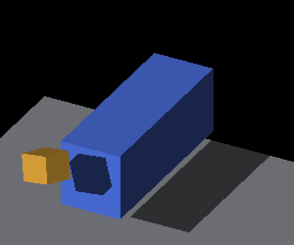

# Signed receiver sides and live cardinal crossing

This extends the authored-corner shadow oracle to the four signed side faces of
the fixed GRID box. It qualifies the existing continuous receiving path; it does
not enable that path by default or claim to fix sampled receiving.

| Sampled receiving | Continuous receiving |
|---|---|
|  |  |

These are two modes on the same implementation, not before/after screenshots of
the picking change. Full frames accompany every crop. The continuous outline
follows the projected rotated cube; the sampled outline retains trixel-scale
steps and incorrect coverage. No blur or edge-tolerance change is involved.

## Geometry and acceptance

The receiver is the authored 18×6×8 box centered at `(0,0,-12)`. Its side planes
are `x=±9` and `y=±3`. The caster is a rigid 3×3×3 cube rotated 0.47 radians about
`(1,1,1)`, centered at `receiverCenter + 12*sun + sourceOffset`. The oracle
projects its eight authored corners onto the selected plane, independently of
GPU records and observed pixels. Signed face normals determine Lambert color.

The selected face must face the camera and sun, and the whole caster must be
upstream. Receiver borders and the projected caster silhouette are excluded.
The shadow boundary retains the one-pixel tolerance. Side coverage requires at
least 60% of the projected face area (minimum 3,000 samples), shadow interior of
at least 10% of its projected polygon (minimum 500), and lit surroundings of at
least 20% of face area (minimum 2,000). These area thresholds come from authored
geometry, not measured color coverage. The existing top-face thresholds remain
20,000 eligible / 2,500 inside / 18,000 outside.

Independent oriented-box ray/slab tests verify signed-plane projection across
quadrants and fractional offsets. Shifted masks, alternating triangle coverage,
wrong colors, absent shadows, all-shadow images and insufficient coverage are
required failure controls.

## Native results

Apple M4 Max, macOS Debug/Metal, offscreen 2560×1440 output, configured game
resolution 1280×720, zoom 4, base subdivisions 1. Three objects: GRID receiver,
GRID floor and rigid detached caster. AO, visibility prepass and profiling are
off. Directional lighting is fixed per case; there are no local-light entities.

All 13 runs exited CLEAN, with unchanged binary/shader/script hashes. The
[commands and exit results](runs.json), configs and compressed complete logs
are retained. [Pixel results](captures.json) record the actual logged camera yaw.

| Cases | Frames | Result |
|---|---:|---|
| Continuous receiving, signed X/Y sides, two camera quadrants each | 8 | PASS: zero unknown, missing or excess pixels |
| Sampled receiving, one view per signed side | 4 | FAIL, retained as required negative controls |
| One live session, top receiver, yaw −0.03 through 0 to +0.03 | 7 | PASS: zero unknown, missing or excess pixels |

All four sampled controls have valid geometric coverage. Their missing/excess
counts are X− 202/158, X+ 184/712, Y− 100/379, Y+ 302/171.
The live sweep uses one settle frame between camera changes and preserves the
same scene/resources. It covers this cardinal/per-axis transition, not arbitrary
animation cadence, all cardinal boundaries, fog reveal or entity mode switches.

An initial sandbox launch found zero displays and was terminated before any
frame rendered. Its failure log is retained under `occluded-x-neg-control`.
A subsequent native capture at yaw −0.6 succeeded, but caster occlusion left
9,983 eligible pixels below its geometric requirement of 10,249. That preliminary
image has zero geometric errors yet does not qualify coverage; it is excluded
from the 19 graded frames. Its complete successful log was not retained. The
main sweep uses the independently chosen more observable quadrant views, with
unchanged thresholds.

## Picking consistency

Rigid canvas bounds now derive their anchor pick depth from the same scaled
origin encoding as compositing, then floor into the integer iso bins used by
hover readback. Default/sampled callers keep their previous depth. Tests cover
signed fractional anchors, four quadrants and subdivisions 1/2/4/8. Bounds picking
remains an anchor approximation; it does not become a surface-intersection test
or distinguish depths inside the same hover bin.

The source at capture is `f4794bb140c6c0e6ebd2c4ef125ada57271ad5c5` plus
[source.patch](source.patch). Binary SHA-256:
`ab8d2f99fc8583de243c869ae602fd5eee9564edf94c33f2a8aeed881496ab70`.
[Runtime hashes](runtime-hashes.json) and [artifact hashes](manifest.json) retain
the exact evidence. The base includes current master and the rigid-origin fix.

Replay the retained-image gate with:

```sh
python3 -m unittest discover -s scripts/tests -p test_render_receiver_shadow_polygon.py
```

For native replay, use the argument arrays in `runs.json`, replacing the absolute
config paths with paths in the local checkout and changing each config's output
directory to a fresh writable location. Native captures require display access.

This is not a performance measurement. Windows smoke of the parent PR does not
qualify these side-face images. Continuous receiving remains opt-in until fog
composition and representative cost/adoption gates pass. Five previously
recorded CanvasStress reference mismatches remain separate.
