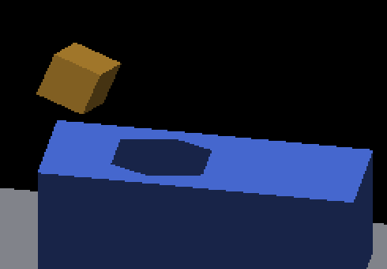
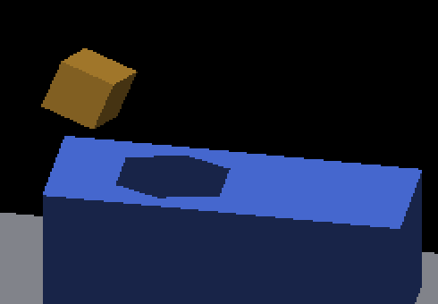

# Rigid canvas world origin

Rigid detached source faces now cast and receive lighting at their authored
fractional translation. Composite depth retains that translation until encoding
in framebuffer depth units. This fixes the misplaced shadows diagnosed by the
[oblique controls](../receiver-oblique-shadow/README.md), without changing the
geometric oracle, adding filtering, or changing revoxelized occupancy.

| Original fractional control | Corrected fractional control |
|---|---|
|  |  |

The original positive/negative sunlight controls had 392/388 missing pixels and
434/399 excess pixels. Both now have zero missing and excess pixels. These compare
the retained diagnosis from PR #4715 against the current implementation, not two
builds of the same parent with only a single line toggled. Each image is evaluated
independently against authored geometry. Full frames accompany every crop.

## Coordinate contract

For a rigid source point, `world = ownerTranslation + ownerRotation * local`.
`C_CanvasLocalRotation::worldGeometryOrigin()` selects the authored owner origin
for rigid geometry and the rounded cell origin for revoxelized occupancy.
`bakeVoxelFaces` and source-face lighting frame data consume the same accessor.
Hosted parts still measure their offsets from the unrounded owner origin.

`canvasWorldDepthOffset` selects depth policy from the producer's effective
layout. `SOURCE_FACES` scales translation by `effectiveSubdivisions * 8` before
the existing yawed-depth function rounds. Rounding the yawed depth first loses a
whole world unit of precision; this affects even integer translations at
intermediate camera yaw. Sampled layouts keep their previous rounding order and
the resampled raster-phase adjustment. Screen-locked overlays keep zero world
depth offset, and foreground priority retains its existing depth override.

The raw `RECTANGULAR` debug view remains a coarse storage/depth visualization.
Its rigid caster follows source geometry, but that view is not a continuous
surface correctness guarantee. Ordinary rigid voxel presentation uses
`SOURCE_FACES`; no new rendering mode or default toggle is introduced.

## Native checks

All 42 native Metal runs exited CLEAN with unchanged binary/runtime hashes.
Forty continuous controls pass the independent polygon oracle with zero unknown,
missing and excess pixels. All 42 have valid coverage under the unchanged
one-pixel shadow tolerance and 20,000/2,500/18,000 sample minima.

| Controls | Count | Result |
|---|---:|---|
| Previous integer/cardinal and near fractional cases, both sun directions | 14 | PASS |
| Fractional origins across four intermediate camera quadrants, both sun directions | 8 | PASS |
| Nine translations per sun direction, steps of 0.125 world units across a one-unit interval | 18 | PASS |
| Default sampled receiving, integer caster, positive/negative sun X | 2 | FAIL, unchanged: 135/498 missing and 382/134 excess |

The translation sequence moves X, Y and Z together, crossing rounded-origin
boundaries; each is a fresh fixed-pose capture. It tests positional correctness,
not animation cadence or temporal history. It does not certify all possible
angles or side receivers. The sampled receiving defect remains an explicit TODO;
the continuous surface-lighting opt-in has not become the default.

The [capture report](captures.json) retains commands, exact geometry, sample
counts, polygons, image hashes and pass/fail verdicts. The capture driver exits
successfully when runs complete cleanly; image verdicts are separate. The
retained-image unit test requires all 40 continuous passes and the two known
failures. Older retained fractional controls must still fail.

## Validation and replay

- `IRCanvasStress` and `IrredenEngineTest` native builds passed.
- 52 C++ pose, depth, attachment and fog-ghost tests passed, including parented
  fractional placement, mode transitions and independent quaternion depth checks
  across four quadrants and subdivisions 1/2/4/8.
- GLSL and Metal early-depth scalar contracts passed: 817 admitted and 1,703
  fallback canvases, 156,864 independently transformed corners per backend.
- Header/Metal registry/GLSL reserved-word checks passed.
- The receiver polygon suite re-evaluates all retained pass/fail images.

## Curved-receiver reference attribution

The broad native CanvasStress regression run passed 27/46 checks before reference
updates. Five failures were the previously recorded GRID mode-switch/return,
detach-to-GRID and two impulse mismatches. Fourteen additional differences were
the cylinder and pitched-cylinder external-caster references.

Four additional eight-angle captures isolate that change without rebuilding:
authored caster placement and a control explicitly offset to the old rounded
origin, each with upright and pitched cylinders. All four runs exited CLEAN.
The [comparison against the old references](curved/reference-comparison.json)
records 52,408 changed pixels in the authored arms, all within the blue receiver;
blue coverage and all pixels outside the receiver are unchanged. With the caster
moved to the rounded origin, every pixel blue in both images matches the old
reference exactly. That control intentionally moves the visible orange cube too,
so its overall image and occlusion coverage are not expected to match.

This isolates the reference changes to correcting the caster origin. The five
GLSL/Metal curved-receiver contract tests also pass, including 255 transformed
receiver rays per backend. Only the 14 changed cylinder references were updated;
the other two cylinder references and every threshold remain unchanged. The
real image comparator passes all 16 stored authored captures against the updated
references with max delta zero ([results](curved/refreshed-comparison.json)).
That is an offline recomparison, not a claimed fresh 46-check native rerun. The
five unrelated reference mismatches remain open.

The [curved capture driver](curved_controls.py), [comparison script](curved_compare.py),
full frames, logs and commands are retained. The comparison reads old reference
bytes directly from its pinned Git revision, so it remains reproducible after
the reference refresh. Existing comb patterns on cylinder sides are not fixed
by this coordinate change.

```sh
python3 docs/pr-screenshots/codex/rigid-canvas-world-origin/capture.py --output /tmp/rigid-origin-replay
python3 scripts/render_receiver_shadow_polygon.py docs/pr-screenshots/codex/rigid-canvas-world-origin/positive-fractional/screenshot_000001.png --yaw 0.6 --sun-direction 0.6 0 -0.8
python3 -m unittest discover -s scripts/tests -p test_render_receiver_shadow_polygon.py
fleet-run IrredenEngineTest --gtest_filter='CanvasRotation.*:CanvasPose.*:DetachedWorldDepthTest.*:DetachedDisplayTest.*:*FogGhost*:*CanvasPart*'
```

Capture base is `b09400aa2f436f73c382bc2bf944543ca2862dc7` plus the retained
[source patch](source.patch). Binary SHA-256:
`95387a9db22060b4b893371832cc3ef424c17bd37573948d4121d4ba2e22bf59`.
[Runtime hashes](runtime-hashes.json) cover the executable and runtime
shader/script files. Configs and compressed wrapper logs remain beside each
full frame. [Artifact hashes](manifest.json) cover the evidence files.

This is a coordinate-correctness change with per-canvas arithmetic, no added GPU
dispatches or per-voxel searches. It is not a measured performance improvement.
Native Windows/OpenGL, side-receiver accuracy and live route-transition image
coverage remain unqualified here.
