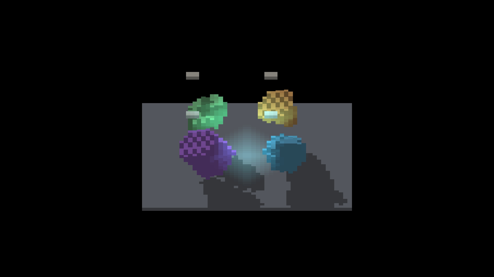
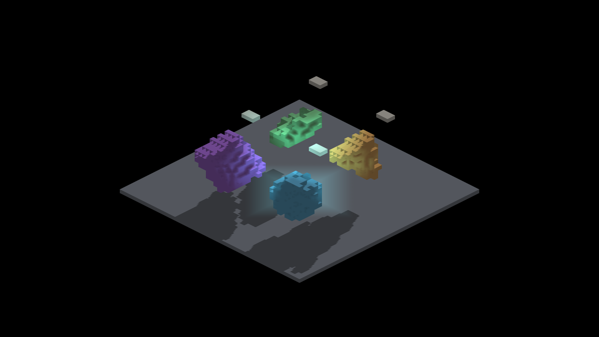
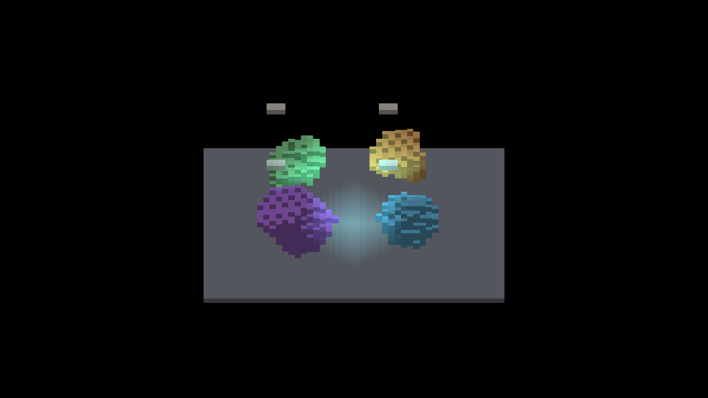
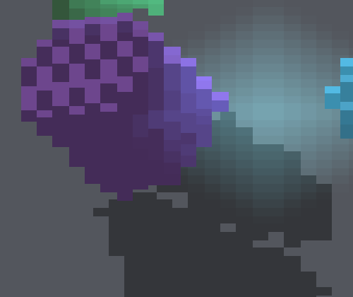
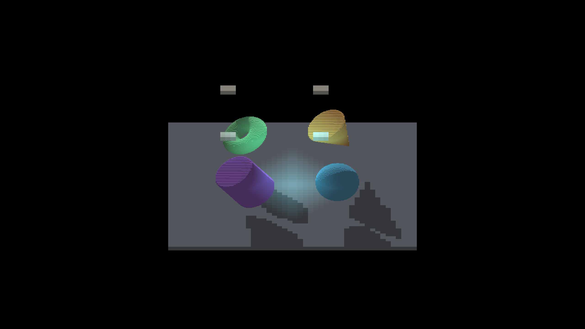

# Baked shape transform controls

Four SDF-authored DENSE assets (sphere, cylinder, cone and torus) are tilted
through ordinary GRID rotation. Each can be placed directly at its world pose
or attached beneath a translated parent with an exact Z half-turn. The root
quaternion is independently expanded as `(-y, x, w, -z)`; it does not call
the transform-composition helper under test. Fractional placement is shared.

All six root/parented frame pairs have **zero changed RGB pixels** with sun
shadows, AO, four external voxel blockers and one local light enabled. Both
arms use the same six images in the permanent ShapeDebug reference manifest.
The existing unposed fixture and profiling defaults are unchanged.

| Root pose | Parented pose |
|---|---|
|  |  |

| Shadows on, cardinal camera | Shadows off, intermediate camera |
|---|---|
|  |  |

The controls prove placement-path agreement, not an absence of visual defects.
These are resampled GRID solids, so their silhouettes differ from rigid source
faces and direct SDFs. Surface steps and shading remain visible with sun shadows
disabled. Ragged shadow boundaries and the isolated light patch within the
cylinder's floor shadow at yaw45 still need independent occupancy/ray attribution;
matching images do not certify them. Long shadows also meet the finite floor edge.
No blur, bias, shape inflation or shader changes are part of this slice.

Detail crop: x=900, y=650, width=500, height=420 from the full parented yaw45
frame, with no resampling.

All five six-shot captures (baked root/parented, baked shadows off, and direct
SDF root/parented) exited `RESULT=CLEAN` on native macOS Metal,
Apple M4 Max, Debug, 2560×1440 framebuffer (1280×720 game resolution).
Camera targets are yaw 0/45/90/180/270 at zoom/subdivision 4 and yaw45 at
zoom/subdivision 2, with origin pivot. Logs retain actual applied camera values.
There are 5,324 authored subject slots and 1,459 occupied source cells; rotated
occupancy is rebuilt by GRID. The floor and blockers are additional voxel sets.

`manifest.json` records capture commands, source/binary fingerprints and image
hashes. The compressed logs retain all wrapper output with the local worktree
path normalized. This is static-pose evidence; continuous motion, private canvas
modes, isolated local-light blocking, native Windows and throughput remain open.

## Verification

- Full `fleet-jobs start render-verify -- --target IRShapeDebug --no-build`:
  **74 checks passed**. All 12 new baked pose checks matched their shared
  references pixel-for-pixel. Existing references and tolerances were unchanged.
- The six direct-SDF root/parented pairs also have **zero changed RGB pixels**.
  Direct and baked representations are intentionally not compared for equality.
- Positive control: temporarily disconnecting the parent failed the real yaw0
  comparator: match **95.2278%**, maximum channel delta **197**, PSNR **27.48 dB**,
  exit 1 (all three thresholds failed). The source was restored and rebuilt;
  all six baked parented frames again matched the references exactly.
- Native target build, header checks, comment-reference lint and the two SDF
  profiling-control unit tests passed.
- `fleet-run IRShapeDebug --sdf-voxel-pose parented` without an isolated scene
  returned the expected usage error (exit 2).

| Direct SDF root | Direct SDF parented |
|---|---|
|  |  |

The direct-SDF screenshots are placement controls, not a claim that their
surface shading or shadow boundaries are correct.
