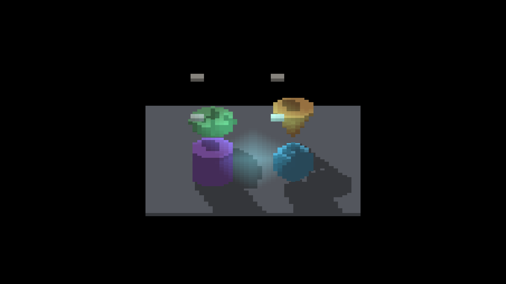

# Profiling-controls visual regression check

Separate untimed native macOS/Metal capture, with the profiling-controls build:

```text
fleet-run IRShapeDebug --sdf-voxel-scene baked --sdf-voxel-blockers --no-ao --auto-screenshot 20 --window-mode offscreen
```

All six shots exited cleanly and are byte-identical to the parent baked-blocker
captures. `manifest.json` records the binary and PNG hashes; `capture-tail.log`
contains all shot/camera/save lines and the clean-exit verdict (startup output
is not included). This confirms unchanged capture output; the timed runs
separately exercise the disabled profiling minimap.




The finite floor clips long shadows, and the retained small floor-shadow gap
at intermediate yaw remains an open geometry investigation. The corresponding
[profiling evidence](../../../perf/sdf-voxel-profile/README.md) makes no
performance-improvement claim.
