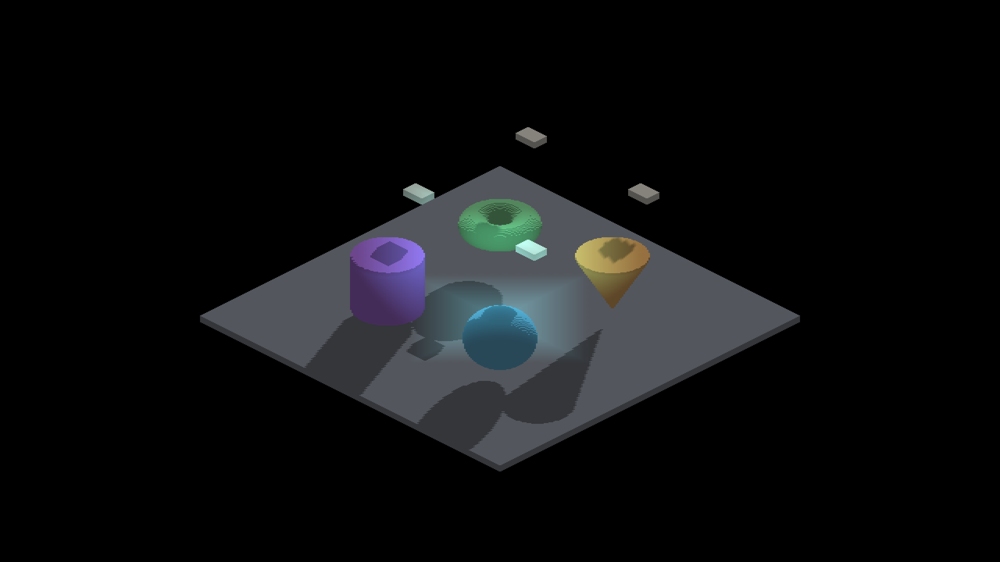
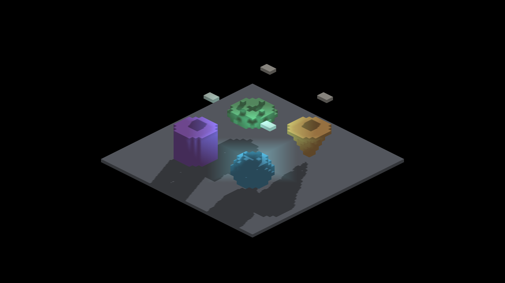
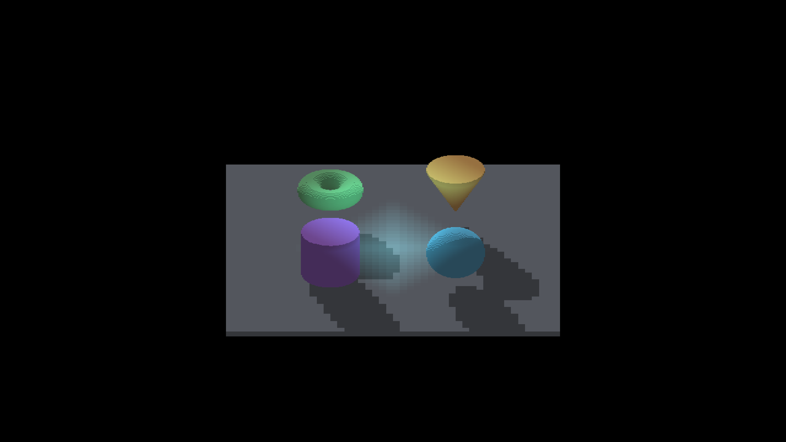
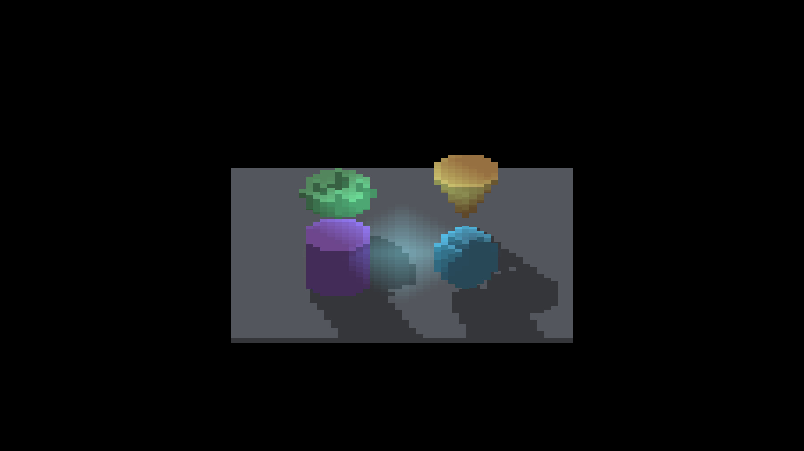
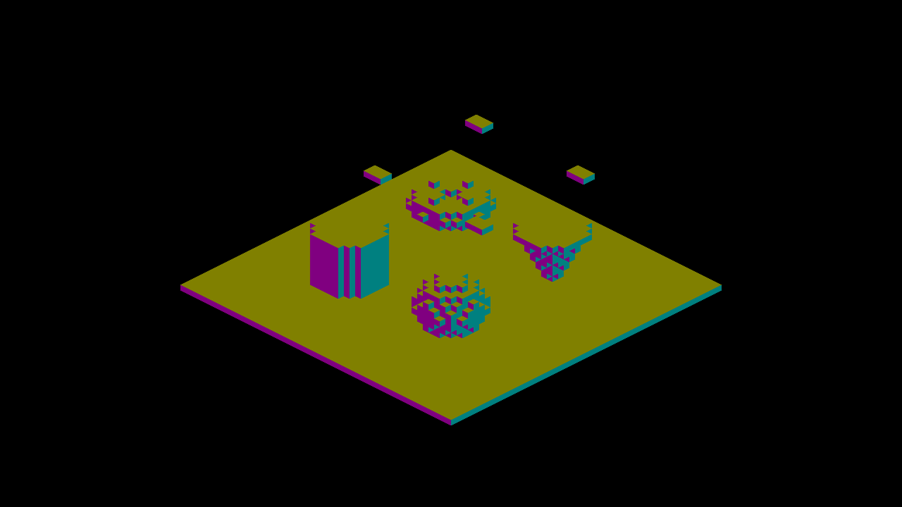

# SDF authoring with voxel runtime geometry

Native macOS/Metal captures of the matched `IRShapeDebug --sdf-voxel-scene`
fixture. These compare representations, not a before/after pixel-equality
contract. The baked arm contains ordinary finite voxels; the direct arm retains
analytic geometry. Both use the same authored parameters, material, position,
origin pivot, floor and local light.

| Direct SDF | Baked occupancy |
|---|---|
|  |  |
|  |  |
|  |  |

## Capture matrix

Eight arms each produced six shots: yaw 0/45/90/180/270 at zoom 4, and yaw 45
at zoom 2. Every arm exited `RESULT=CLEAN` (48 captures). `*-blockers` and
`*-unblocked` disable AO to isolate shadows; `*-no-shadow` keeps blockers but
disables AO and shadows; `*-normals` keeps blockers and displays normals.
The corresponding logs record the actual commands and shot labels. Each
directory's manifest records image hashes, the capture-time base HEAD, hashes
of the three changed rendering/authoring source files and the native binary.
The source changes were uncommitted at capture time; file hashes identify them.
These manifests do not fingerprint every build input or qualify performance.
The first baked-blockers log has an explicitly marked truncated startup chunk.

Representative beauty, no-shadow and normal views were visually inspected.
The baked cell steps and face-normal changes are intentional geometry. A small
gap in a baked floor shadow at intermediate yaw remains an investigation item;
this conversion is not evidence that every shared voxel shadow defect is fixed.
The finite floor also clips some long shadows at its boundary. Direct SDF
artifacts remain visible in its control arm. No blur or silhouette inflation is
introduced by the conversion.

The four baked subjects contain 1,459 occupied cells in 5,324 allocated slots,
or 63,888 bytes of voxel records. This excludes positions, other buffers and
the floor/blockers. It is a storage observation, not a speedup measurement.

## Validation

- `fleet-build --target IrredenEngineTest IRShapeDebug`: passed.
- `SdfBake*:VoxelSetEditApiTest.*:VoxelSetAnchorTest.*:SDF*`: 20 tests passed.
- `Sdf*`: 13 tests passed; the two runs cover 27 distinct tests.
- `render-verify.py --target IRShapeDebug --no-build`: all 62 checks passed.
  The six LOD, nine moving-caster and nine pivot-focus references were exactly
  equal. Two default-scene images and prefab-flower images retained tolerated
  reference deltas; this is not a claim that all 62 images were byte-identical.
- Four invalid CLI combinations rejected before window initialization; exact
  arguments and child exit codes are in `cli-controls.json`.
  Their wrapper `RESULT=CRASH exit=2` labels describe intentional CLI rejection,
  not a crash in a valid rendering run. Exported logs omit trailing blank lines.
- `git diff --check` and comment-reference lint passed. Instruction-size lint
  reports eight inherited over-budget documents; the edited voxel instruction
  file remains 210 lines, unchanged from the parent.

Windows/OpenGL qualification, matched warm-frame/stage profiling, startup cost,
density/overlap scaling and wider rotation/attachment coverage remain pending.
