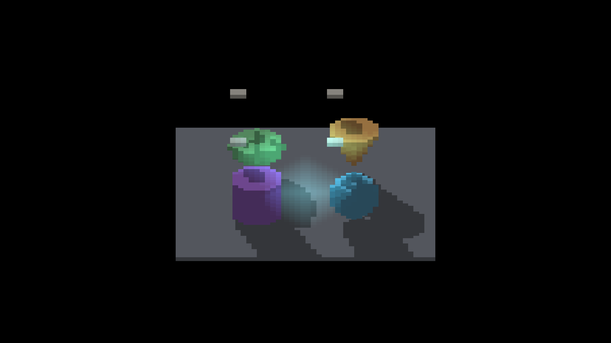

# Closed projected-face shadow boundaries

The small lit hole inside the baked sphere's floor shadow at yaw 45 was a
floating-point boundary rejection in the shared finite-face query. It disappears
with conservative closed-edge predicates based on projected binary32 roundoff.
Occupancy, shadow softness, caster dimensions and receiver bias are unchanged.

| Parent | Closed boundary |
|---|---|
|  |  |

The corrected region is immediately to the right of the blue sphere. The shape's
cell steps remain intentional; the finite floor still clips long shadows. This
is a specific seam fix, not a claim that every shadow artifact is resolved.

## Native evidence

Three macOS/Metal runs each captured yaw 0/45/90/180/270 at zoom 4 and yaw 45 at
zoom 2. All exited `RESULT=CLEAN`. The 18 full frames, complete normalized logs
and `manifest.json` retain commands, pose labels, source/binary/config hashes,
baseline paths/hashes and RGB differences. Source was uncommitted at capture;
the manifest identifies the four changed shader files, checks their staged
runtime copies and records parent `c9496f2ab20fb82053cda5aefcc125d23f5f3449`.
The source/binary/config fingerprints are not a complete build provenance record.
All images are 2560×1440; the logged game resolution is 1280×720.

| Arm | Changed RGB pixels in pose order |
|---|---|
| Baked occupancy, shadows on | 1960 / 940 / 1816 / 1768 / 1680 / 232 |
| Baked occupancy, shadows off | 0 / 0 / 0 / 0 / 0 / 0 |
| Direct SDF with voxel blockers | 120 / 0 / 120 / 8 / 120 / 0 |

The direct controls retain analytic shapes and voxel blockers; they exercise the
shared finite-face query without migrating the shapes. The yaw-45 direct control
is byte-identical. Representative baked cardinal/intermediate and direct frames
were visually inspected. No temporal stability or throughput claim is made.

## Deterministic checks

- `test_render_projected_face_boundary.py`: both production shader queries pass
  20,952 independently constructed boundary/exterior/grazing checks each.
  Mutations restoring strict edges, inflating footprints, or removing either
  finite-depth clamp fail as intended.
- `test_render_source_face_*.py`: 21 tests pass, including 61,934 independent
  ray queries per backend, bounded tile/spill/overflow behavior and source bases.
- Impulse shadow and detached triangle receiver adapters: three tests pass.
- `render-verify.py --target IRShapeDebug --no-build`: all 62 checks pass,
  without changing references. Full result is in `render-verify.log`.
- Native build, changed-file format check, Python lint and whitespace check pass.
  Focused mathematical and simplify reviewers found no remaining blocker after
  adding finite-depth clamping and separate U/V grazing mutations.

The [numerical contract](../../../design/surface-shadow-sampling.md#rounded-finite-face-boundaries)
is conservative at rounded boundaries and does not bound upstream projection
cancellation. Candidate-index tile seams remain separate. Rejection-heavy GPU
cost at 64/256 candidates and native Windows/OpenGL execution remain unqualified.
The earlier full representation performance matrix still needs a quiet host.

Master advanced during validation with the cardinal SDF AO/local-light depth
work. These captures deliberately compare against the unchanged stack parent;
integrating that work and reconciling the two changed screenshot references is
the next stack task, before new performance comparisons.
