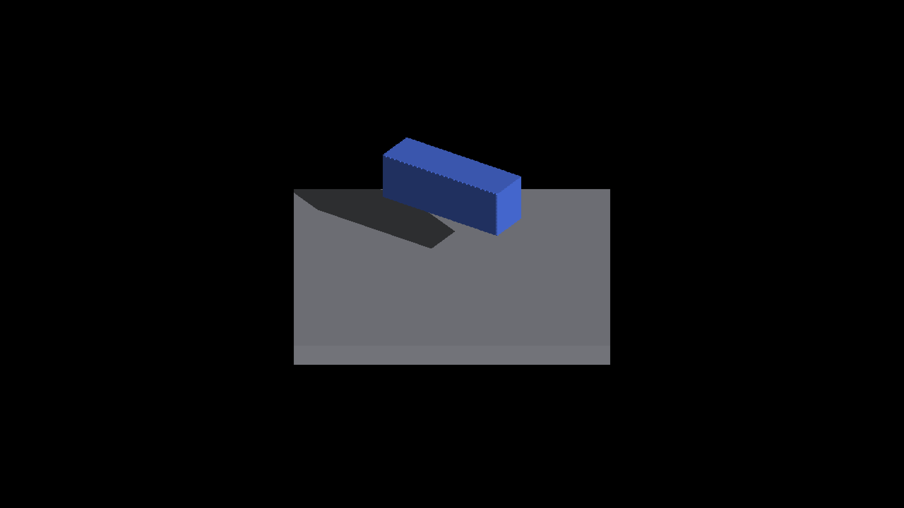

# Complete shadow queries for crowded tiles

Native Metal, Apple M4 Max, 2560×1440 output, offscreen. Both runs report
`RESULT=CLEAN`, exit zero. The before baseline is
`90503255f84bf5046b04fc9a31788bc17c2447ed`; after applies the bounded spill
implementation recorded in [capture-source.patch](after/capture-source.patch).
The fixture overlaps 65 analytic boxes on an SDF floor and sweeps eight camera
yaws with AO and animation disabled. Capture commands, binary hashes and image
hashes are in each run's manifest. The PNGs are unmodified engine captures.

| 45° before | 45° after |
|---|---|
|  |  |

The before shadow edge has repeating steps larger than the projected straight
edge. The after edge follows the finite geometry. Visual inspection of this pair
and the 180° after frame agrees with the metric; this does not approve every
other display or receiver mode. No blur, dilation or bias change is involved.

## Independent edge check

The unchanged projected-box metric uses the historical complete-reference
fixture's geometry and fixed one-pixel boundary tolerance. Its
[before command](before/metric-command.json) and
[after command](after/metric-command.json) run from the repository root.
[Before](before/metric-results.json) fails all eight strict checks;
[after](after/metric-results.json) passes all eight.

| Camera yaw | Before missing pixels | Before excess pixels | After missing/excess |
|---|---:|---:|---:|
| 0° | 27 | 28 | 0 / 0 |
| 45° | 37 | 51 | 0 / 0 |
| 90° | 82 | 62 | 0 / 0 |
| 135° | 73 | 124 | 0 / 0 |
| ≈180° | 90 | 140 | 0 / 0 |
| −135° | 59 | 91 | 0 / 0 |
| −90° | 107 | 122 | 0 / 0 |
| −45° | 117 | 86 | 0 / 0 |
| Total | 592 | 704 | 0 / 0 |

Every after PNG is **byte-identical** to the corresponding
[historical complete-geometry diagnostic](../shadow-overflow-order-proof/complete/).
[Provenance](provenance.json) records the eight comparisons and hashes. Production
queries retain per-tile geometry; they do not enable that diagnostic's full-pool
scan.

## Coverage and limits

Each frame requests 198 geometry records; the busiest tile contains 196.
Before, 203–356 tiles per frame exceed the 64-candidate inline list. After,
all those tiles have complete local queries, using 7,166–12,477 spill nodes.
The raw probe CSVs and engine logs are retained as losslessly compressed gzip
files. [Probe summaries](after/probe-summary.json) report zero incomplete tiles
for every after frame.

The bounded allocation retains 64 inline candidates, up to 256 queried
candidates per tile, and 262,144 shared spill nodes. The buffer is 30,146,568
bytes, approximately 2.125 MiB larger. Above the tile/record limits or on global
spill exhaustion, sampled fallback remains; global exhaustion demotes all
spill-dependent tiles so allocation order does not choose exact coverage.
This fixture does not establish arbitrary-density sharpness or a performance
improvement. Native Windows/OpenGL and warmed Release timing remain separate
validation work.

The captured `renderer.patch` contains shaders only. `capture-source.patch`
supplements it with the allocation and probe headers, reconstructed after the
capture. Its shader portion was checked byte-for-byte against the recorded
shader patch; runtime probe metadata independently reports the new buffer size.
Both patch hashes and reviewed source hashes are retained in provenance.
The two header hashes were sampled after formatting. Reconstructing their earlier
bytes from the base and patch confirms that all non-whitespace source tokens,
including string literals, match the formatted headers.
The original manifest's `clean` means clean process completion, not a clean git
working tree.
