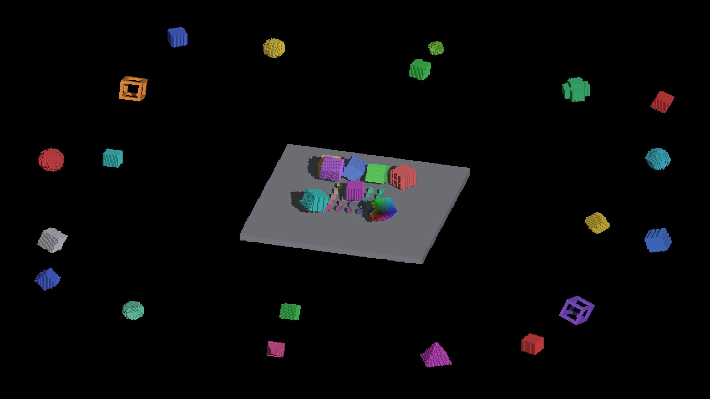

# Full-scene attribution

Native Metal on Apple M4 Max, 2560×1440, offscreen. Parent
`90503255f84bf5046b04fc9a31788bc17c2447ed` reproduces all eleven selected
committed references byte for byte. Candidate
`9256ac0473584699c98de0e1f470378224f7fff0` changes eight of them, on object
surfaces. A second candidate run with the index probe enabled reproduces all
eleven candidate captures byte for byte.

The diagnostic arm replaces tile traversal only for complete spilled tiles
with a scan of every published geometry record. It preserves ordinary inline
and incomplete-tile behavior. All eleven diagnostic PNG hashes equal their
candidate hashes. The diagnostic patch, commands, binary hashes and clean-exit
logs are retained per run; [comparisons.json](comparisons.json) records every
image hash. The diagnostic is restored afterward and is not production code.

| Sampled overflow, before | Complete finite query, after |
|---|---|
|  |  |

The front red object's irregular dark bites disappear, while the stepped
geometry and its directional face lighting remain. Other changes include both
new finite hits and removed extrapolated hits. The independent
[receiver contract](../receiver-contract.md) checks the actual producer,
receiver and finite caster functions against triangle vertices and ray controls;
the native comparison checks index completeness in these real scenes. Together
these justify updating the eight Metal references without changing thresholds.
They do not certify arbitrary grazing-angle numerical precision or tiles above
the bounded query limits.
