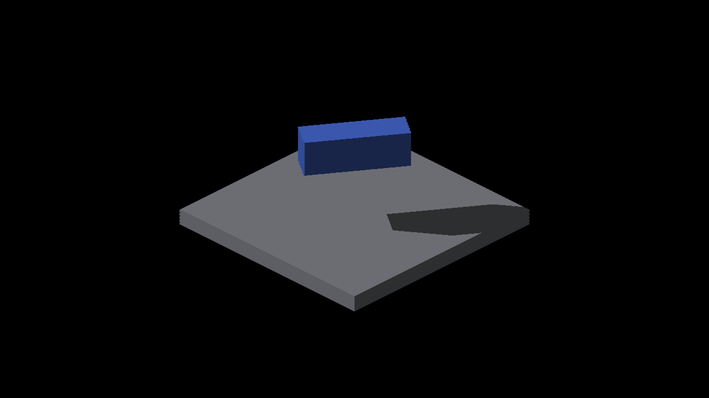

# Dense-overlap shadow query controls

This is diagnostic evidence and a regression guard, **not a production shadow
fix**. The production sampler is unchanged; the complete-pool experiment is
restored to its default-off state. Native Metal, Apple M4 Max, Debug,
2560×1440 output, on the receiver-registration stack after merging master
`e85624b3e`. Each manifest records the exact revision, binary hash, command,
screenshot names and renderer-patch hash. The enabled arm retains its patch.

## Result

The scene has 65 identical overlapping analytic boxes above an SDF BOX floor.
It produces 198 records, with a maximum tile count of 196. Its union geometry
is the same as one box; the extra entities only increase index pressure.
Eight yaw views include all quadrants and their intermediate angles.

| Query | Missing shadow pixels | Excess shadow pixels | Strict edge checks |
|---|---:|---:|---:|
| Default overflow fallback | 592 | 704 | 0/8 |
| Complete-pool diagnostic | 0 | 0 | 8/8 |

[Metrics](metrics.json) use the independent projected-box oracle, the corrected
displayed receiver origin, and the unchanged one-pixel boundary tolerance.
The tolerance only grades the image; it does not alter rendered edges. The
experimental arm changes no geometry, blur, bias, fallback footprint or index
construction. All eight restored images are RGB-identical to baseline, and
all eight restored tile tables are byte-identical ([restoration](restoration.json)).
This isolates the remaining error in this fixture to incomplete-query fallback.
It does not certify every caster/receiver combination or performance.

| Default sampled fallback | Complete-query diagnostic, not enabled in production |
|---|---|
|  |  |
|  |  |

Small teeth on the displayed box face boundaries remain visible in both arms.
This floor-only oracle excludes the caster and does not establish whether those
boundaries are valid reconstruction or a separate display defect. Keep that
question separate from the measured floor-shadow correction.

## Reproduce

Run the command in each manifest through `fleet-run`. The only experimental
edit changes `IR_SUN_FACE_OVERFLOW_REFERENCE` from 0 to 1 in both sampler
backends; stage shader assets with `fleet-build --target IRCanvasStress` before
each arm. Restore 0 and rebuild for the final control. The bounded reference
is documented in [the overflow design](../../../perf/bounded-source-face-reference.md).

```sh
fleet-run --timeout 120 IRCanvasStress --only shadowbox,floor --probe-source-box --probe-floor-mode sdf --probe-floor-span 40 --frozen-pose 0.6 --pivot-origin --no-spin --no-auto-rotate --no-ao --subdivisions 1 --zoom 3 --auto-screenshot 6 --sweep-yaw 0 5.49778714 8 --sun-face-index-probe --probe-analytic-box --analytic-box-yaw 0.6 --analytic-box-count 65
```

The capture log supplies actual yaw (the nominal 180° view is -3.1414928),
effective density four and screenshot paths. Copy exactly those images and
that run's index CSVs before the next launch. Compressed logs and tables are
retained per arm. Commands in `metric-command.json` name the original temporary
capture paths; substitute the corresponding retained PNG paths to rerun.
The analytic box half extents are `(8.625,2.625,3.625)`, yaw 0.6; floor top
2.375, half-span 19.625; screen origin `(1280,720)`, iso scale `(16,8)`.
The metric's legacy effective-subdivision field is unused for this explicit
continuous-geometry case; capture density is recorded separately.

## Why the partial-list shortcut was rejected

The sampler can safely accept a hit from a valid retained record while keeping
sampled fallback after an incomplete miss. But the first 64 records are chosen
by atomic reservation order. The same scene can therefore become shadowed or
lit depending on whether its real blocker survives, if fallback misses it.
It also cannot remove excess sampled shadow after a miss.

`test_render_source_face_overflow.py` executes both production shader backends
through a C++ adapter. For the same 65- and 129-record scenes it exchanges the
last retained candidate between a miss and the sole blocker, without changing
the complete record pool or sampled depths. The subtexel blocker contains
receiver `(2.9,3.5)` but misses sampled texel center `(2.5,3.5)`; the independent
triangle oracle verifies that an empty indexed fallback is geometrically
possible. Nonempty indexed fallback uses an additional tap-only face, and the
primary layer represents a separate non-indexed surface. All four primary/indexed fallback
combinations and both cascades are exercised: 16 comparisons per backend and
switch setting. Current default behavior and the complete-pool diagnostic are
stable. A mutation that enables capacity-guarded partial hits fails specifically
with `retained subset changes shadow coverage` on both backends.

The guard also supplies poisoned, unpublished IDs after global exhaustion;
the sampler must not read them. Existing tests retain complete-tile authority
in an exhausted pool. These host controls demonstrate the schedule-dependence
of the proposed shortcut; they do **not** claim observed native flickering.
The native screenshots compare default fallback with a complete query, never
with the rejected partial query.

## Next implementation gate

A production fix needs complete local candidate coverage without a global
small-scene cutoff. Pooled tile ranges can redistribute the existing index
budget; conservative sun-space bounds and depth intervals can reduce exact
ray work. Validate true overlap, false AABB overlap, empty rays, unrelated
remote casters, global exhaustion, and the separate FIELD fog eligibility
policy. Measure index-build and receiver-query costs before adopting a layout.
The current 256-record complete scan remains a diagnostic, not that solution.
