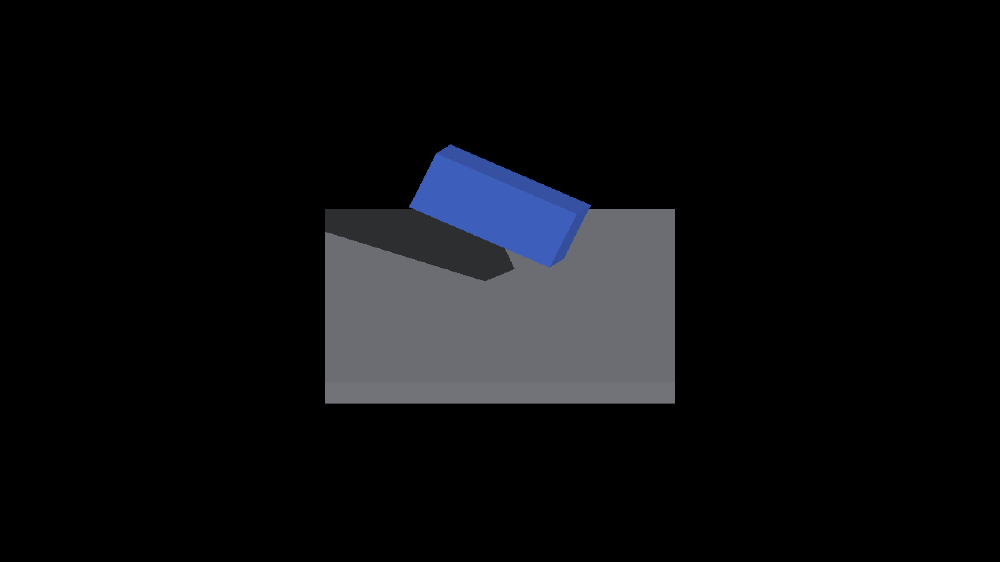
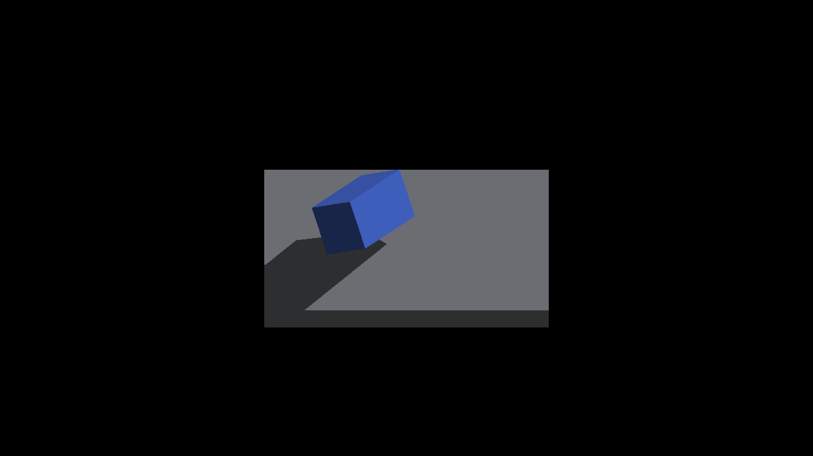
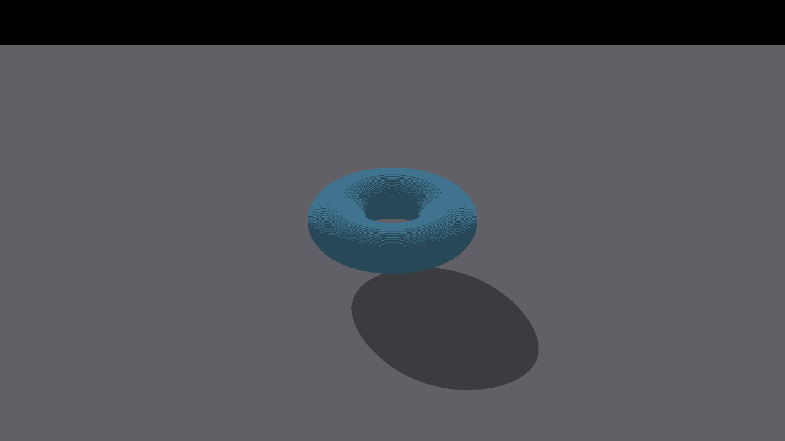
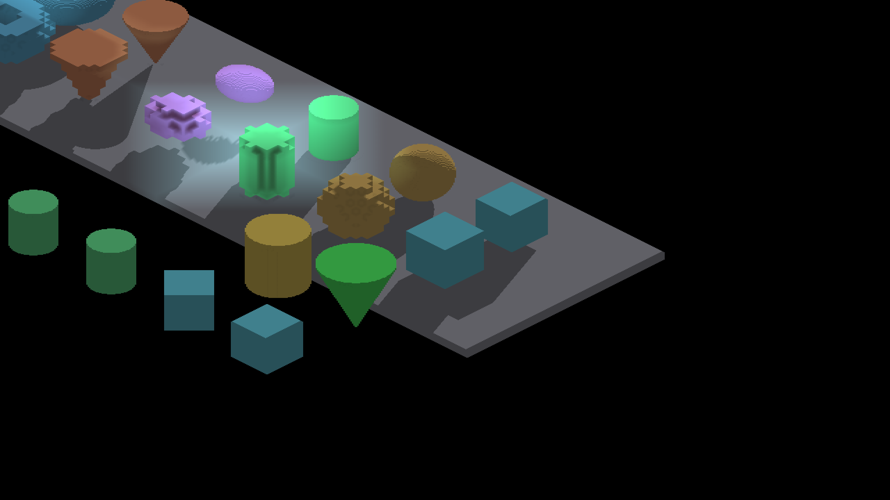

# Fragment receiver registration and mode matrix

Native Metal, Apple M4 Max, Debug, 2560×1440 output. Parent revision
`3fe348fff8c7d8024f0daf3fba5c26cebeca6eb9`; after captures retain the renderer
patch in their manifests. No blur, dilation, edge cleanup or threshold relaxation
is applied. Logs record clean shutdown, actual yaw, density and capture paths.

## Coordinate repair

Continuous fragment rays were one storage texel ahead of the displayed geometry.
The compositor centers world geometry at the floating canvas center; the SDF
receiver reconstructs coordinates from the integer Z1 producer anchor. Convert
only the geometric query with `raw - canvasSize/2 + trixelOriginOffsetZ1(size)`.
Raw texture, owner and hover addresses stay unchanged, as do compute queries.
GLSL and Metal share the same conversion and use it in beauty and shadow debug.

At this box fixture's density four, the error displaced the floor shadow by
(-4,-2) output pixels. The corrected box checker projects actual geometry and
uses an independent displayed screen origin. Its ray/slab control covers eight
yaws, noninteger extents, translated centers and floor intersections. A connected
production-shader adapter checks 15,200 screen rays per backend at densities
1/2/4/8, 16 yaws and even/odd backing sizes. Missing conversion and a hardcoded
even-size offset both fail. Odd-size tests establish query algebra, not complete
producer coverage or sampled-depth correctness for odd backing sizes.

## Box receiver matrix

Each row contains eight yaw views. Counts are missing/excess output pixels
outside the unchanged one-pixel measurement boundary; that band never changes
the rendered image. Full results are in [metrics.json](metrics.json).

| Caster / receiver | Before | After |
|---|---:|---:|
| Rigid / SOURCE_FACES | 0 / 0 | RGB-identical in all eight views |
| Near-contact rigid / SOURCE_FACES | 0 / 0 | Unchanged path |
| Rigid / SDF BOX | 3,647 / 4,936 | 0 / 0 |
| Near-contact rigid / SDF BOX | 3,538 / 4,250 | 0 / 0 |
| Analytic box / SDF BOX | 3,711 / 4,841 | 0 / 0 |
| 65 overlapping analytic boxes / SDF BOX | 3,820 / 5,168 | 592 / 704 |

The three unsaturated SDF cases remove 24,923 wrong pixels across 24 checks.
The pressure case retains real errors: its maximum tile count is 196 and all
views contain incomplete index tiles. [Index summaries](index-summary.json)
retain per-view counts and hashes; compressed raw CSVs accompany the one-box
and 65-box after controls. These are deliberately identical overlapping solids,
so the reference shape is unchanged while index pressure increases.

GRID and revoxelized receiver captures are diagnostic comparisons against a
continuous floor, not pass/fail certificates of their different representations.
GRID currently lights coarse face samples. Revoxelized receivers use their own
resampled occupancy and display-trixel centroids. Neither run saturated the
index. Enabling fragment lighting for GRID needs separate cost evidence: the
existing opt-in path has a measured wider-view GPU regression. The bounded
[exact-pool diagnostic](../../../perf/bounded-source-face-reference.md) already
separates overflow fallback errors; this patch does not enable that experiment.

| Rigid on SDF, before | Rigid on SDF, after |
|---|---|
|  |  |

| Near-contact before | Near-contact after |
|---|---|
|  |  |

Reproduce captures using each directory's manifest command. The rigid box is
18×6×8 at `(0,0,-12)`, rotated 0.6 radians about `(1,1,1)`. Near-contact adds
the rendered offset `(4,6,6)`. The analytic box has half extents
`(8.625,2.625,3.625)` and rotates 0.6 radians about Z. Effective density is four,
screen iso scale `(16,8)`, screen origin `(1280,720)`. The recorded metric
`effective_subdivisions=1` is an unused legacy quantization input in this explicit
continuous-geometry mode; `capture_effective_subdivisions=4` records the renderer. SOURCE_FACES floor top is
2 with half-span 20; SDF floor top is 2.375 with half-span 19.625.

```sh
python3 scripts/render-shadow-box-metric.py <capture.png> --source --iso-scale 16 8 --camera-yaws <actual-radians> --box-pose 0.6 --floor-top 2.375 --floor-half-span 19.625 --strict-edges
```

Use `--box-offset 4 6 6` for contact, or replace `--box-pose 0.6` with `--box-yaw 0.6 --box-half-extents
8.625 2.625 3.625` for the analytic fixture. Geometry arguments describe the
rendered pose; the demo snaps rigid source translations.

## Independent curved-shadow registration

The earlier cone/torus checker copied the displaced receiver origin into its
expectation. Its historical 16/16 result proved relative caster shape, not
absolute registration. The corrected default is image center; explicit
`--screen-origin 1276 718` reproduces the historical convention at this fixture.
Old captures are preserved in the sibling report and regraded here.

| Shape | Before missing / excess | After missing / excess | Strict checks |
|---|---:|---:|---:|
| Cone | 9,102 / 7,346 | 0 / 0 | 0/8 → 8/8 |
| Torus | 7,800 / 5,786 | 0 / 0 | 0/8 → 8/8 |

[Curved metrics](curved-metrics.json) pair each shadow with its no-shadow control.
All 16 after projections pass the independent horizontal-section union oracle;
no reference is clipped. Surface banding remains visible in the controls and is
not certified or repaired by these floor-shadow measurements.

```sh
fleet-run IRShapeDebug --spin-yaw --auto-screenshot 8 --zoom 8 --no-ao --pivot-origin --spin-shape torus --spin-shape-floor
python3 scripts/render-shape-footprint-metric.py <shadow.png> <control.png> --shape torus --representation analytic --yaw <actual-radians> --iso-scale 32 16 --subdivisions 8 --strict-edges
```

Repeat for cone; add `--no-shadows` for controls.

| Torus before | Torus after |
|---|---|
|  |  |

## Full-scene regression and limits

Fresh parent and after captures each completed the 21-shot ShapeDebug sequence
with warmup 10. [Scene comparison](scene-comparison.json) separates changes from
this patch from small inherited parent/reference differences around the sphere.
The three density-one views remain RGB-identical. Eighteen affected default
references are refreshed after the geometric checks and image review. Reference
thresholds, structural gates and extra-run references remain unchanged.

| ShapeDebug before | ShapeDebug after |
|---|---|
|  |  |

This is a coordinate-correctness fix, not a performance gain or proof that all
rendering modes have exact shadows. Remaining work includes saturated-index
fallback, GRID sampling costs, curved-surface reconstruction/reception, native
OpenGL presentation, and integration with the separately owned FIELD fog shadow
policy. The parent dependency hold on that fog work remains in effect.
