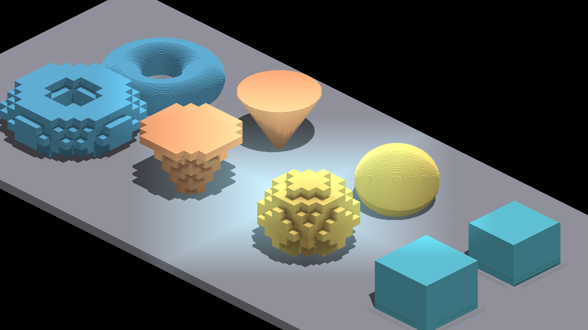

# Lighting-reference attribution

The full native lighting suite completed all three runs cleanly and passed its
domain assertions. Before reference updates, 44 of 46 image rows passed.
Two rows failed the unchanged 99.5% match requirement:

| Row | Parent match | Corrected match |
|---|---:|---:|
| `domain_z4_yaw0_band` | 99.5167% (pass) | 99.4838% (fail) |
| `domain_z8_yaw0_inwin` | 99.4701% (fail) | 99.3638% (fail) |

The parent already fails the second row. The first crosses the threshold with
the corrected floor-query placement. These are image-reference failures, not
failed domain assertions. [Reference metrics](reference-comparison.json) retain
the original scores. The images retain parent, corrected, and original reference
for each row; only these two lighting references are refreshed, without changing
thresholds. The independent floor-ray and caster-footprint controls in the parent
report establish the intended registration rather than using reference agreement
as correctness evidence.

Both attribution runs used:

```sh
fleet-run --timeout 120 IRLightingEmissive --light-domain-matrix --auto-screenshot 10
```

The parent run restored only the four changed shader files from
`3fe348fff8c7d8024f0daf3fba5c26cebeca6eb9` and rebuilt the target. The after run
used `64ad1cf42bb61783e3811211fb6ae3de8ce62483` shaders. Both completed cleanly;
all 36 rows have matching labeled poses. [RGB hashes](comparison.json) retain
their comparison: eight images are identical, 28 reflect changed lighting.
The corrected shaders and staged assets were restored after attribution.

| Parent | Corrected |
|---|---|
|  |  |

Inherited curved-surface striping and sampled voxel lighting remain outside
this coordinate repair. The separate AO/light-depth work will require combined
recaptures at integration; neither branch's references alone certify that result.
