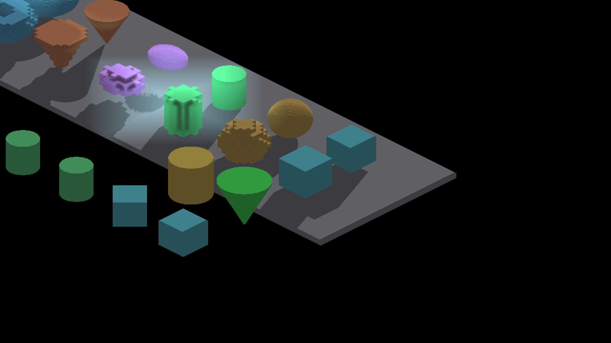

# Analytic shape floor shadows

Native Metal, Apple M4 Max, Debug, 2560×1440. The baseline combines the
cardinal-continuity branch (#4258, `afcd6c0cf`) with master `6dc95f706`.
`capture-manifest.json` records the exact baseline revision and commands.
The after images use this change's algebraic light-space caster/query path.
Final recaptures at `cdab8cf8ea0e5063d6207f42d132bd15623d439b` are RGB-identical
to all 16 measured cone/torus after frames. The manifest records that revision
and shader hashes, including the shared quadratic-interval cleanup and the
latest parent GLSL fix. The baseline lacks only that GLSL-only parent repair;
its Metal rendering is the matching control.

Each shape has eight complete before/after/control frames. Controls disable
sun shadows; AO is disabled throughout. All capture runs exited cleanly.
`sha256.json` hashes the native PNGs; no blur or image cleanup is applied.

```sh
fleet-run IRShapeDebug --spin-yaw --auto-screenshot 8 --zoom 8 --no-ao --pivot-origin --spin-shape cone --spin-shape-floor
```

Repeat for `torus`, and add `--no-shadows` for the matching control. Actual
yaws and subdivision density are in each run log. Measure each pair with:

```sh
python3 scripts/render-shape-footprint-metric.py <shadow.png> <control.png> --shape cone --representation analytic --yaw <actual-radians> --iso-scale 32 16 --subdivisions 8 --strict-edges
```

The independent reference unions projected horizontal disks/annuli from the
rendered field solid, using 4096 height intervals and 512 angular sectors.
This is a convergent geometric reference, not a claim of exact raster boundary
ownership. The one-pixel boundary tolerance is measurement-only. It does not
alter rendering. Fixture tests check section boundaries and convergence.

| Shape | Before IoU range | After IoU range | Strict edges before → after |
|---|---:|---:|---:|
| Cone | 0.65923–0.83425 | 0.99056–0.99429 | 0/8 → 8/8 |
| Torus | 0.66508–0.83868 | 0.99453–0.99639 | 0/8 → 8/8 |

Every after frame has zero missing/excess shadow outside the one-pixel boundary
band; no projected reference is clipped. Per-frame counts are in each
before/after directory's `metrics.json`.

| Cone, 45° before | Cone, 45° after |
|---|---|
|  |  |

| Torus, 45° before | Torus, 45° after |
|---|---|
|  |  |

The torus's fine surface striping is also present in the no-shadow control.
These captures establish its floor projection, not clean curved-surface normals
or exact self-shadow reception.

## Full-scene and unchanged-path controls

The standard ShapeDebug sequence completed 21/21 frames on both revisions,
covering zoom 1–16, cardinal/intermediate yaw, LOD changes and camera pans.
The three subdivision-one captures (0, 3 and 7) are RGB-identical. Higher-density
frames change with the corrected analytic shadows; `scene-comparison.json`
records their raw changed-pixel counts and bounds, not a correctness score.
Representative full frames are included below.

After integration with master `c369df603`, the native `render-verify` run at
`1fe03b342` passed all **44 checks**. The 18 changed default references were
reviewed against the matching before/after captures and refreshed; all 21
default shots then matched exactly. No thresholds, extra-run references or
structural gates changed. Pivot, dense LOD, portrait and prefab runs also pass.
The flower's highest-zoom shot retains its 99.9028% match within the unchanged
tolerance. [render-verify.log](render-verify.log) contains the complete result.

The complete render/tooling harness passes all 79 suites after updating the
three executable shader adapters to the shared shape helpers. Their independent
geometry and mutation controls remain enabled. The profiling harness passes all
six suites after making mocked report timestamps deterministic; production
freshness checks are unchanged. [harness-tests.log](harness-tests.log) records
the full render/tooling suite result.

| ShapeDebug zoom 4 before | ShapeDebug zoom 4 after |
|---|---|
|  |  |

CanvasStress's frozen default scene completed three matched yaw captures
(0°, 45°, 90°) at zoom 2, with **all three RGB-identical** before/after.
`canvas-comparison.json` records null difference bounds; all six PNGs are
included. This is a regression control for the unchanged voxel/box scene,
not new certification of inherited artifacts.

Sphere and cylinder also completed eight-angle isolated Metal sweeps; their
0°/45° frames are included. The strict image oracle currently grades cone and
torus only. Executable ray tests cover all four analytic types.

## Timing check

Three guarded 300-frame runs per revision use the same full ShapeDebug scene,
zoom 4, yaw 45° and `profiles/timing.lua` to enable GPU stage timing:

```sh
fleet-run --timeout 90 IRShapeDebug --auto-profile 300 --zoom 4 --yaw 0.7853982 --config-preset <absolute-path-to-profiles/timing.lua>
```

The baseline revision is `8055aeb5f`; the after revision is `cdab8cf8e`.
All six runs exited cleanly with guarded quiet windows, 300/300 valid GPU frame
samples and zero dropped per-axis entries. Raw reports are in `profiles/`.

| Measurement | Before run mean (range), ms | After run mean (range), ms |
|---|---:|---:|
| Steady frame, excluding first 75 frames | 10.43 (10.02–10.63) | 10.59 (10.28–11.00) |
| GPU frame envelope | 5.128 (5.072–5.236) | 4.991 (4.990–4.992) |

This is a small Debug workload regression check on one Metal host. Runs are
grouped before/after rather than interleaved, and frame pacing has a wide tail;
the measurements do not establish a speedup or dense-scene throughput. GPU
envelope includes inter-submission gaps and buffer stalls, not just busy time.
The extra type word costs 256 KiB at the unchanged 65,536-record capacity;
there is no new dispatch or buffer binding.

## Voxel measurement correction

`voxel-baseline-corrected.json` remeasures the unchanged 16 native voxel images
in [the earlier footprint investigation](../4274-shape-shadow-footprints/README.md).
Accounting for the Z1 framebuffer origin removes the false displacement in the
oracle: every voxel frame passes strict edges. No voxel renderer change is
responsible for that improvement. Historical oracle/error images in the earlier
directory retain their original, incorrect image-center origin.

## Bounds and validation limits

The ray path supports non-hollow smooth sphere, cylinder, cone and torus shapes.
Lattice/hollow/other SDF shapes preserve their existing sampled caster path.
Exact continuous edges require an eligible surface receiver and a complete
bounded index tile. Overflow falls back to the separately ray-baked depth map.
OpenGL native execution and broad performance acceptance remain separate from
the Metal screenshots and executable CPU tests of both shader implementations.

Next checks are native OpenGL, finite-ray reception on curved SDF surfaces,
surface-normal/fragment reconstruction (the torus's no-shadow striping), and
high-overlap/overflow performance. The isolated voxel floor footprints are
already correct under the repaired measurement convention.
