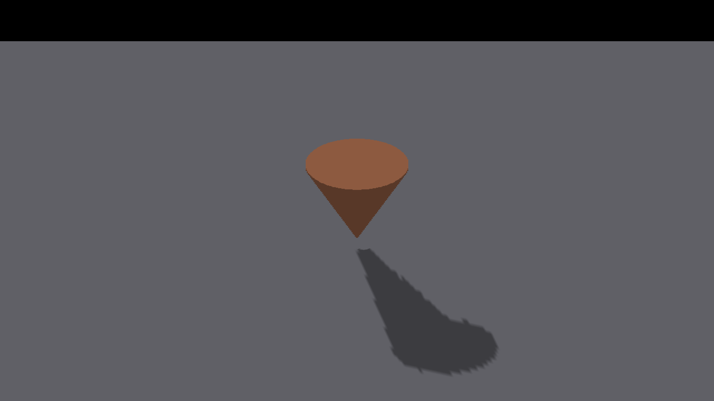
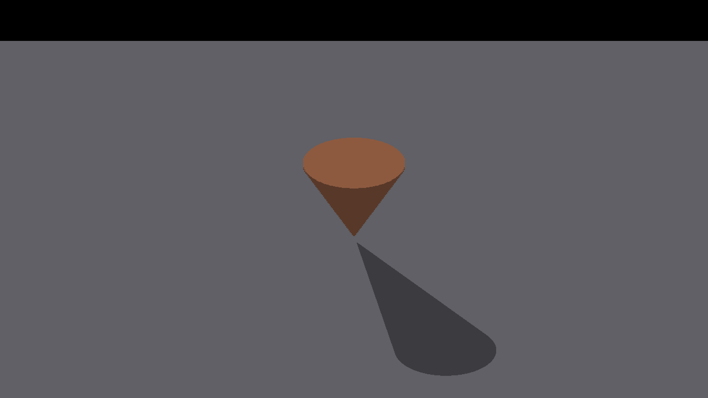
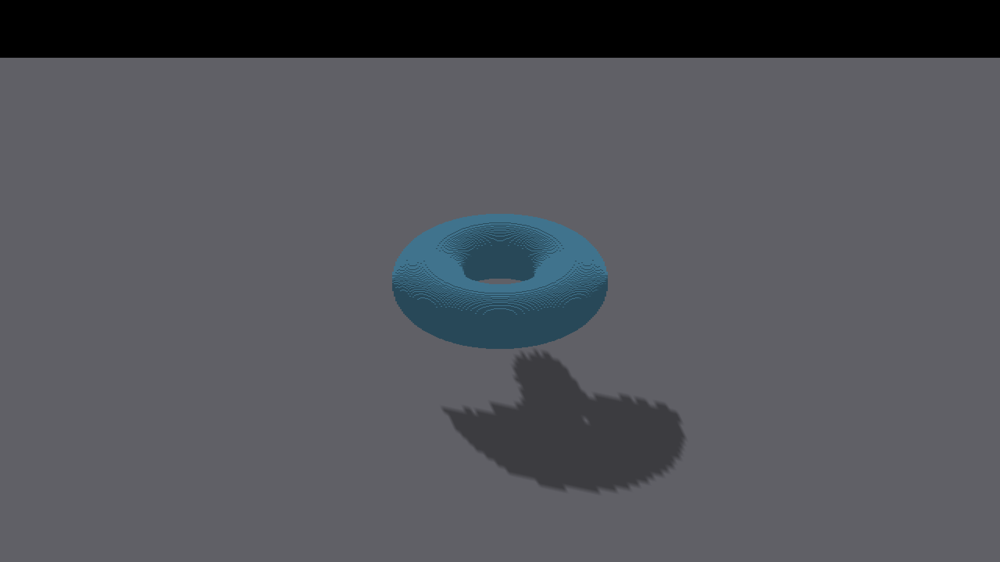

# Analytic shape floor shadows

Native Metal, Apple M4 Max, Debug, 2560×1440. The baseline combines the
cardinal-continuity branch (#4258, `afcd6c0cf`) with master `6dc95f706`.
`capture-manifest.json` records the exact baseline revision and commands.
The after images use this change's algebraic light-space caster/query path.

Each shape has eight complete before/after/control frames. Controls disable
sun shadows; AO is disabled throughout. All capture runs exited cleanly.
`sha256.json` hashes the native PNGs; no blur or image cleanup is applied.

```sh
fleet-run IRShapeDebug --spin-yaw --auto-screenshot 8 --zoom 8 --no-ao --pivot-origin --spin-shape cone --spin-shape-floor
```

Repeat for `torus`, and add `--no-shadows` for the matching control. Actual
yaws and subdivision density are in each run log. Measure each pair with:

```sh
python3 scripts/render-shape-footprint-metric.py <shadow.png> <control.png> --shape cone --representation analytic --yaw <actual-radians> --iso-scale 32 16 --subdivisions 8 --strict-edges
```

The independent reference unions projected horizontal disks/annuli from the
rendered field solid, using 4096 height intervals and 512 angular sectors.
This is a convergent geometric reference, not a claim of exact raster boundary
ownership. The one-pixel boundary tolerance is measurement-only. It does not
alter rendering. Fixture tests check section boundaries and convergence.

| Shape | Before IoU range | After IoU range | Strict edges before → after |
|---|---:|---:|---:|
| Cone | 0.65923–0.83425 | 0.99056–0.99429 | 0/8 → 8/8 |
| Torus | 0.66508–0.83868 | 0.99453–0.99639 | 0/8 → 8/8 |

Every after frame has zero missing/excess shadow outside the one-pixel boundary
band; no projected reference is clipped. Per-frame counts are in each
before/after directory's `metrics.json`.

| Cone, 45° before | Cone, 45° after |
|---|---|
|  |  |

| Torus, 45° before | Torus, 45° after |
|---|---|
|  |  |

The torus's fine surface striping is also present in the no-shadow control.
These captures establish its floor projection, not clean curved-surface normals
or exact self-shadow reception.

## Voxel measurement correction

`voxel-baseline-corrected.json` remeasures the unchanged 16 native voxel images
in [the earlier footprint investigation](../4274-shape-shadow-footprints/README.md).
Accounting for the Z1 framebuffer origin removes the false displacement in the
oracle: every voxel frame passes strict edges. No voxel renderer change is
responsible for that improvement. Historical oracle/error images in the earlier
directory retain their original, incorrect image-center origin.

## Bounds and validation limits

The ray path supports non-hollow smooth sphere, cylinder, cone and torus shapes.
Lattice/hollow/other SDF shapes preserve their existing sampled caster path.
Exact continuous edges require an eligible surface receiver and a complete
bounded index tile. Overflow falls back to the separately ray-baked depth map.
OpenGL native execution and broad performance acceptance remain separate from
the Metal screenshots and executable CPU tests of both shader implementations.
