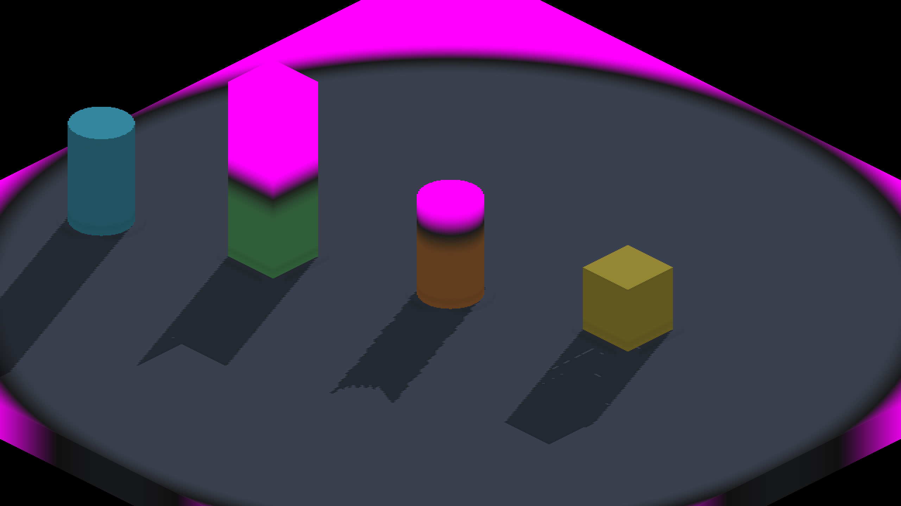

# FIELD fog integration

The stack integrates master `9409a78fcd004a88f1be581ed8c809a07fb3831e`,
including the merged FIELD ceiling policy. Eligibility for whole-shape indexing
uses the same BODY/FIELD decision for boxes and curved shapes. Fog samples use
the solved caster hit. Deliberately unindexed FIELD cuts write the independent
depth layer so a complete source-face query cannot discard their shadows.

`fleet-run IRFogDemo --ceiling-shadow-curved --auto-screenshot 10` completed
with exit 0 and `RESULT=CLEAN` on the integrated Metal renderer.
The native probe reported centre `66:15.774`, rim `72:13.816`, control
`70:13.870`, BODY twin `111:22.298`, and curved gap `6.524` above required
minimum `2.298` (sun texel `0.463`). The FIELD cylinder remains ceiling-cut
while its BODY twin casts its full silhouette.

The production-executing box/FOW adapter tests both shader twins, including
complete empty/BODY-only tile queries and three rejected policy/layer mutations.
The combined CPU render harness passes 88/88 suites. Windows presentation of
this combined implementation remains unverified.
