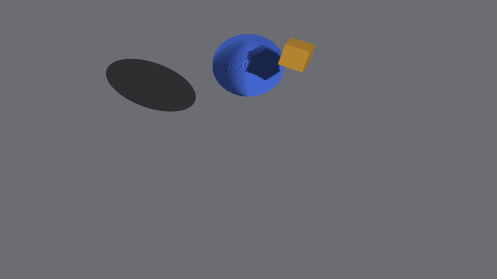
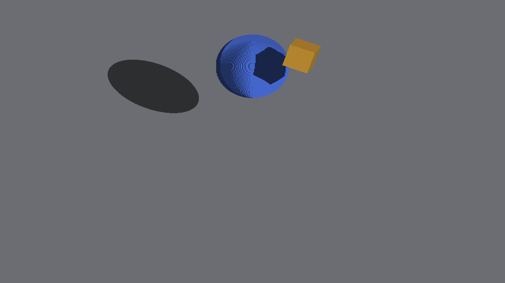

# Sphere shadow reception

Native Metal, Apple M4 Max, Debug, 2560×1440 output, 1280×720 game
framebuffer. Requested zoom 6 produces effective subdivision 8. Before is
`72c6e5218ae9e217813a08b63cfac3336cb54017`, including master `9e45a862e`.
The after build adds the sphere receiver change; `capture-manifest.json`
records source hashes, exact commands and all image hashes. Every retained
capture run exited CLEAN.

The blue sphere receives the shadow of a separate rigid voxel cube. Its
previous receiver reconstructed a point from the stored integer depth and
display slot, applied an outward half-voxel offset, and sampled the depth map.
The new receiver intersects the retained source sample's camera ray with the
same finite sphere used for casting, then queries geometric occluders there.
Shared box/sphere placement math keeps cardinal snapping and smooth yaw in
agreement. No filter, blur, dilation, canvas coverage or displayed normal changes.

The displayed face normal still controls direct lighting and query eligibility.
A sun-lit voxel face on the analytical sphere's back side must let the sphere
occlude it; substituting the radial normal would incorrectly skip that query.

| 45° before | 45° after |
|---|---|
|  |  |

The horizontal surface bands remain in the [shadows-disabled control](no-shadows/1.png).
This change does not repair their fragment reconstruction. It computes one
visibility value per retained sample, not an independent value per display
fragment. Hollow/lattice/subdivision-one spheres and other curved shapes retain
their existing paths; curved silhouette and thin boundary ownership are not
certified by this slice.

## Reproduce

```sh
fleet-run --timeout 120 IRCanvasStress --only shadowbox,floor --probe-analytic-sphere --probe-overlapping-source --pivot-origin --no-spin --no-auto-rotate --no-ao --subdivisions 1 --zoom 6 --auto-screenshot 6 --sweep-yaw 0 5.49778714 8
```

Repeat with `--no-shadows` for the control. The eight control images are
RGB-identical before/after. Every changed pixel in the shadow-enabled pair
belongs to the blue receiver; floor and blocker colors are unchanged.
All eight existing isolated cone/floor captures also remain RGB-identical.

The independent fixture oracle intersects camera rays with the sphere and
sun rays with the rotated blocker box. Its blocker translation is rounded to
the rendered world cell, as required by `CanvasPose::write`; using the raw
authoring translation creates a false discrepancy. It excludes a four-game-pixel
band around the expected shadow boundary and a two-pixel band around eligible
surface pixels. These are measurement exclusions for sampled display ownership,
not renderer smoothing. Near the terminator it excludes radial facing below
0.15 and displayed faces with insufficient direct light. It is an interior
external-shadow check, not an exact silhouette or self-shadow image oracle.

Run the independent check for each pair (yaw is in radians):

```sh
python3 scripts/render_sphere_shadow_metric.py --image docs/pr-screenshots/codex/shape-shadow-sun-space/sphere-receiver/after/1.png --control docs/pr-screenshots/codex/shape-shadow-sun-space/sphere-receiver/no-shadows/1.png --yaw 0.7853981633974483
```

[All eight angle reports](interior-metrics.json) retain the same 10,122 shadow
interior and 43,154 lit interior game pixels before and after. Missing shadow
pixels fall from 551 to zero; excess shadow pixels fall from 394 to zero.
Three views have no visible blocker-shadow interior and check lit support only.
Seven metric tests include independent synthetic geometry, empty support and
all-lit/all-shadow failure controls. Independent review found no blocking issues.

Executable production GLSL/Metal helper tests cover 23,328 rays per backend,
all 384 owner-key lanes, unsupported/missing-owner fallback, disabled shadows,
unchanged lighting normals, self-occlusion and external blocker rays. Ten
mutations are rejected. Native OpenGL and dense-scene performance remain
unverified for this change.

## General-scene references

The first full ShapeDebug run passed 39/44 checks. Four default views and
`prefab_flower_z16` crossed the existing pixel thresholds. A native recapture
with the four modified shader assets restored from the baseline reproduced all
21 default references exactly. The flower baseline already had a small reference
difference (99.9028% match, maximum delta 56), which passed the unchanged gate.

[Retained original references, baseline captures and final captures](regression/manifest.json)
separate that inherited variation from this change. The four default differences
are confined to sphere surfaces; new flower differences are 3,200 darker pixels
on its yellow sphere, with petals and stem unchanged from the recaptured baseline.
Independent review accepted these as the intended self-occlusion change, where a
displayed face can face the sun while the analytic solid blocks it. Only these
five native references were refreshed; thresholds and the other references were
left unchanged. This is not certification of the remaining surface bands or
general petal shading.

The final fresh native run of `python3 scripts/render-verify.py --target
IRShapeDebug --no-build` passes [all 44 checks](regression/final-gate.log).

## Ground-gap controls

Separate eight-yaw CanvasStress runs isolated `shadowbox,floor` at frozen pose
0.6 and requested zoom 3 (effective density 4), with AO/spin disabled. The rigid
source variant used `--probe-source-box`; the revoxelized variant omitted it.
Both exited CLEAN. Their maximum per-tile record counts were 23 and 39,
respectively, below the capacity of 64. Inspected ground projections were solid.
This does not close the report of gaps in the full scene, at contact boundaries,
on different receivers or under index saturation.
