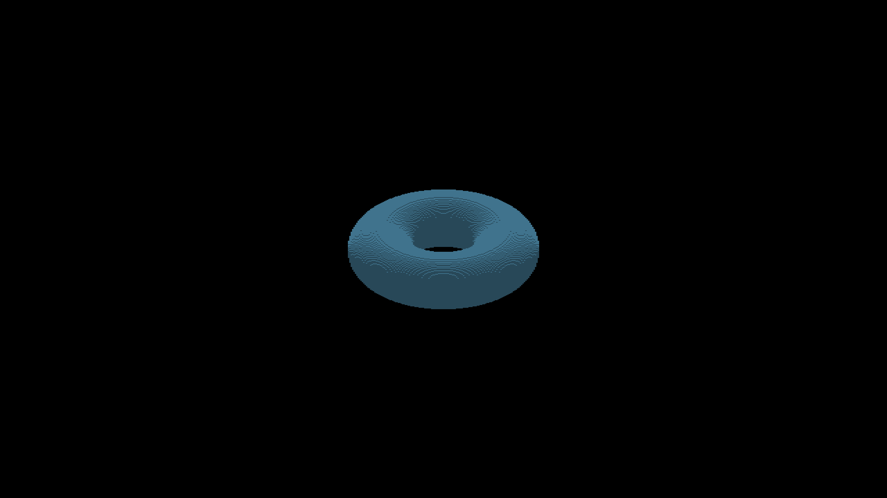
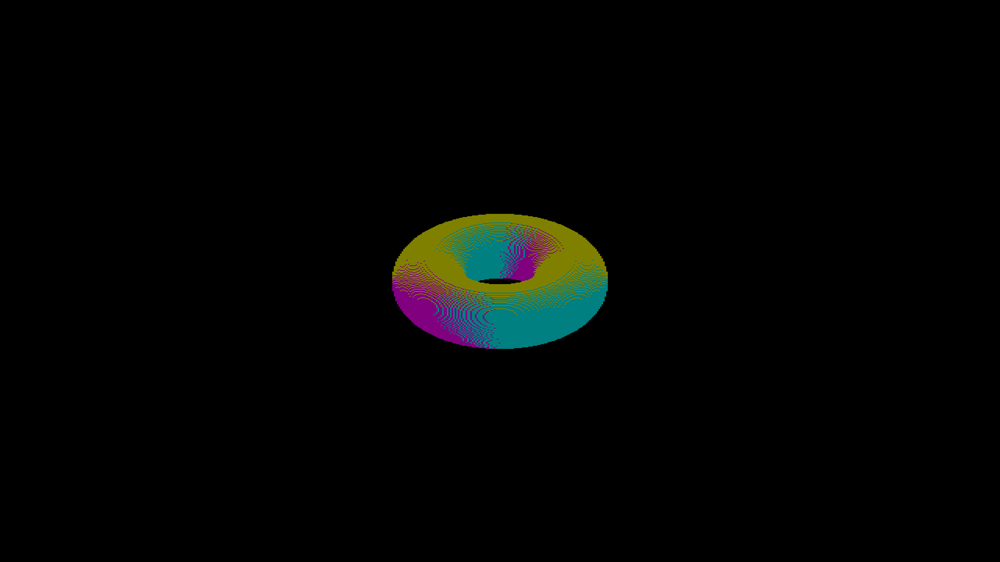
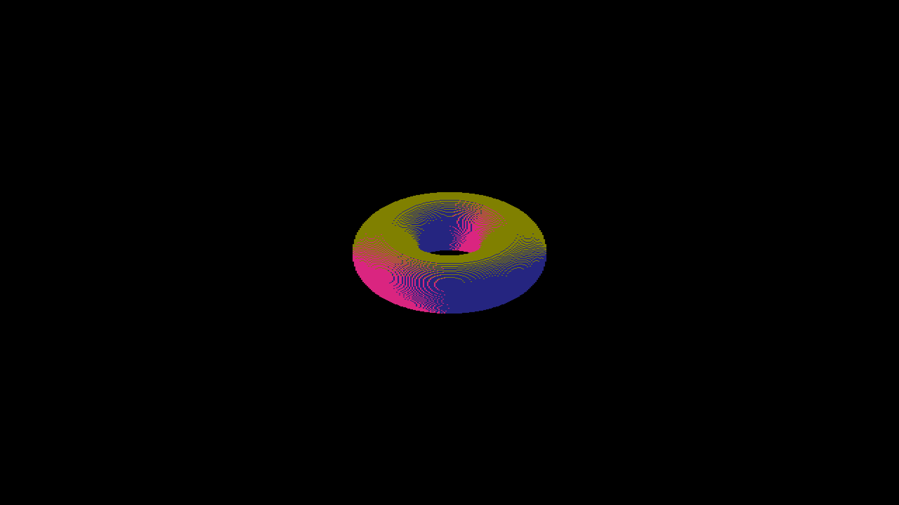

# Torus surface classification probe

Native Metal at `3fe9f6cd6477976473858bda30bd0d9d2b8c73c7`, effective
subdivision eight. Eight matched beauty/normal frames disable both sun shadows
and AO, with no floor. Both runs exit cleanly. Commands, source revision, RGB
hashes and full-frame color-pair counts are in [capture-pairs.json](capture-pairs.json).
The example PNGs are unmodified native captures.

| Yaw | Beauty, no shadows or AO | Normal diagnostic |
|---|---|---|
| 0° |  |  |
| 45° |  |  |

At yaw zero, every non-background pixel belongs to one of three normal classes:
63,376 pixels of `(128,128,0)` have beauty color `(64,115,141)`; 59,824 pixels
of `(0,128,128)` and 28,176 of `(128,0,128)` have beauty color `(40,72,88)`.
The bands therefore coincide with face-normal selection even with shadows and
AO disabled. This localizes their immediate shading input; it does not prove
that the normals or represented geometry are wrong.

`shapeBoxReceiver` excludes curved shapes, so the torus does not use finite
fragment reconstruction. Its general depth search and three emitted diamonds
retain their sample/face-slot convention, and lighting decodes those slots into
axis normals. A continuous torus gradient is a useful representation comparison,
but it is not an oracle for stepped voxel faces. Legitimate depth steps can have
different exposed normals and triangular risers.

## Executable classification

`scripts/render_torus_surface_probe.py` independently enumerates accepted
fractional samples. For integer iso coordinates `(i,j)` and depth `d`, the sample
center in subdivision-scaled view space is
`((2d-3i-j)/6, (2d+3i-j)/6, (d+j)/3)`. These centers do not form a single integer
voxel lattice; rounding them would test a different representation.

The [retained report](classification.json) reproduces all 151,376 foreground
pixels and the full background exactly: 18,406 accepted samples produce 18,922
stored texels. This is a publisher/image agreement check, not a visual approval.
The companion test executes extracted GLSL and Metal depth search, face offsets,
depth and owner election, publication guards and normal decoding. Both backends
reject six mutations; shuffled submission order preserves the elected output.
Independent small controls test occlusion, edge ties and missing/extra pixels.

Separately, the report intersects camera rays with the union of finite unit
cubes centered at those fractional samples. It examines all equal encoded-depth
owners rather than inferring a native owner from normal color. Its classifications
of published pixels are:

| Finite-face model classification | Pixels |
|---|---:|
| Nearest exposed face for every possible owner | 40,056 |
| Selected face does not intersect the ray | 37,504 |
| Selected face is occluded | 26,390 |
| Classification depends on the unknown owner | 46,906 |
| Outside the finite union | 520 |

The model also covers 808 pixels absent from publication. Normal classes differ
from the nearest model face at 49,124 published pixels; the 520 pixels without
a finite hit are counted separately. The report retains
examples, depth intersections, input hashes and the fixed Z1 registration.

These counts measure a representation difference, not certified renderer errors:
the current smooth SDF path uses rectangular gather, which does not promise
finite unit-cube coverage. The next rendering change must establish the intended
curved-surface geometry and retain native owner/depth evidence where ties matter.
Compare an explicit finite-face route against these controls before changing
normals or extending curved receivers. Continuous torus gradients remain a
separate comparison; no normal averaging or renderer change is included here.

Run from the repository root:

```bash
python3 scripts/tests/test_render_torus_surface_probe.py
python3 scripts/render_torus_surface_probe.py --normals docs/pr-screenshots/codex/shape-shadow-sun-space/torus-surface-probe/normals-0.png --output /tmp/torus-surface-classification.json
```

The CLI's exit status grades publisher/image agreement only. Finite-model
differences are reported without turning the existing artifact into an accepted
geometry golden. `--pixel X Y` explains a particular framebuffer location.
