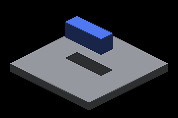

# Cooperative sun hierarchy: unchanged crowded shadows

All eleven native Metal captures are pixel-identical in full RGBA to the retained
[14-pass production controls](../sun-overflow-hierarchy/README.md). No reference
image was refreshed. This optimization changes hierarchy construction, not the
finite geometry, tree layout, shadow predicates or receiver sampling.

| Retained 14-pass frame | Two cooperative passes |
|---|---|
|  |  |

The detail is an unchanged 360×240 crop at `(1100,600)-(1460,840)`; the full
[cardinal](far-128/screenshot_000001.png) and
[oblique](oblique-aligned-128/screenshot_000001.png) captures retain the distant
caster. The lower blocker's shadow remains intact with 128 distant casters.

The cases cover complete and overflowed tiles, nearby/distant casters, vertical
and oblique sunlight, and probe-on/off equivalence. [comparisons.json](comparisons.json)
records zero changed RGBA pixels for every pair. The comparison uses the already
retained baseline, not a freshly rebuilt parent. The separate native kernel
comparison does compile the actual parent and candidate production kernels.

[captures.json](captures.json) preserves commands, binary hash and geometry/index
counts. Each case retains its original config, compressed log and full PNG; nine
retain geometry/index readback. [source.patch](source.patch) records the engine
overlay on `4ef8a31b6607cbcce2c3d7845cbe05c3d6874dfd` at capture time.
[runtime-hashes.json](runtime-hashes.json) fingerprints the binary, scripts and
runtime shader files. The capture used Metal Debug on Apple M4 Max, macOS 26.5.2,
with a 2560×1440 framebuffer. Subsequent C++ source formatting does not change
the captured algorithm. Capture/readback runs are not timing evidence.

Replay from a matching build:

```bash
ir-acquire gpu -- python3 docs/pr-screenshots/codex/sun-overflow-hierarchy/capture.py --output /tmp/sun-cooperative-replay
```

[Build timings and node readbacks](../../../perf/sun-cooperative-build/README.md)
are retained separately. Native Windows/OpenGL, global record-pool exhaustion,
broader scene transitions and the known sampled receiver-edge defect remain
outside this qualification. Unchanged images do not establish universal shadow
correctness or a million-entity frame-rate target.
