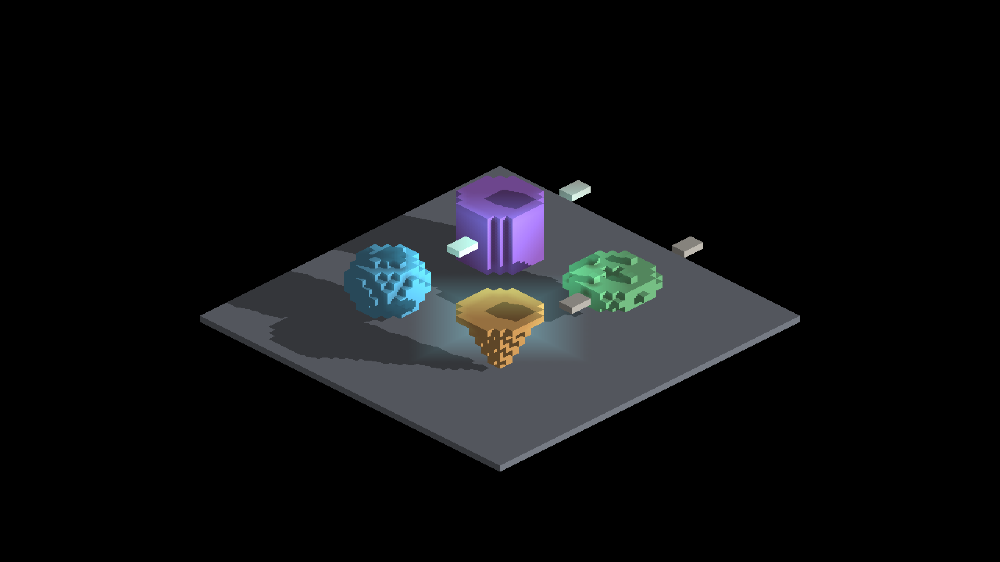
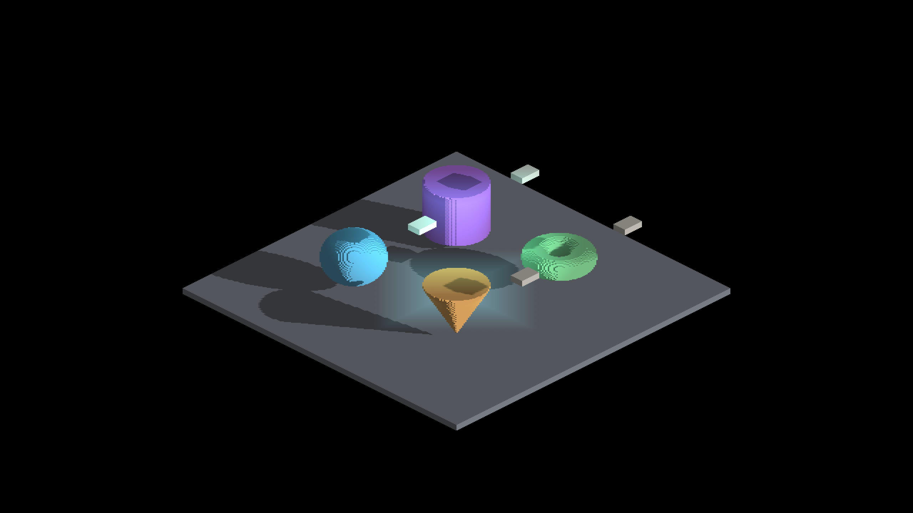
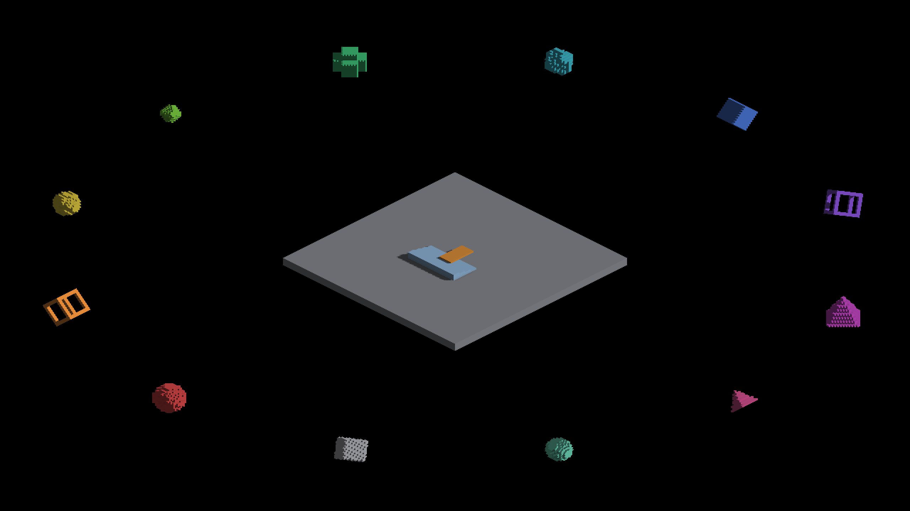

# Conservative sun-face index: native regression captures

Apple M4 Max, macOS 26.5.2, Metal Debug, 2560x1440. `parent` uses the original
index staged from `9917cb533ec8ee517390ed716edfa4a200e7d242`; `candidate` uses the
conservative bounds and degeneracy guard. Every run exits cleanly. Source,
binary and staged-shader hashes, exact commands and original image names are
in each arm's `manifest.json`; full console logs are beside the images.

The main matrix contains six IRShapeDebug baked views, six direct views and
nine IRCanvasStress mixed-mode yaw views. `parent-stats` / `candidate-stats`
start at a fixed non-cardinal pose long enough to report diagnostic queries;
they add 14 pairs. [All 35 RGB comparisons](comparison.json) have zero changed
pixels. Native visual inspection confirms unchanged geometry/lighting in the
sampled views. Existing orbit face patterns and coarse floor-shadow steps are
not accepted as universally correct by this parity result.

The bug is established by executable index/query boundary and independent-FMA
witnesses, not by these scenes. [Numerical tests, timing and remaining limits](../../../perf/sun-face-index-coverage/README.md).

| Original index | Corrected index |
|---|---|
|  |  |
|  |  |
|  |  |
