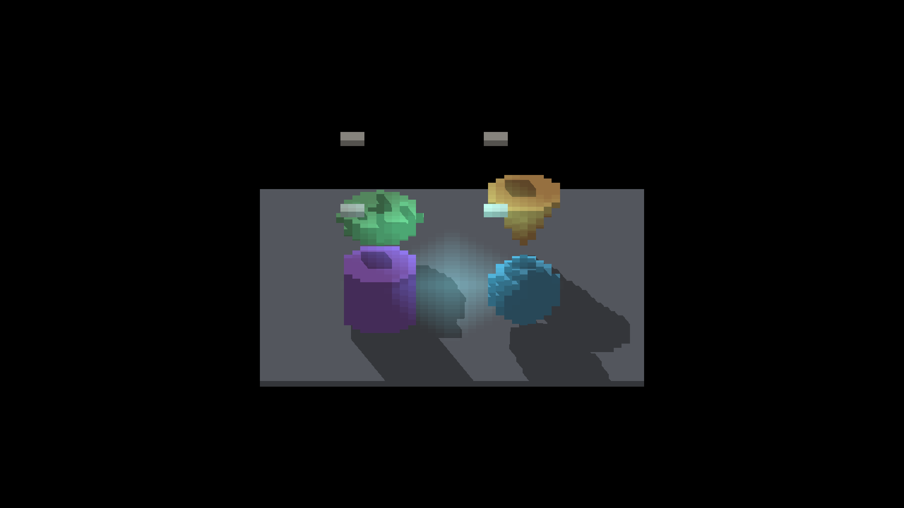

# Deferred depth-fetch experiment

The prototype was rejected: it preserved appearance but demonstrated no GPU
gain. Production query source and staged assets were restored. See the
[experiment, timings and boundary finding](../../../perf/sun-face-query-cost-followup/README.md).

| Parent | Candidate | Restored |
|---|---|---|
|  |  |  |

All 12 full-image RGB comparisons are exact: six candidate/parent and six
restored/parent. [comparison.json](comparison.json) records the comparisons.
Indices 0–5 correspond to yaw 0°, 45°, 90°, 180°, 270° at zoom four and yaw
45° at zoom two. All frames are retained without alignment or resampling.
Existing stepped silhouettes and coarse floor shadows remain visible; no visual
repair or temporal stability claim is made.

All three capture arms exited cleanly on macOS Metal Debug with this command:

```bash
fleet-run --env IR_PERAXIS_SURFACE_LIGHTING=1 \
  --env IR_PERAXIS_VISIBILITY_PREPASS=1 --env IR_PERAXIS_VISIBILITY_STATS=0 \
  IRShapeDebug --surface-lighting --sdf-voxel-scene baked \
  --sdf-voxel-blockers --no-ao --auto-screenshot 20
```

The output is 2560×1440. Capture commands and clean exits were read from the
launcher; full capture console logs were not archived. Full timed-run logs are
in the linked profile archives. The staged parent/candidate shader hashes are
retained here; the final archive manifest also fingerprints every image.
